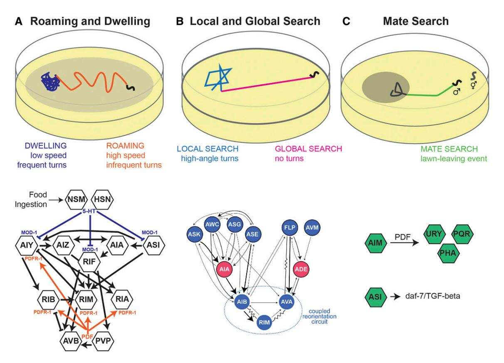
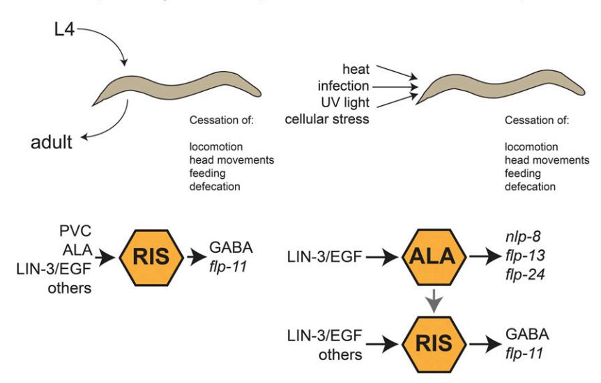
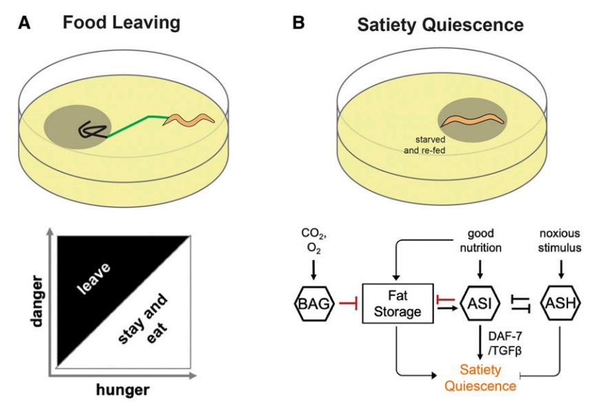

# **Behavioral States**

### Steven W. Flavell,\* David M. Raizen,†,1 and Young-Jai You‡

\*Picower Institute for Learning and Memory, Department of Brain and Cognitive Sciences, Massachusetts Institute of Technology, Cambridge, Massachusetts 02139, †Department of Neurology, Perelman School of Medicine, University of Pennsylvania, Philadelphia, Pennsylvania 19104, and †Division of Biological Science, Graduate School of Science, Nagoya University, 464-8602, Japan

ORCID ID: 0000-0001-5935-0476 (D.M.R.)

**ABSTRACT** Caenorhabditis elegans' behavioral states, like those of other animals, are shaped by its immediate environment, its past experiences, and by internal factors. We here review the literature on *C. elegans* behavioral states and their regulation. We discuss dwelling and roaming, local and global search, mate finding, sleep, and the interaction between internal metabolic states and behavior.

KEYWORDS neuromodulation; behavioral states; sleep; foraging; satiety; WormBook

| TABLE OF CONTENTS                                                                                                                                                                                                                  |                                 |
|------------------------------------------------------------------------------------------------------------------------------------------------------------------------------------------------------------------------------------|---------------------------------|
| Abstract                                                                                                                                                                                                                           | 315                             |
| Introduction                                                                                                                                                                                                                       | 315                             |
| Locomotion States Roaming and dwelling states Local search and global search Mate searching in males Sleep as a Behavioral State                                                                                                   | 316 316 318 319        |
| Behavioral quiescence during developmentally timed sleep Behavioral quiescence during SIS Reduced responsiveness during sleep Homeostatic regulation of sleep                                                                      | 320 320 322 322        |
| Behavioral States Regulated by Metabolic Status  Metabolism affects behavioral states  Leaving food quality and past experience Satiety quiescence fat storage  Neural circuits integrating metabolic state with sensory responses | 323 324 324 324 325 |
| Methodological Considerations                                                                                                                                                                                                      | 326                             |

S animals explore their environments, their nervous systems transition between behavioral states that influence how sensory information is processed and how actions are generated. Among the most familiar of these

behavioral states are easily observable arousal states like sleep and wakefulness, as well as feeding states controlled by hunger and satiety. Animals also exhibit emotional states, like states of heightened anxiety or depression, as well as

Copyright © 2020 by the Genetics Society of America

doi: https://doi.org/doi: https://doi.org/10.1534/genetics.120.303539

Manuscript received March 8, 2020; accepted for publication August 20, 2020.

Available freely online through the author-supported open access option.

&lt;sup>1Corresponding author: Department of Neurology, Perelman School of Medicine, 315 CRB, 415 Curie Blvd., University of Pennsylvania, Philadelphia, PA 19104. E-mail: raizen@pennmedicine.upenn.edu

cognitive states, for example, in the contexts of attention or working memory. Understanding the neural mechanisms that give rise to behavioral states is a critical goal of neuroscience: these states are central to the functioning of the brain and are disrupted in human sleep, mood, and cognitive disorders. In this chapter, we describe our current understanding of *C. elegans* behavioral states.

Over recent decades, there have been major advances in our understanding of the mechanisms that underlie behavioral states. Many studies suggest that these persistent states are often controlled by neuromodulatory systems. For example, the neuropeptides orexin and pigment-dispersing factor (PDF) promote wake states in mammals and flies, respectively (Saper et al. 2010; Taghert and Nitabach 2012). Dopamine signals reward in the context of motivational states (Schultz et al. 1997), and noradrenaline regulates vigilance and attention (Aston-Jones and Cohen 2005; Carter et al. 2010). In mammals, most of the neuromodulatory centers receive bottom-up (i.e., sensory) as well as top-down (i.e., from higher brain areas) inputs, such that they receive a complex mixture of information about internal and external cues (Weissbourd et al. 2014). Neuromodulatory systems typically influence the activity of neurons distributed throughout many brain regions, a feature that likely relates to their ability to control global behavioral states, but also poses challenges for understanding their mechanism of action. Despite major progress in this area, our understanding of how internal and external cues are integrated by neural circuits to give rise to behavioral states remains limited.

Caenorhabditis elegans has emerged as a premiere model system for the study of behavioral states. Due to its simple, well-defined nervous system and excellent set of genetic and imaging tools, mechanistic studies of behavioral states in the worm currently span from molecular genetic analyses to wholebrain scale studies. In this chapter, we review progress in this exciting research area and highlight challenges that lie ahead. We focus on locomotion states, sleep states, and feeding states. The organization of behavior into long-lasting states is also important for aspects of egg-laying behavior and dauer formation, but for these topics we refer the reader to other WormBook chapters (Schafer 2005; Hu 2007; Baugh and Hu, in press).

### **Locomotion States**

Like other animals, *C. elegans* exhibit long-lasting behavioral states in which they display different movement patterns. By switching between different locomotion states, animals can alter how they explore their environment, for example searching for food locally *vs.* more globally. As described below, the locomotion states of *C. elegans* have been characterized mostly in the contexts of foraging and search behaviors. A theme that is emerging from these studies is that multimodal sensory inputs can influence the activity of key interneurons and neuromodulator-producing neurons, which exert long-lasting effects on motor circuits to underlie locomotion states.

In each locomotion state, C. elegans animals express a characteristic set of locomotor parameters over a long-lasting, stable time period. C. elegans locomotion is comprised of just a few basic building blocks: (1) forward locomotion, (2) brief backward locomotion (aka reversals) and omega turns in which animals change their direction of movement, (3) postural changes such as fine-scale head movements (Von Stetina et al. 2006), and (4) locomotion pauses (Steuer Costa et al. 2019). These four basic building blocks are present in every locomotion state, but their frequencies and amplitudes can vary considerably. For example, animals in different states can display different forward velocities, altered reversal frequencies, or different head movements. Importantly, each locomotion state that we describe below is reliably observed under specific environmental conditions and consists of a reliable set of locomotion parameters.

### Roaming and dwelling states

While animals are feeding on standard Escherichia coli food sources, they display a bistable behavioral state structure consisting of roaming and dwelling (Figure 1A) (Fujiwara et al. 2002). The roaming state consists of long bouts of high-velocity forward movement (~0.1 mm/s), punctuated by infrequent reversals (Fujiwara et al. 2002; Ben Arous et al. 2009; Flavell et al. 2013). In contrast, the dwelling state consists of short bouts of low-velocity forward movement (<0.05 mm/s), with a high frequency of short reversals. This basic structure is observed in both larvae (Shtonda and Avery 2006; Stern et al. 2017) and adults. While the dwelling state is promoted by many of the same mechanisms that promote behavioral quiescence (see Sleep as a behavioral state and Behavioral states regulated by metabolic status), it is a distinct behavioral state (Gallagher et al. 2013): dwelling animals still move, feed, defecate, and lay eggs.

The percent of time that animals spend in the roaming vs. dwelling state depends on the food environment. These states are influenced by (i) sensory cues like food odors and oxygen levels, (ii) food ingestion and presence of food in the alimentary canal, and (iii) satiety levels. Chemosensory cues are detected by a set of CNG/TAX-4-expressing olfactory and gustatory neurons. Mutants with impaired chemosensation, like che-2 and tax-4, show increased dwelling, while egl-4 loss-of-function mutants, which have attenuated sensory adaptation (L'Etoile et al. 2002), display increased roaming (Fujiwara et al. 2002; McCloskey et al. 2017). Roaming/ dwelling analysis of mutants with impairments in specific sensory neurons suggests a particularly important role for AWC neurons in the detection of food odors (Ben Arous et al. 2009). Consistent with these genetic studies, transitions between roaming and dwelling are influenced by the animal's detection of food odors. When animals detect an increase in the concentration of food odors, they prolong their roaming state to navigate to the food source. But when the concentration of food odors decreases, they transition to dwelling states (Ji et al. 2020). Detection of additional chemosensory cues also impacts these states: pheromones that signal a

Figure 1 Locomotion states in C. elegans. (A) Top: roaming and dwelling locomotion states can be observed in animals exploring a bacterial food source. Bottom: neural circuitry implicated in the control of roaming and dwelling states. (B) Top: Immediately upon food removal, C. elegans animals display a 10–20 min bout of local search, followed by global search. Bottom: neural circuitry implicated in local vs. global search. (C) Top: male animals will leave a food source in search of hermaphrodite mates. Bottom: neurons and molecules implicated in mate search behaviors. Figure 1B (bottom) reprinted with permission from Neuron (Lopez-Cruz et al. 2019).

higher density of animals inhibit roaming (Greene et al. 2016), and aversive stimuli that signal potential harm can drive a high-speed state reminiscent of roaming (Ardiel et al. 2017; Chew et al. 2018). These studies suggest that regulation of roaming and dwelling states depends on an integration of diverse chemosensory cues.

The successful ingestion of bacterial food increases the amount of time that animals spend dwelling. This effect appears to be independent of olfactory and gustatory cues external to the animal: treatment of bacteria with a drug (aztreonam) that makes them too large to ingest dramatically decreases dwelling, even though the odorants and tastants produced by the aztreonam-treated bacteria are presumably very similar to those produced by untreated bacteria (Ben Arous et al. 2009). The presence of bacterial food in the pharyngeal and intestinal lumens appears to promote dwelling behavior. Bacteria in the pharyngeal lumen are sensed by the pair of serotonergic NSM neurons, which extend a sensory dendrite into the lumen (Rhoades et al. 2019). The [DEL-](https://identifiers.org/bioentitylink/WB:WBGene00009144?doi=10.1534/genetics.120.303539)[3](https://identifiers.org/bioentitylink/WB:WBGene00009144?doi=10.1534/genetics.120.303539) and [DEL-7](https://identifiers.org/bioentitylink/WB:WBGene00016699?doi=10.1534/genetics.120.303539) ASIC channels on this sensory dendrite are required for NSM's sensation of bacterial food ingestion, which drives dwelling through serotonin release. Food presence in the intestinal lumen impacts Rictor/TORC2 signaling, which also functions to promote dwelling (O'Donnell et al. 2018). It is likely that additional mechanisms for alimentary tract lumen food sensation remain to be identified.

Satiety levels also exert a strong influence on roaming and dwelling behaviors. Animals that have been fasted display an increased level of dwelling when they are re-exposed to food, compared to well-fed animals (Sawin et al. 2000; Ben Arous et al. 2009). The molecular pathways and neural circuits that mediate these effects are starting to be clarified. The [ETS-5](https://identifiers.org/bioentitylink/WB:WBGene00016600?doi=10.1534/genetics.120.303539) transcription factor functions in ASG and BAG sensory neurons to promote roaming and intestinal fat mobilization (Juozaityte et al. 2017). Genetic perturbations to fat metabolism pathways show that changes in fat storage can feed back to the nervous system to influence roaming (Juozaityte et al. 2017). In fact, multiple lines of evidence suggest bidirectional communication between sensory neurons and peripheral fat stores. In addition to ASG and BAG, the URX and ASI sensory neurons can also influence intestinal fat storage via neuroendocrine signaling (Noble et al. 2013; Palamiuc et al. 2017). Of these, URX has notably been shown to detect mobilization of peripheral fat stores, suggesting that it may be a hub for nervous system-intestine interactions (Noble et al. 2013). Many of these pathways that couple the animal's satiety to roaming and dwelling states also impact quiescence states (see Behavioral states regulated by metabolic status), suggesting a great deal of overlap in the mechanisms that regulate distinct states.

The above studies provide a view that roaming and dwelling states are influenced by chemosensory cues, food ingestion, and satiety levels. But what are the central circuits that encode the roaming and dwelling states? These states appear to be controlled by diffuse neuromodulatory systems whose receptors are expressed on a diverse set of neurons that control locomotion. In particular, the serotonergic system promotes the dwelling state (Horvitz et al. 1982; Sawin et al. 2000; Flavell et al. 2013; Churgin et al. 2017). Both the NSM and HSN classes of serotonergic neurons promote dwelling, and optogenetic activation of these neurons can switch roaming animals into dwelling states. Serotonin likely acts through multiple receptors to mediate these effects, though of these receptors the serotonin-gated chloride channel MOD-1 has the strongest effect (Ranganathan et al. 2000; Flavell et al. 2013, Churgin et al. 2017). The serotonergic system acts in opposition to the pigment dispersing factor (PDF) neuropeptide system that drives roaming. There are two PDF neuropeptide genes in C. elegans (pdf-1 and pdf-2), and the PDF-1 neuropeptide released by AVB, PVP, and SIA neurons has the strongest impact on roaming. Optogenetically activating the PDF system drives dwelling animals into long-lasting roaming states. MOD-1 and PDFR-1 are each expressed in interneurons that impact locomotion, including AIY, RIF, RIM, RID, and others (Ranganathan et al. 2000; Wenick and Hobert 2004; Janssen et al. 2008; Flavell et al. 2013).

Each of these neurons receives additional inputs and releases neuropeptides that also influence movement. For example, the RID premotor neuron that drives forward locomotion (Lim et al. 2016) receives FLP-20 peptidergic inputs from sensory neurons that drive high-speed locomotion (Chew et al. 2018). The AIY interneuron releases multiple neuropeptides, including FLP-1, which modulates locomotion (Buntschuh et al. 2018). The ability of the biogenic amines and neuropeptides to exert a strong effect on roaming and dwelling is likely related to the architecture of these systems: diffuse neuromodulators can broadly impact multiple nodes in the C. elegans nervous system. The abilities of these neuromodulators to drive long consolidated roaming or dwelling states suggests that a winner-takes-all architecture must be present in the neural circuitry that drives these states. Indeed, ensemble calcium imaging during roaming and dwelling states confirms the presence of a winnertakes-all mutual inhibitory loop between the serotonergic neuron NSM, which promotes dwelling, and the MOD-1and PDFR-1-expressing neurons that promote roaming (Ji et al. 2020). The activities of these two opposing groups of neurons are mutually exclusive in wild-type animals, but mutants lacking PDF signaling display miscoordinated circuit activity where both cell populations can be simultaneously active. Chemosensory inputs acting through AIA interneurons modulate this mutual inhibitory loop, allowing animals to switch between states based on dynamic changes in food odors.

Additional neuromodulators implicated in food detection impact the roaming and dwelling states. Octopamine promotes the roaming state via SER-3 and SER-6 receptors expressed on cholinergic SIA neurons (Churgin et al. 2017). Interestingly, octopamine release is thought to be elevated in the absence of food, suggesting that the levels of this neuromodulator may depend on the feeding state of the animal (Horvitz et al. 1982). In contrast, dopaminergic neurons are thought to be activated by the presence of bacterial food and the release of dopamine controls the animal's roaming speed (Sawin et al. 2000; Stern et al. 2017). In addition, dopamine release during roaming increases the animal's egg-laying rate, so that animals display higher egg-laying rates during roaming vs. dwelling, which allows them to disperse their eggs across a food source (Cermak et al. 2020). The fact that multiple biogenic amines and neuropeptides are required for the proper expression of roaming and dwelling states suggests that these states are specified by the combinatorial action of many neuromodulators.

### Local search and global search

When C. elegans animals are removed from food, they display a stereotyped sequence of two consecutive locomotion states (Figure 1B). For the first  $\sim$ 15 min, they engage in a local search state (also called "area-restricted search") (Hills et al. 2004) consisting of a high frequency of high-angle turns and omega bends (Wakabayashi et al. 2004; Gray et al. 2005). Then, they transition to a global search state (also referred to as dispersal); Gray et al. 2005) where they suppress their turning rates. This behavioral sequence allows them to perform an area-restricted search of the environment immediately after their food source has vanished, but then to broaden their search to a wider area if the local search is unsuccessful. Theoretical studies have suggested these search states likely comprise an effective foraging strategy (Calhoun et al. 2014; Salvador et al. 2014). Unlike roaming and dwelling, where animals stochastically switch between the two states, the timing of the switch from local search to dispersal reliably occurs ~15 min after food removal, suggesting that the mechanisms underlying these state transitions are different (Calhoun et al. 2014; López-Cruz et al. 2019).

The initiation of the local search state is strongly dependent on sensory inputs, including both chemosensory and mechanosensory cues. The food odor-sensing glutamatergic neurons ASK and AWC are particularly important for local search behavior (Gray et al. 2005). Glutamate released from ASK and AWC, together with glutamate released from other chemo- and mechanosensory neurons, is required for animals to execute the local search state. This glutamate release is detected by AIA and ADE neurons via the metabotropic glutamate receptor MGL-1 (López-Cruz et al. 2019). Activation of the ASK neuron can drive high-angle turns during local search, but has an attenuated effect when animals transition to the global search state (López-Cruz et al. 2019). AIA likely acts together with AIB and AIY interneurons to regulate

reversal frequencies during local and global search states. Interestingly, the energy-sensitive enzyme AMPK/[AAK-2](https://identifiers.org/bioentitylink/WB:WBGene00020142?doi=10.1534/genetics.120.303539) regulates [MGL-1](https://identifiers.org/bioentitylink/WB:WBGene00003232?doi=10.1534/genetics.120.303539) expression levels in AIY, as well as [GLR-1](https://identifiers.org/bioentitylink/WB:WBGene00001612?doi=10.1534/genetics.120.303539) levels in AIB, to promote the dispersal state (Ahmadi and Roy 2016). Such a mechanism might allow starvation to tune the levels of glutamatergic signaling from sensory neurons onto these key interneurons. Indeed, the turning frequency during local search is increased when animals are exposed to a higher density of food prior to food removal (López-Cruz et al. 2019). In addition, one study has suggested that the level of variability in the food environment influences turning rates during the subsequent local search (Calhoun et al. 2015). These latter effects require dopaminergic signaling, which has been implicated in sensing the food environment prior to food removal (Hills et al. 2004).

# Mate searching in males

When male C. elegans animals are positioned on a bacterial food lawn without potential mating partners (Figure 1C), they exhibit lawn-leaving events at a much higher frequency than do hermaphrodites (Lipton et al. 2004). Like hermaphroditic locomotion states discussed above, these lawn-leaving events reflect all-or-none behavioral switches, where there is a sharp increase in the probability of the animal persisting in a forward run when it encounters the edge of the bacterial food lawn.

Male lawn-leaving depends on several sensory inputs that reflect the animal balancing its reproductive drive with its need to consume food. Male leaving rates are dramatically reduced by physical contact with hermaphrodites on the food lawn (Barrios et al. 2008). This effect may be mediated by the ray sensory neurons in the male tail, which mediate responses to hermaphrodite contact. Loss of the ray neurons reduces leaving rates in mate-deprived males, but increases leaving in males exposed to hermaphrodites, suggesting that the function of the ray neurons changes depending on the sensory environment. The food signals that influence male leaving decisions are detected by amphid sensory neurons, as shown by the finding that mutants lacking the [OSM-9](https://identifiers.org/bioentitylink/WB:WBGene00003889?doi=10.1534/genetics.120.303539), [OCR-2](https://identifiers.org/bioentitylink/WB:WBGene00003839?doi=10.1534/genetics.120.303539), or [TAX-2](https://identifiers.org/bioentitylink/WB:WBGene00006525?doi=10.1534/genetics.120.303539) sensory transduction ion channels have higher leaving rates in the absence of mates (Barrios et al. 2008). However, the presence of mates fully suppresses these mutant phenotypes, suggesting that mate detection can overcome reduced detection of food signals. The high propensity of males to leave the food may be partially explained by reduced expression of the food-sensing [odr-10](https://identifiers.org/bioentitylink/WB:WBGene00003856?doi=10.1534/genetics.120.303539) chemoreceptor (Ryan et al. 2014). Consistent with the notion that animals balance their mate search and food seeking, males that have been starved for three or more hours reduce their lawn-leaving rates (Lipton et al. 2004). These effects may be mediated by [DAF-2](https://identifiers.org/bioentitylink/WB:WBGene00000898?doi=10.1534/genetics.120.303539) insulin receptor signaling to regulate chemoreceptor expression (Lipton et al. 2004; Wexler et al. 2020).

As is the case for other behavioral states, neuromodulation plays a pivotal role in mate searching behavior. PDF neuropeptide signaling promotes the drive to search for mates when

animals are deprived of potential mates (Barrios et al. 2012). However, PDF effects are attenuated when mates are present. This function for PDF in promoting a search state is reminiscent of its role in promoting roaming, though, interestingly, [PDF-1,](https://identifiers.org/bioentitylink/WB:WBGene00020317?doi=10.1534/genetics.120.303539) as well as its receptor [PDFR-1](https://identifiers.org/bioentitylink/WB:WBGene00015735?doi=10.1534/genetics.120.303539), functions in different neurons to control these two different behavioral states. [PDF-1](https://identifiers.org/bioentitylink/WB:WBGene00020317?doi=10.1534/genetics.120.303539) functions in AIM to promote mate search (Barrios et al. 2012), but in AVB, SIA, and PVP to promote roaming (Flavell et al. 2013). [PDFR-1](https://identifiers.org/bioentitylink/WB:WBGene00015735?doi=10.1534/genetics.120.303539) functions in URY, PQR, and PHA to promote mate search (Barrios et al. 2012), but in RIA, RIM, and AIY to promote roaming (Flavell et al. 2013). This suggests that while PDF may generally promote high-locomotion search states, the neural circuits that utilize this signal may be different for cases where sensory inputs need to be weighed differently. One other prominent target of PDF signaling in the male is the ASJ neuron: [PDF-1](https://identifiers.org/bioentitylink/WB:WBGene00020317?doi=10.1534/genetics.120.303539) promotes the male-specific expression of [DAF-7](https://identifiers.org/bioentitylink/WB:WBGene00000903?doi=10.1534/genetics.120.303539)/TGF-beta in the ASJ neurons (Hilbert and Kim 2018). This expression drives increased mate searching and can be repressed by starvation to allow animals to balance their mate search with feeding needs. The nematode oxytocin-like peptide nematocin promotes mate searching (Garrison et al. 2012) and also organizes other steps of the mating behavior, suggesting a broader role in reproductive behaviors.

### Sleep as a Behavioral State

The behavioral state whose appearance contrasts most conspicuously with that of other overt behaviors is the sleep state. While electrical recordings can act as a proxy to sleep in mammals and birds, ultimately sleep is a behavioral state, which can be easily distinguished from wake in all animals. The most obvious behavioral feature of sleep is the absence of movement. Sleeping animals are not only behaviorally quiescent, but also less responsive. Rapid reversibility of this quiescent state by strong sensory stimuli distinguishes sleep from other nonresponsive states such as torpor, hibernation, coma/obtundation, and general anesthesia. The last property of sleep, which speaks to its important physiological function, is its homeostatic regulation: following sleep deprivation, animals sleep more deeply or at inappropriate times.

Using these behavioral criteria, C. elegans has been shown to sleep during a larval transition phase known as lethargus (Raizen et al. 2008). Lethargus occurs four times in the animal's life cycle, once at transitions between larval stages L1/L2, L2/L3, and L3/L4, and once between L4 and adulthood. Periodic display of sleep during lethargus is likely one manifestation of oscillation of physiology during larval development (George-Raizen et al. 2014; Hendriks et al. 2014; Turek and Bringmann 2014). This oscillation, which has a larval periodicity, is reminiscent of circadian oscillation of physiology and sleep/wake cycles in other animals. [LIN-](https://identifiers.org/bioentitylink/WB:WBGene00018572?doi=10.1534/genetics.120.303539)[42](https://identifiers.org/bioentitylink/WB:WBGene00018572?doi=10.1534/genetics.120.303539), the C. elegans ortholog of the core circadian regulator PERIOD, oscillates its expression (Jeon et al. 1999) and affects timing of lethargus quiescence (Monsalve et al. 2011), thereby showing molecular parallels to circadian sleep/wake cycles in other animals. Because lethargus occurs only during larval development, this sleep state is sometimes referred to as developmentally timed sleep (DTS; Trojanowski and Raizen 2016). Most C. elegans sleep research has been performed on the L1/L2 and L4/adult lethargus periods. Thus far, the genetic and neural regulation of sleep appears to be the same during these two stages, and it is therefore reasonable to assume that it will be the same during L2/L3 and L3/L4 lethargus periods.

Outside of lethargus, some aspects of sleep behavior including reversible behavioral quiescence and reduced responsiveness have been demonstrated in C. elegans during prolonged starvation (Skora et al. 2018; Wu et al. 2018) and in response to environmental exposures that make animals sick (Hill et al. 2014; DeBardeleben et al. 2017). In addition, feeding worms display brief spontaneous quiescent bouts (Wu et al. 2018), and, after a prolonged fast and full refeeding, display prolonged episodes of movement and feeding quiescence (You et al. 2008), consistent with the behavioral sequence for satiety observed in other animals. However, homeostatic regulation of these quiescent sleep-like behaviors has been reported only for starvation quiescence (Skora et al. 2018; Wu et al. 2018). Satiety quiescence is discussed further in Behavioral states regulated by metabolic status.

We will refer to the behavioral quiescence that is a component of sickness behavior as sickness (or cell stress)-induced sleep (SIS).

C. elegans research into the regulation of sleep can be divided into components focused on particular aspects of sleep behavior: behavioral quiescence, reduced responsiveness, and homeostatic regulation.

# Behavioral quiescence during developmentally timed sleep

Studies of behavioral quiescence during sleep have benefited from separately quantifying each of the specific components of the quiescence program. These include feeding quiescence, head movement quiescence, body movement quiescence, defecation quiescence, and egg-laying quiescence (Figure 2A). In addition, while there are commonalities, the regulation of quiescence during DTS is in some ways distinct from that observed during SIS (Trojanowski et al. 2015; Iannacone et al. 2017).

RIS, a GABAergic and peptidergic interneuron, is a chief neuron regulating movement quiescence during DTS. RIS is activated coincidentally with bouts of quiescence; genetic or laser ablation of RIS impairs quiescence; and optogenetic activation of RIS causes quiescence of movement and of feeding during the adult stage (Turek et al. 2013). Among about a third of the animal's nervous system RIS alone (and perhaps also the GABAergic RME neurons) has increased calcium activity during DTS (Nichols et al. 2017).

Mutations in either [unc-25](https://identifiers.org/bioentitylink/WB:WBGene00006762?doi=10.1534/genetics.120.303539), which is required for GABA synthesis, or in [unc-47](https://identifiers.org/bioentitylink/WB:WBGene00006783?doi=10.1534/genetics.120.303539), which is required for GABA packaging into synaptic vesicles, do not eliminate RIS induced quiescence during DTS, but cause a delay in the onset of

quiescence (Turek et al. 2013; Steuer Costa et al. 2019). In contrast, removal of [egl-3](https://identifiers.org/bioentitylink/WB:WBGene00001172?doi=10.1534/genetics.120.303539), which encodes a proprotein convertase required for maturation of most C. elegans neuropeptides, impairs quiescence during DTS, suggesting that neuropeptides processed by [EGL-3](https://identifiers.org/bioentitylink/WB:WBGene00001172?doi=10.1534/genetics.120.303539) promote quiescence. The relevant neuropeptides released from RIS are those encoded by fl[p-11](https://identifiers.org/bioentitylink/WB:WBGene00001454?doi=10.1534/genetics.120.303539) as fl[p-11](https://identifiers.org/bioentitylink/WB:WBGene00001454?doi=10.1534/genetics.120.303539) mutants have little quiescence during lethargus or during RIS activation outside of lethargus (Turek et al. 2013; Steuer Costa et al. 2019).

Mechanistic details of RIS activation are beginning to emerge. RIS, like ALA (see below), responds to the epidermal growth factor EGF (Konietzka et al. 2020), but is also activated by excitatory input from several other neurons (Maluck et al. 2020). These include the forward command interneuron PVC, suggesting a mechanism by which locomotion circuit activity during wake behavior can influence sleep (Maluck et al. 2020).

In contrast to the role of RIS as a sleep-promoting neuron, wake-and arousal-promoting neurons are not yet well-delineated. Here, the field has used the term "wake" and "arousal" somewhat interchangeably, though different degrees of arousal during wake behavior have been reported (Jee et al. 2013; Laurent et al. 2015; Chew et al. 2018). For example, strains with reduced function of [npr-1](https://identifiers.org/bioentitylink/WB:WBGene00003807?doi=10.1534/genetics.120.303539) show aroused (enhanced) locomotion under certain conditions (de Bono and Bargmann 1998). In addition to the [dmsr-1](https://identifiers.org/bioentitylink/WB:WBGene00010191?doi=10.1534/genetics.120.303539) expressing neurons discussed below, multiple classes of sensory neurons including nociceptive (ASH), touch sensitive (ALM and PLM) and stretch sensitive (DVA) appear to be important since they are required for the aroused locomotion of [npr-1](https://identifiers.org/bioentitylink/WB:WBGene00003807?doi=10.1534/genetics.120.303539) reduced function mutants (Choi et al. 2015). Arousal promoting neuropeptides include [PDF-1](https://identifiers.org/bioentitylink/WB:WBGene00020317?doi=10.1534/genetics.120.303539) and [PDF-2](https://wormbase.org/species/c_elegans/gene/WBGene00018590#40efc-9b31a6-10) (Chen et al. 2016), the C. elegans homologs of PDF, which is wake-promoting in Drosophila (Parisky et al. 2008), as well as [FLP-2](https://identifiers.org/bioentitylink/WB:WBGene00001445?doi=10.1534/genetics.120.303539) (Chen et al. 2016). Dopamine signaling, which is wake-promoting both in flies (Andretic et al. 2005) and mammals (Wisor et al. 2001) may play a role in worm arousal since loss of the dopamine transporter [DAT-1](https://identifiers.org/bioentitylink/WB:WBGene00000934?doi=10.1534/genetics.120.303539) is associated with reduced quiescence and loss of the dopamine receptor [DOP-1](https://identifiers.org/bioentitylink/WB:WBGene00001052?doi=10.1534/genetics.120.303539) is associated with increased quiescence (Singh et al. 2014). Activation of dopamine neurons causes increased sensory acuity (Ezcurra et al. 2011).

### Behavioral quiescence during SIS

SIS (Figure 2B) requires the second-order interneuron ALA as well as RIS (the role of RIS in SIS is described below). Removal of ALA either by laser ablation (DeBardeleben et al. 2017) or by mutations that disrupt its development (Hill et al. 2014; Nelson et al. 2014, 2016) results in continued movements of the pharynx and of the body during SIS. The body movements consist of sinusoidal movements similar to those observed when the animals are awake (Robinson et al. 2019). ALA shows elevated calcium upon activation by heat stress (Konietzka et al. 2020) and reducing the excitability of ALA neurons via chemogenetics attenuates the feeding and movement quiescence responses to cellular stress (Nelson et al.

Figure 2 Sleep states in C. elegans. (A) Top: Developmentally timed sleep is observed during each larval transition. Studies have focused on the L4 to adult transition (as shown), as well as the L1 to L2 transition. Bottom: The RIS neuron is critical in the control of developmentally timed sleep. (B) Top: Stress-induced sleep is observed in response to a wide range of cellular stressors. Bottom: The ALA and RIS neurons play central roles in the control of stress-induced sleep. The neuropeptide genes fl[p-11](https://identifiers.org/bioentitylink/WB:WBGene00001454?doi=10.1534/genetics.120.303539) (RIS), fl[p-13](https://identifiers.org/bioentitylink/WB:WBGene00001456?doi=10.1534/genetics.120.303539) (ALA), fl[p-24](https://identifiers.org/bioentitylink/WB:WBGene00016028?doi=10.1534/genetics.120.303539) (ALA), and [nlp-8](https://identifiers.org/bioentitylink/WB:WBGene00003746?doi=10.1534/genetics.120.303539) (ALA and RIS) promote quiescence.

2014). In contrast, optogenetic stimulation of ALA results in slowing of feeding and body movements (Nelson et al. 2014). Therefore, depolarization of the ALA neuron is necessary for movement cessation during SIS.

The mechanism by which ALA becomes activated in response to sickness is poorly understood. One mechanism involves the epidermal growth factor [LIN-3](https://identifiers.org/bioentitylink/WB:WBGene00002992?doi=10.1534/genetics.120.303539), which stimulates the EGF receptor [LET-23](https://identifiers.org/bioentitylink/WB:WBGene00002299?doi=10.1534/genetics.120.303539) expressed in ALA (Van Buskirk and Sternberg 2007). However, the source of [LIN-3](https://identifiers.org/bioentitylink/WB:WBGene00002992?doi=10.1534/genetics.120.303539) and the mechanism by which it is released to affect ALA remains unclear. Because [lin-3](https://identifiers.org/bioentitylink/WB:WBGene00002992?doi=10.1534/genetics.120.303539) null mutants are lethal (Hill and Sternberg 1992), deciphering this mechanism of EGF signaling may require conditional mutants. Downstream of EGF function, the GEF for Rho-family GTPase [VAV-1](https://identifiers.org/bioentitylink/WB:WBGene00006887?doi=10.1534/genetics.120.303539) plays an important role in ALA (Fry et al. 2016), but how EGF receptor signaling results in membrane depolarization remains unknown. Another mechanism of ALA regulation involves the CEP sheath glial cells, since Glia-ablated animals display prolonged quiescence bouts, which are suppressed by concurrent ablation of ALA (Katz et al. 2018). Finally, ALA is also activated by harsh mechanical stimulation to the body (Sanders et al. 2013).

How does ALA promote behavioral quiescence? Electron micrographs of ALA show vesicles with dense cores (White et al. 1986), suggesting that ALA secretes neuropeptides. Further supporting a neurosecretory role for ALA in quiescence is its requirement for [UNC-31/](https://identifiers.org/bioentitylink/WB:WBGene00006767?doi=10.1534/genetics.120.303539)CAPS (Van Buskirk and Sternberg 2007), which functions in dense core vesicle release (Speese et al. 2007). Although ALA stains weakly for GABA and expresses both the GABA uptake transporter [SNF-](https://identifiers.org/bioentitylink/WB:WBGene00004910?doi=10.1534/genetics.120.303539)[11](https://identifiers.org/bioentitylink/WB:WBGene00004910?doi=10.1534/genetics.120.303539) and the GABA vesicular transporter [UNC-47](https://identifiers.org/bioentitylink/WB:WBGene00006783?doi=10.1534/genetics.120.303539) (Gendrel et al. 2016), a function for GABA or other clear vesicle neurotransmitters in ALA has not been reported. Finally, genetic axotomy does not eliminate ALA function (Van Buskirk and Sternberg 2007), indicating that ALA likely can signal via volume transmission [it likely also signals synaptically, by inhibiting activity of the command interneuron AVE (Fry et al. 2014; Katz et al. 2018)]. These data suggest that ALA promotes sleep via neuropeptide release.

Peptidomic analysis of ALA in Ascaris suum (Jarecki et al. 2010) as well as transcriptomic analysis of ALA in C. elegans (Nath et al. 2016) suggested that fl[p-7](https://identifiers.org/bioentitylink/WB:WBGene00001450?doi=10.1534/genetics.120.303539), fl[p-13](https://identifiers.org/bioentitylink/WB:WBGene00001456?doi=10.1534/genetics.120.303539), and fl[p-24](https://identifiers.org/bioentitylink/WB:WBGene00016028?doi=10.1534/genetics.120.303539) are expressed in ALA. Nath and colleagues also found numerous other neuropeptide-encoding genes including [nlp-8](https://identifiers.org/bioentitylink/WB:WBGene00003746?doi=10.1534/genetics.120.303539) to be enriched in ALA [[nlp-8](https://identifiers.org/bioentitylink/WB:WBGene00003746?doi=10.1534/genetics.120.303539) is also enriched in the RIS neuron (Konietzka et al. 2020)]. fl[p-7](https://identifiers.org/bioentitylink/WB:WBGene00001450?doi=10.1534/genetics.120.303539) null mutants have no apparent SIS phenotype (Van Buskirk and Sternberg 2007; Nath et al. 2016), and fl[p-13](https://identifiers.org/bioentitylink/WB:WBGene00001456?doi=10.1534/genetics.120.303539) mutants have only a small impairment in feeding quiescence, locomotion quiescence, and head movement quiescence during SIS (Nelson et al. 2014, 2016). However, fl[p-13](https://identifiers.org/bioentitylink/WB:WBGene00001456?doi=10.1534/genetics.120.303539); [nlp-8](https://identifiers.org/bioentitylink/WB:WBGene00003746?doi=10.1534/genetics.120.303539) as well as fl[p-24](https://identifiers.org/bioentitylink/WB:WBGene00016028?doi=10.1534/genetics.120.303539); fl[p-13](https://identifiers.org/bioentitylink/WB:WBGene00001456?doi=10.1534/genetics.120.303539) double mutants show strong defects in quiescent behaviors (Nath et al. 2016). In contrast to the weak loss-of-function single gene effects, inducible over-expression of fl[p-13](https://identifiers.org/bioentitylink/WB:WBGene00001456?doi=10.1534/genetics.120.303539), fl[p-24](https://identifiers.org/bioentitylink/WB:WBGene00016028?doi=10.1534/genetics.120.303539), or [nlp-8](https://identifiers.org/bioentitylink/WB:WBGene00003746?doi=10.1534/genetics.120.303539) alone each results in strong quiescent phenotypes (Nath et al. 2016). The observation of weak or no SIS phenotype in single gene mutants yet strong phenotypes in multi-gene mutants suggests a high degree of neuropeptide degeneracy in the regulation of sleep during SIS. Such degeneracy has also been observed in a vertebrate system (Chiu et al. 2016; Lee et al. 2017), pointing to a common theme across phylogeny.

Elucidation of the signaling pathways downstream of fl[p-](https://identifiers.org/bioentitylink/WB:WBGene00001456?doi=10.1534/genetics.120.303539)[13](https://identifiers.org/bioentitylink/WB:WBGene00001456?doi=10.1534/genetics.120.303539), fl[p-24](https://identifiers.org/bioentitylink/WB:WBGene00016028?doi=10.1534/genetics.120.303539), and [nlp-8](https://identifiers.org/bioentitylink/WB:WBGene00003746?doi=10.1534/genetics.120.303539) remains in its nascent stages. The G-protein coupled receptor [DMSR-1](https://identifiers.org/bioentitylink/WB:WBGene00010191?doi=10.1534/genetics.120.303539) is potently activated in vitro by peptides encoded by fl[p-13](https://identifiers.org/bioentitylink/WB:WBGene00001456?doi=10.1534/genetics.120.303539), is required for fl[p-13](https://identifiers.org/bioentitylink/WB:WBGene00001456?doi=10.1534/genetics.120.303539) overexpression-induced quiescence, and is partially required for SIS (Iannacone et al. 2017). [dmsr-1](https://identifiers.org/bioentitylink/WB:WBGene00010191?doi=10.1534/genetics.120.303539) is expressed in -10 neuron types including the roaming-promoting neurons RID and AIY (Iannacone et al. 2017). It is not detected in the AVA or AVE neurons connected directly with ALA, supporting the notion that [FLP-13](https://identifiers.org/bioentitylink/WB:WBGene00001456?doi=10.1534/genetics.120.303539) signals through volume transmission. Silencing [dmsr-1](https://identifiers.org/bioentitylink/WB:WBGene00010191?doi=10.1534/genetics.120.303539)-expressing neurons increases quiescence during SIS suggesting that these neurons are, in sum, wake promoting (Iannacone et al. 2017). [FLP-13](https://identifiers.org/bioentitylink/WB:WBGene00001456?doi=10.1534/genetics.120.303539), in addition to its role in ALA-regulated quiescence, also plays a role in quiescence mediated by the BAG neuron [see Satiety quiescence: fat storage (Figure 3B)]. Receptors for [FLP-24](https://identifiers.org/bioentitylink/WB:WBGene00016028?doi=10.1534/genetics.120.303539) or for [NLP-8](https://identifiers.org/bioentitylink/WB:WBGene00003746?doi=10.1534/genetics.120.303539) have yet to be reported but their sites of action should shed light on the circuit downstream of ALA mediating behavioral quiescence.

RIS, in addition to its role in DTS, also functions in SIS. RIS is activated by exposure to heat (Kotera et al. 2016; Konietzka et al. 2020), which causes cellular stress. Optogenetic activation of ALA or over-expression of the ALA neuropeptide [FLP-24](https://identifiers.org/bioentitylink/WB:WBGene00016028?doi=10.1534/genetics.120.303539) results in RIS activation, suggesting that RIS acts downstream of ALA in the quiescence program (Konietzka et al. 2020). [aptf-1](https://identifiers.org/bioentitylink/WB:WBGene00019424?doi=10.1534/genetics.120.303539) mutants, in which RIS development is defective (Turek et al. 2013), are deficient in SIS (Robinson et al. 2019; Grubbs et al. 2020; Konietzka et al. 2020). However, there are reported differences in the type of movements made by RIS-defective mutants, such as [aptf-1](https://identifiers.org/bioentitylink/WB:WBGene00019424?doi=10.1534/genetics.120.303539) and fl[p-11](https://identifiers.org/bioentitylink/WB:WBGene00001454?doi=10.1534/genetics.120.303539), compared to those made by ALA mutants, such as [ceh-14](https://identifiers.org/bioentitylink/WB:WBGene00000438?doi=10.1534/genetics.120.303539) and [ceh-17](https://identifiers.org/bioentitylink/WB:WBGene00000440?doi=10.1534/genetics.120.303539) (Robinson et al. 2019). RIS depolarization causes complete movement quiescence with elongation of the head (Steuer Costa et al. 2019) whereas ALA depolarization slows but does not fully stop behavior (Nelson et al. 2014). Details of the circuit downstream of ALA and RIS and connecting these two neurons remain to be worked out. Since feeding and body movement quiescence caused by fl[p-13](https://identifiers.org/bioentitylink/WB:WBGene00001456?doi=10.1534/genetics.120.303539) overexpression can be reversed by stimulation of cholinergic motor neurons (Trojanowski et al. 2015), some effects of ALA activation (at least those mediated by fl[p-13](https://identifiers.org/bioentitylink/WB:WBGene00001456?doi=10.1534/genetics.120.303539)) are likely mediated at the level of motor neuron inhibition (Fry et al. 2014).

### Reduced responsiveness during sleep

Arguably the most mysterious property of sleep is the reduction of responsiveness to sensory stimuli since it would seem to be maladaptive from an evolutionary standpoint. The reduction in responsiveness is not absolute: strong stimulation will wake up even a deeply sleeping animal. This property of sleep is often referred to as "sensory gating"—there is a barrier to the registration of sensory information but that barrier can be overcome if the sensory input is sufficiently strong. The mechanism of sensory gating in mammals is poorly understood.

Research to date in C. elegans has implicated sensory neuron responsiveness as well as connectivity between interneurons as sites of sensory gating during sleep. Mechanosensory receptor neurons as well as the multimodal sensory ASH neurons show reduced sensitivity to stimuli during sleep states (Schwarz et al. 2011; Cho and Sternberg 2014). In addition to gating at the level of primary sensory neurons, synchrony between interneurons downstream of ASH is reduced during sleep and restoring this synchrony can arouse the animal from sleep (Cho and Sternberg 2014). The molecular mechanisms of reduced sensory neuron sensitivity and of interneuron desynchrony are currently unclear. The cGMP-dependent protein kinase [EGL-4](https://identifiers.org/bioentitylink/WB:WBGene00001173?doi=10.1534/genetics.120.303539) plays a role in the former (Raizen et al. 2008), by acting in primary sensory neurons to promote sensory adaptation (L'Etoile et al. 2002). Neuromodulators may play a role in the latter but the mechanism remains to be worked out.

The neuropeptides encoded by fl[p-18](https://identifiers.org/bioentitylink/WB:WBGene00001461?doi=10.1534/genetics.120.303539) and fl[p-21](https://identifiers.org/bioentitylink/WB:WBGene00001464?doi=10.1534/genetics.120.303539) to activate the neuropeptide Y-like receptor [NPR-1](https://identifiers.org/bioentitylink/WB:WBGene00003807?doi=10.1534/genetics.120.303539) to promote sensory gating, as [npr-1](https://identifiers.org/bioentitylink/WB:WBGene00003807?doi=10.1534/genetics.120.303539) loss-of-function mutants show elevated responsiveness and reduced quiescence under conditions of mild sensory stimulation (Choi et al. 2013) or under conditions of normoxia (Nichols et al. 2017). [NPR-1](https://identifiers.org/bioentitylink/WB:WBGene00003807?doi=10.1534/genetics.120.303539) signaling occurs at least partially in the highly connected hub interneuron RMG (Choi et al. 2013; Nichols et al. 2017). The elevated arousal under normoxia that results from loss of [npr-1](https://identifiers.org/bioentitylink/WB:WBGene00003807?doi=10.1534/genetics.120.303539) function is suppressed by genetic ablation of oxygen sensing neurons (Nichols et al. 2017).

### Homeostatic regulation of sleep

Following sleep deprivation, animals display homeostatic regulation in different fashions. In some animals, like Drosophila, the main manifestation of homeostasis is sleeping at a time of day when the animals are usually awake. In mammals, the chief manifestation of sleep homeostasis is a deepening of sleep following sleep curtailment; sleeping mice or humans are less likely to be awakened from sleep following a period of sleep curtailment. In other words, their sensory gating is stronger. Mechanisms of sleep homeostasis remain largely a mystery. In early conceptual models of sleep regulation, natural unperturbed sleep and sleep after deprivation were considered to be controlled by the same biological process. However, in recent years, studies in mice (Halassa et al. 2009) and fruit flies (Seidner et al. 2015; Dubowy et al. 2016; Liu et al. 2016) have suggested that these mechanisms appear to be at least partially distinct since genetic manipulations can affect the homeostatic response to sleep deprivation without affecting sleep amounts when the animals are unperturbed. As we will describe below, C. elegans too shows a dissociation between regulation of unperturbed sleep and sleep after deprivation.

Homeostatic regulation of sleep has been studied primarily during DTS. In the absence of perturbation or following weak photic or mechanical stimulation, Nagy and colleagues observed a correlation between the duration of quiescence bouts and the duration of motion bouts that immediately preceded that quiescence. This pairwise correlation was disrupted in mutants for [NPR-1](https://identifiers.org/bioentitylink/WB:WBGene00003807?doi=10.1534/genetics.120.303539) signaling (Nagy et al. 2014).

In contrast to this bout-to-bout homeostatic regulation, which they term "microhomeostasis," strong photic or mechanical stimuli result in prolonged active bouts followed by an increased overall quiescence. Moreover, animals that had been stimulated to swim for at least 20 min during lethargus, will subsequently show deeper sleep, as manifested by elevated arousal threshold (Raizen et al. 2008). This homeostatic response to prolonged sleep deprivation is independent of [NPR-1](https://identifiers.org/bioentitylink/WB:WBGene00003807?doi=10.1534/genetics.120.303539) signaling but is instead dependent on the stressresponsive FOXO transcription factor [DAF-16](https://identifiers.org/bioentitylink/WB:WBGene00000912?doi=10.1534/genetics.120.303539) (Driver et al. 2013; Nagy et al. 2014). In contrast to its importance in the

Figure 3 Behavioral states regulated by metabolic status. (A) Top: animals will at times leave their bacterial food source in search of other resources. Bottom: Food leaving rates are influenced by the animal's hunger (past and present feeding conditions), as well as harmful environmental cues. (B) Top: animals can enter a state of satiety quiescence. This is commonly observed when starved animals are refed with a nutritious food source. Bottom: Neural circuits that control fat storage (red connections show negative feedback) and satiety quiescence.

homeostatic response to sleep deprivation, removing [daf-16](https://identifiers.org/bioentitylink/WB:WBGene00000912?doi=10.1534/genetics.120.303539) function alone minimally affects baseline sleep (Driver et al. 2013; Nagy et al. 2014; Wu et al. 2018) or microhomeostasis (Nagy et al. 2014). However, removing [daf-16](https://identifiers.org/bioentitylink/WB:WBGene00000912?doi=10.1534/genetics.120.303539) together with the AMP kinase-encoding genes [aak-1](https://identifiers.org/bioentitylink/WB:WBGene00019801?doi=10.1534/genetics.120.303539) and [aak-2](https://identifiers.org/bioentitylink/WB:WBGene00020142?doi=10.1534/genetics.120.303539) results in a near-complete absence of quiescence in the adult stage (Wu et al. 2018). Further evidence for a role of [DAF-16](https://identifiers.org/bioentitylink/WB:WBGene00000912?doi=10.1534/genetics.120.303539) in sleep homeostasis comes from analysis of mutants for the NOTCH ligand [LAG-2](https://identifiers.org/bioentitylink/WB:WBGene00002246?doi=10.1534/genetics.120.303539) or for the [DAF-16](https://identifiers.org/bioentitylink/WB:WBGene00000912?doi=10.1534/genetics.120.303539) regulator [JNK-1.](https://identifiers.org/bioentitylink/WB:WBGene00002178?doi=10.1534/genetics.120.303539) The sleep depth in both [lag-2](https://identifiers.org/bioentitylink/WB:WBGene00002246?doi=10.1534/genetics.120.303539) and [jnk-1](https://identifiers.org/bioentitylink/WB:WBGene00002178?doi=10.1534/genetics.120.303539) loss-of-function mutants is reduced yet they show an overall increased duration of quiescence, suggesting that longer quiescence is required to discharge homeostatic sleep drive (Bennett et al. 2018). Removing the function of [daf-16](https://identifiers.org/bioentitylink/WB:WBGene00000912?doi=10.1534/genetics.120.303539) in these two mutants does not correct the arousal threshold defects but does restore total quiescence time back to a level similar to that of wild-type controls (Bennett et al. 2018).

There remains several unknowns regarding the role of [DAF-16](https://identifiers.org/bioentitylink/WB:WBGene00000912?doi=10.1534/genetics.120.303539) in sleep homeostasis. It is not clear if it acutely activates during sleep deprivation or whether it promotes relevant signaling throughout larval development. It also remains unclear where [DAF-16](https://identifiers.org/bioentitylink/WB:WBGene00000912?doi=10.1534/genetics.120.303539) is acting to promote sleep homeostasis. Expression in neurons restores the enhanced quiescence response to sleep deprivation (Nagy et al. 2014) but expression in muscle is sufficient to restore the elevated arousal threshold response to sleep deprivation (Driver et al. 2013). The compensatory elevated quiescence of [lag-2](https://identifiers.org/bioentitylink/WB:WBGene00002246?doi=10.1534/genetics.120.303539) requires [daf-16](https://identifiers.org/bioentitylink/WB:WBGene00000912?doi=10.1534/genetics.120.303539) in neurons, whereas that of [jnk-1](https://identifiers.org/bioentitylink/WB:WBGene00002178?doi=10.1534/genetics.120.303539) requires [daf-16](https://identifiers.org/bioentitylink/WB:WBGene00000912?doi=10.1534/genetics.120.303539) in muscle (Bennett et al. 2018). Though sleep is conventionally considered a nervous system state, there is evidence also in mammals for a homeostatic regulation of sleep in muscle, where the b2HLH transcription factor BMAL1 regulates sleep drive (Ehlen et al. 2017). Since [DAF-16](https://identifiers.org/bioentitylink/WB:WBGene00000912?doi=10.1534/genetics.120.303539) is a transcription factor, it is likely that one or more of its transcriptional targets is required for sleep homeostasis. These targets have not been identified.

In all animals studied to date, sleep deprivation causes not just behavioral changes (increased sleep pressure) but also cellular stress (Cirelli and Tononi 2000; Cirelli et al. 2005; Naidoo et al. 2005; Jones et al. 2008), and, in some animals, total sleep deprivation is lethal (Rechtschaffen et al. 1983; Shaw et al. 2002; Vaccaro et al. 2020). In C. elegans too, sleep deprivation results in cell stress, as manifested by movement of [DAF-16](https://identifiers.org/bioentitylink/WB:WBGene00000912?doi=10.1534/genetics.120.303539) into the nucleus (Driver et al. 2013; Sanders et al. 2017), and by upregulation of markers for ER and mitochondrial proteostatic stress (Sanders et al. 2017). Sleep deprivation by mechanical stimulation of [daf-16](https://identifiers.org/bioentitylink/WB:WBGene00000912?doi=10.1534/genetics.120.303539) mutants defective for the cellular stress response can be lethal (Driver et al. 2013; Bennett et al. 2018). However, RIS-defective [aptf-1](https://identifiers.org/bioentitylink/WB:WBGene00019424?doi=10.1534/genetics.120.303539) mutants that are severely defective in behavioral quiescence during DTS do not die during lethargus, unless mechanically stimulated (Bennett et al. 2018). These observations suggest that sleep-deprived animals are hypersensitive to injuries caused by mechanical stimulation.

### Behavioral States Regulated by Metabolic Status

A major determinant of an animal's behavioral state is its metabolic status: a hungry animal may explore to seek food and take risks, while a sated animal may rest, sleep, and reduce risk-taking. Because the perception of hunger or satiety can interact with factors such as the degree of danger in the environment, a behavioral state emerges from the integration of multiple cues, both internal and external. Furthermore, an animal's behavioral state is also influenced by its history, since the association of environmental cues such as innocuous chemicals with a past metabolic status can also influence the behavioral state.

This section summarizes our current understanding of the neuro-molecular mechanisms by which the internal metabolic state of the animal, together with external sensory cues, affects behavior.

### Metabolism affects behavioral states

Since feeding is essential for survival, it impacts numerous processes and decisions throughout an animal's life. In C. elegans, feeding controls not only growth rate, body size, fat accumulation, brood size, and lifespan, but also behaviors and decisions such as various forms of taxis, dauer decision, and egg-laying. In most cases, sensory perception of food is integrated into the worm's metabolic status and influences the animal's behavioral output to maximize its fitness.

The locomotion states described in Locomotion States concern food, since the metabolic states of hunger or satiety can influence whether animals stay on a food source or decide to leave. Various aspects of bacteria, such as their smell (Bargmann 2006) and texture (Ranganathan et al. 2000; Sawin et al. 2000) influence behavioral states. The size of bacteria, which affects how well C. elegans can consume them, is closely related to food quality (Shtonda and Avery 2006).

Food quality is operationally defined by how well the bacteria support the growth of C. elegans (Shtonda and Avery 2006). Bacterial metabolic and size properties can explain some dietary influences on worm growth rates. For instance, the bacteria Comamonas sp., which synthesizes vitamin B12, supports faster C. elegans growth than E. coli strains (Watson et al. 2013). E. coli bacteria, whose cell-wall division is blocked by the antibiotic aztreonam, are large and therefore poor quality food (Ben Arous et al. 2009). Poor food quality promotes roaming whereas good food quality promotes dwelling and quiescence (You et al. 2008; Ben Arous et al. 2009).

We will discuss two particular behavioral states, leaving and satiety quiescence, to explain how behavior states are modulated by food quality, past experience, and fat storage.

Leaving: food quality and past experience: C. elegans modify their behavior depending on their previous experience of food quality and familiarity (Figure 3A). Worms rarely leave high quality food, but will frequently leave poor quality food (Avery and Shtonda 2003; Shtonda and Avery 2006). When offered the choice between two bacterial diets of equal quality, worms prefer familiar food (Song et al. 2013).

Feeding-defective mutants show a higher probability of leaving a medium-quality bacterial food lawn (Shtonda and Avery 2006). Reduced food ingestion due to either poor food quality (i.e., difficult to ingest) or mutations that impair pharyngeal function can lead to leaving behavior. These effects may be mediated by reduced adiposity, reduced signaling from pharyngeal neurons that sample the pharyngeal lumen, or both. The observation that leaving probability reaches steady-state values within 10 min (Shtonda and Avery 2006) suggests that food sampling plays an important role. Leaving also depends on prior experience: after being conditioned for 3 hr on high-quality food, worms leave mediumquality food at a higher frequency then worms conditioned on low-quality food. Remarkably, leaving behavior is influenced even by remote experience during larval development.

After experiencing starvation-induced dauer formation in early life, adults do not leave food as frequently as animals that have never experienced starvation (Pradhan et al. 2019). This suggests that transient metabolic stress during development forms a long-lasting memory that influences behavior. This plasticity is mediated by [glb-5](https://identifiers.org/bioentitylink/WB:WBGene00015964?doi=10.1534/genetics.120.303539), an oxygen sensor expressed in several neurons including BAG and URX, which play important roles in fat storage and satiety (Juozaityte et al. 2017; Hussey et al. 2018) (discussed below).

Satiety quiescence: fat storage: When satiated, C. elegans stop eating and moving and become quiescent (Figure 3B), exhibiting a behavioral sequence of satiety similar to that observed in mammals (Antin et al. 1975). Satiety quiescence depends on food quality, intestinal function, past metabolic experiences, and fat storage. Insulin ([daf-2](https://identifiers.org/bioentitylink/WB:WBGene00000898?doi=10.1534/genetics.120.303539)), TGFb ([daf-7](https://identifiers.org/bioentitylink/WB:WBGene00000903?doi=10.1534/genetics.120.303539)), and cGMP ([daf-11](https://identifiers.org/bioentitylink/WB:WBGene00000907?doi=10.1534/genetics.120.303539) and [egl-4](https://identifiers.org/bioentitylink/WB:WBGene00001173?doi=10.1534/genetics.120.303539)) pathways, all of which are necessary for reproductive growth in response to favorable environmental conditions, regulate satiety quiescence (You et al. 2008). TGFb [\(DAF-7\)](https://identifiers.org/bioentitylink/WB:WBGene00000903?doi=10.1534/genetics.120.303539), which is produced in the ASI sensory neurons in well-fed animals (Schackwitz et al. 1996), binds to its receptor in the RIM and RIC neurons (Greer et al. 2008). Activation of the [DAF-7](https://identifiers.org/bioentitylink/WB:WBGene00000903?doi=10.1534/genetics.120.303539) receptor [DAF-1](https://identifiers.org/bioentitylink/WB:WBGene00000897?doi=10.1534/genetics.120.303539) in the tyraminergic RIM neuron and the octopaminergic RIC neuron promotes satiety quiescence (Gallagher et al. 2013). How [DAF-1](https://identifiers.org/bioentitylink/WB:WBGene00000897?doi=10.1534/genetics.120.303539) signaling in RIM and RIC promotes behavioral quiescence remains unclear, though it presumably involves RIS activation (Wu et al. 2018; Maluck et al. 2020).

Satiety quiescence is observed most consistently when animals are fully refed with high quality food after starvation. If the food quality is low, or if the animal has a defect absorbing nutrients from the intestine, satiety quiescence is reduced. The duration of starvation also influences satiety quiescence: the longer the starvation, the deeper the subsequent quiescence, as measured by reduced responsiveness to sensory stimulation. During satiety quiescence, animals respond poorly to the touch of an eyelash, suggesting a change in arousal threshold (You et al. 2008).

Several studies suggest that fat storage affects satiety quiescence. Like mammals, C. elegans store fat in the form of triacylglycerol (TG) (Watts and Ristow 2017). Pathways for synthesis, storage, and mobilization of fatty acids are highly conserved between C. elegans and other animals (Ashrafi 2007; Watts and Ristow 2017). Fatty acids are obtained both from bacterial diet and from synthesis via the SREBP (steroid response element binding protein)—FAS (fatty acid synthase)—SCD (stearoyl CoA decarboxylase)— ACC (acetyl CoA carboxylase) pathways (Brock et al. 2007). The SREBP-FAS-SCD-ACC pathways are essential: although 80% of fatty acids are obtained from the bacterial diet, this is insufficient to support larval growth of [sbp-1](https://identifiers.org/bioentitylink/WB:WBGene00004735?doi=10.1534/genetics.120.303539) mutants (McKay et al. 2003; Nomura et al. 2010).

Most mutants defective in satiety quiescence, such as mutants of insulin, TGFb, or cGMP pathways, also misregulate fat storage, suggesting that fat metabolism and satiety quiescence are linked. However, dissociating cause and effect between satiety and fat storage is complicated. A satietydefective mutant may constantly eat and therefore accumulate more fat. If a mutant is hypersensitive to a satiety signal, it may reduce food intake and therefore reduce fat accumulation. Selective nutrient manipulations and genetic perturbations can begin to disentangle causality in the relationship between fat storage and satiety. For example, supplementing the worm's diet with the monosaturated fatty acid oleic acid, a product of the enzyme SCD in the SREBP pathway, promotes satiety quiescence (Hyun et al. 2016). Also, mutants in the SREBP-FAS-SCD-ACC pathway are defective for satiety quiescence due to reduced fat storage (Hyun et al. 2016).

How does fat storage regulate satiety quiescence? Two transcription-based mechanisms have been implicated: one involving the [ETS-5](https://identifiers.org/bioentitylink/WB:WBGene00016600?doi=10.1534/genetics.120.303539) transcriptional factor and the other involving nuclear hormone receptors (NHRs).

[ets-5](https://identifiers.org/bioentitylink/WB:WBGene00016600?doi=10.1534/genetics.120.303539), an ETS (E twenty-six) family transcription factor and an ortholog of mammalian FEV/Pet1, regulates both fat storage and satiety quiescence. When fed with the E. coli strain [OP50](https://identifiers.org/bioentitylink/WB:WBStrain00041969?doi=10.1534/genetics.120.303539), a mediocre quality food (Avery and You 2012), [ets-5](https://identifiers.org/bioentitylink/WB:WBGene00016600?doi=10.1534/genetics.120.303539) mutants show reduced roaming and enhanced satiety quiescence. This enhanced quiescence requires excessive fat storage; if fat storage is reduced either by growing worms on poor quality food or by introducing a mutation such as [eat-2](https://identifiers.org/bioentitylink/WB:WBGene00001133?doi=10.1534/genetics.120.303539) that impairs feeding, the enhanced satiety quiescence of [ets-5](https://identifiers.org/bioentitylink/WB:WBGene00016600?doi=10.1534/genetics.120.303539) is suppressed. Additionally, knockdown of [atgl-1](https://identifiers.org/bioentitylink/WB:WBGene00015484?doi=10.1534/genetics.120.303539) (an adipocyte triglyceride lipase), which results in enhanced fat storage, phenocopies the [ets-5](https://identifiers.org/bioentitylink/WB:WBGene00016600?doi=10.1534/genetics.120.303539) mutation (Juozaityte et al. 2017). These results support that increased fat storage promotes satiety quiescence.

NHRs also regulate behavioral states controlled by fat storage. In mammals, NHRs play a critical role in fat metabolism; peroxisome proliferator activated receptor a (PPARa) and hepatic nuclear factor (HNF) mediate the fasting response by regulating the expression of genes involved in fatty acid beta-oxidation, whereas PPARg is required for adipogenesis. C. elegans has about seven times as many NHRs (293) as mammals (48) (Chawla et al. 2001; Taubert et al. 2011). Their roles in dauer formation (Antebi et al. 2000) and molting (Gissendanner and Sluder 2000) suggest that NHRs link the animal's metabolic status to developmental decisions. NHRs also regulate the transcriptional network that coordinates metabolic adaptation to different diets (Watson et al. 2013), suggesting that NHRs promote adaptive behavioral states by controlling the expression of specific sets of genes. A total of 11 NHR genes regulate both fat storage and satiety quiescence, supporting the role of NHRs in linking adiposity and behavioral states (Hyun et al. 2016).

How do [ETS-5](https://identifiers.org/bioentitylink/WB:WBGene00016600?doi=10.1534/genetics.120.303539) and NHRs link fat storage to satiety quiescence? [ets-5](https://identifiers.org/bioentitylink/WB:WBGene00016600?doi=10.1534/genetics.120.303539) promotes transcription in BAG neurons of fl[p-13](https://identifiers.org/bioentitylink/WB:WBGene00001456?doi=10.1534/genetics.120.303539) and fl[p-19](https://identifiers.org/bioentitylink/WB:WBGene00001462?doi=10.1534/genetics.120.303539), which encode neuropeptides partially required for the enhanced satiety quiescence of [ets-5](https://identifiers.org/bioentitylink/WB:WBGene00016600?doi=10.1534/genetics.120.303539) (Guillermin et al. 2011; Brandt et al. 2012). Most of the 11 NHRs that regulate satiety quiescence are expressed in the intestine and in neurons, but how and where NHRs function to regulate adiposity related to satiety quiescence is unknown.

The nervous system directly modulates intestinal fat storage. Serotonin stimulates fat loss in the intestine by promoting the release of [FLP-7](https://identifiers.org/bioentitylink/WB:WBGene00001450?doi=10.1534/genetics.120.303539) from ASI neurons (Palamiuc et al. 2017). [FLP-7](https://identifiers.org/bioentitylink/WB:WBGene00001450?doi=10.1534/genetics.120.303539) binds to the [NPR-22](https://identifiers.org/bioentitylink/WB:WBGene00022004?doi=10.1534/genetics.120.303539) receptor in the intestine to upregulate [atgl-1](https://identifiers.org/bioentitylink/WB:WBGene00015484?doi=10.1534/genetics.120.303539) transcription and thus promotes fat loss (Palamiuc et al. 2017). Two oxygen-sensing neurons, URX and BAG, antagonize each other to regulate fat storage via [FLP-17](https://identifiers.org/bioentitylink/WB:WBGene00001460?doi=10.1534/genetics.120.303539) and its receptor [EGL-6](https://identifiers.org/bioentitylink/WB:WBGene00001175?doi=10.1534/genetics.120.303539) (Hussey et al. 2018). These studies suggest that there is bidirectional communication between the gut and the brain. ASI plays a major role in [DAF-7](https://identifiers.org/bioentitylink/WB:WBGene00000903?doi=10.1534/genetics.120.303539)-dependent satiety quiescence (Gallagher et al. 2013), whereas BAG plays a major role in [FLP-13-](https://identifiers.org/bioentitylink/WB:WBGene00001456?doi=10.1534/genetics.120.303539) and [FLP-19](https://wormbase.org/species/c_elegans/gene/WBGene00001462#40efc-9b31a6-10) dependent mechanism of satiety quiescence (Guillermin et al. 2011; Brandt et al. 2012). The neuronal regulation of fat storage by ASI and BAG suggests that satiety quiescence and fat storage can be modulated by the same set of neurons.

In an extraordinary forward genetic screen for mouse sleep mutants, Funato et al. (2016) discovered that SIK3, a saltinducible kinase in the AMPK super-family, promotes sleep. Similarly, the lone C. elegans ortholog of the three mammalian SIKs, [KIN-29,](https://identifiers.org/bioentitylink/WB:WBGene00002210?doi=10.1534/genetics.120.303539) promotes quiescence associated with satiety (van der Linden et al. 2008), molting (Funato et al. 2016), and recovery from sickness (Grubbs et al. 2020). Despite storing excessive fat, [kin-29](https://identifiers.org/bioentitylink/WB:WBGene00002210?doi=10.1534/genetics.120.303539) mutants behave like starved animals and have reduced ATP levels (Grubbs et al. 2020), indicating a defective response to cellular energy deficits. Liberating energy stores by over-expressing [ATGL-1](https://identifiers.org/bioentitylink/WB:WBGene00015484?doi=10.1534/genetics.120.303539) corrects adiposity and sleep defects of [kin-29](https://identifiers.org/bioentitylink/WB:WBGene00002210?doi=10.1534/genetics.120.303539) mutants, suggesting that free fatty acids or their metabolites are a signal for promoting sleep. [KIN-29](https://identifiers.org/bioentitylink/WB:WBGene00002210?doi=10.1534/genetics.120.303539) functions in nuclei of ciliated sensory neurons to promote both fat stores and sleep, demonstrating an intricate association between neuroendocrine regulation of behavior and metabolism.

### Neural circuits integrating metabolic state with sensory responses

ASI is a critical regulator of metabolism-dependent larval development, physiology, and behavior. ASI is required to prevent dauer formation (Bargmann and Horvitz 1991), to extend lifespan caused by calorie restriction (Bishop and Guarente 2007), and to exhibit satiety quiescence (Gallagher et al. 2013). Nutrient activation of ASI (Gallagher et al. 2013) is enhanced by starvation (Davis et al. 2018), showing that ASI sensory responses are modulated by the metabolic status of the animal.

Activation of ASI by nutrients is blunted by simultaneous activation of ASH (Davis et al. 2018), a nociceptive neuron that can be activated by high NaCl concentration. Starved animals are more willing than well-fed animals to cross an aversive high osmotic strength barrier to reach food (Ghosh et al. 2016). The degree to which animals suppress the aversive response, which is mediated by ASH, increases with the duration of prior fasting, showing that decision-making circuits integrates hunger and harmful sensory cues (Ghosh et al. 2016). Indeed, food, serotonin and dopamine sensitize ASH to stimulate aversive response (Harris et al. 2010; Ezcurra et al. 2011). Reciprocal inhibition between ASH and ASI via a circuit that includes serotonin and octopamine modulates nociception and avoidance (Guo et al. 2015). These studies indicate that internal metabolic conditions are integrated with external sensory cues to influence behavioral states.

The antagonism between danger and hunger is conserved across animals. For instance, in mammals, a risk of predation suppresses roaming when well-fed, but extreme hunger overrides danger perception and results in prioritizing food-seeking behavior (Sternson 2013; Burnett et al. 2016).

How does hunger override danger cues? In this circuit, ASI acts to gauge the animal's internal metabolic state, AWA to gauge external nutritional cues, and ASH to sense external danger. The integration of ASI and ASH activities may occur in interneurons such as RIM via [PDF-2](https://wormbase.org/species/c_elegans/gene/WBGene00018590#40efc-9b31a6-10) (Ghosh et al. 2016). Additional elements of the relevant circuit have also been characterized. Serotonin released from ADF and octopamine released from RIC control ASI and ASH antagonism (Guo et al. 2015). Another potential mechanism underlying the antagonism is via opioid signaling mediated by [NPR-17](https://identifiers.org/bioentitylink/WB:WBGene00015559?doi=10.1534/genetics.120.303539), a C. elegans opioid receptor. Food and serotonin sensitize ASH by increasing release of [NLP-3](https://identifiers.org/bioentitylink/WB:WBGene00003741?doi=10.1534/genetics.120.303539), which activates [NPR-17](https://identifiers.org/bioentitylink/WB:WBGene00015559?doi=10.1534/genetics.120.303539) in ASH (Harris et al. 2010). During starvation, the endogenous opioid [NLP-24](https://identifiers.org/bioentitylink/WB:WBGene00003762?doi=10.1534/genetics.120.303539) activates [NPR-17](https://identifiers.org/bioentitylink/WB:WBGene00015559?doi=10.1534/genetics.120.303539) in ASI, which sensitizes ASI to food and results in increased feeding (Cheong et al. 2015). Hunger can even fully reverse the valence of certain sensory cues: CO2 repels well-fed animals but attracts starved animals. This switch is mainly controlled by dopamine, which promotes CO2 repulsion, and octopamine, which promotes CO2 attraction, working via antagonism between the interneurons AIY and RIG (Rengarajan et al. 2019). Interestingly, CO2 is sensed by BAG neurons (Hallem and Sternberg 2008), which, as described above, regulate both satiety quiescence and fat storage (Gallagher et al. 2013; Cunningham et al. 2014).

## Methodological Considerations

Studying behavioral states in C. elegans can present a number of experimental challenges. These states reflect behavioral modulation and appear to be more sensitive to variation in environmental conditions than studies of more hard-wired aspects of behavior, such as sinusoidal locomotion and pharyngeal contraction.

Studies of locomotion states are impacted by several aspects of the environment that need to be carefully controlled. First, the bacterial food source is a pivotal sensory stimulus for many of these states (Shtonda and Avery 2006, Ben Arous et al. 2009). The exact species and strain of bacteria that animals eat during their development and during the behavioral assay can profoundly alter these states. For example, the E. coli bacterial strain [OP50](https://identifiers.org/bioentitylink/WB:WBStrain00041969?doi=10.1534/genetics.120.303539) (Brenner 1974), which is used in nearly all C. elegans laboratories, is considered mediocre quality food, whereas the E. coli strain [HB101](https://identifiers.org/bioentitylink/WB:WBStrain00041075?doi=10.1534/genetics.120.303539) is considered high quality food (Shtonda and Avery 2006). Conditions for bacterial growth prior to the experiment also matter, since they can impact production of bacterial metabolites; they too must be standardized.

Animal transfer to the assay plates can stimulate the animals and impact their behavioral state. The method of transfer (picking vs. washing) and duration of time between transfer and behavioral analysis need to be standardized for these assays. In addition, these states vary significantly over the course of development and during adulthood (Nagy et al. 2013; Stern et al. 2017), so precise staging of animals is essential. Finally, many different tracking systems for recording worm locomotion have been developed (Husson et al. 2013). While there is no evidence that this impacts the animal's behavioral state, direct comparisons of behavior across systems remain limited.

The nature of the chamber housing the worm during monitoring is important. Variables demonstrated to affect behavioral measurements include oxygen tension (Nichols et al. 2017; Soto et al. 2019), mechanical pressure on the worm body (Gonzales et al. 2019), temperature (Gonzales et al. 2019), food availability (McCloskey et al. 2017) (Gonzales et al. 2019), and liquid vs. solid media (Ghosh and Emmons 2008; McCloskey et al. 2017).

Three chief approaches have been employed for measuring movement and quiescence. The first is direct visual observations (You et al. 2008; Choi et al. 2013; Nath et al. 2016; Robinson et al. 2019), which allow the experimentalist to quantify several behaviors including body bends, nose movements, pharyngeal pumping, and defecation cycles (Nath et al. 2016; Robinson et al. 2019). The drawbacks of direct observation are reduced throughput, the potential for experimental bias, and the possibility of disturbing the worms with light or mechanical vibration. A variant of direct observation that minimizes perturbation of the worm is to track the position of the nose tip off line after the video recording (Turek et al. 2013). In general, nose tip quiescence is associated with body movement quiescence (Iwanir et al. 2013) and therefore reliably identifies a quiescent animal. However, this method is labor intensive, and, while it can reliably identify a fully quiescent animal, it does not readily distinguish different modes of behavior in animals that are not quiescent. Some animals may move just the nose while others may make dorso-ventral body bends resulting in translating the position of the worm (Robinson et al. 2019). Frame subtraction analysis, in which temporally adjacent video frames are digitally subtracted, has the advantage of higher throughput and of being fairly robust to lighting and animal contrast (Raizen et al. 2008; Zimmerman et al. 2008; Donelson et al. 2012; Nagy et al. 2014; Huang et al. 2017; Churgin et al. 2019). However, as in the case nose tip tracking, frame subtraction analysis does not distinguish the type of movement the worm makes when active (Robinson et al. 2019).

Our current understanding of the regulation of behavioral states has emerged from the use of various chambers and analysis methods, and, while most conclusions we discuss appear to be robust to the methods used, it is possible that some results will in the future be shown to be due to an interaction between the biology and the method used to study it.

# Acknowledgments

We thank Alejandro López-Cruz, Arantza Barrios, Leon Avery, Mike Hart, Mara Cowen, and members of the Flavell laboratory for comments. S.W.F. was supported by National Institutes of Health [\(NIH](https://doi.org/10.13039/100000002)) (NS104892 and GM135413) and National Science Foundation (NSF) (IOS 1845663). D.M.R. was supported by [NIH](https://doi.org/10.13039/100000002) (R01NS107969 and R01NS088432). Y.Y. was supported by the Neuroscience Institute Nagoya University.

### Literature Cited

- Ahmadi, M., and R. Roy, 2016 AMPK acts as a molecular trigger to coordinate glutamatergic signals and adaptive behaviours during acute starvation. eLife 5: e16349. [https://doi.org/10.7554/](https://doi.org/10.7554/eLife.16349) [eLife.16349](https://doi.org/10.7554/eLife.16349)
- Andretic, R., B. van Swinderen, and R. J. Greenspan, 2005 Dopaminergic modulation of arousal in Drosophila. Curr. Biol. 15: 1165–1175. <https://doi.org/10.1016/j.cub.2005.05.025>
- Antebi, A., W. H. Yeh, D. Tait, E. M. Hedgecock, and D. L. Riddle, 2000 daf-12 encodes a nuclear receptor that regulates the dauer diapause and developmental age in C. elegans. Genes Dev. 14: 1512–1527. [http://genesdev.cshlp.org/content/14/12/](http://genesdev.cshlp.org/content/14/12/1512.full.pdf) [1512.full.pdf](http://genesdev.cshlp.org/content/14/12/1512.full.pdf)
- Antin, J., J. Gibbs, J. Holt, R. C. Young, and G. P. Smith, 1975 Cholecystokinin elicits the complete behavioral sequence of satiety in rats. J. Comp. Physiol. Psychol. 89: 784–790. <https://doi.org/10.1037/h0077040>
- Ardiel, E. L., A. J. Yu, A. C. Giles, and C. H. Rankin, 2017 Habituation as an adaptive shift in response strategy mediated by neuropeptides. NPJ Sci. Learn. 2: 9. [https://](https://doi.org/10.1038/s41539-017-0011-8) [doi.org/10.1038/s41539-017-0011-8](https://doi.org/10.1038/s41539-017-0011-8)
- Ashrafi, K., 2007 Obesity and the regulation of fat metabolism (March 9, 2007), WormBook, ed. The C. elegans Research Community, WormBook, doi/10.1895/wormbook.1.130.1, [http://](http://www.wormbook.org/chapters/www_obesity/obesity.html) [www.wormbook.org/chapters/www\\_obesity/obesity.html](http://www.wormbook.org/chapters/www_obesity/obesity.html)
- Aston-Jones, G., and J. D. Cohen, 2005 An integrative theory of locus coeruleus-norepinephrine function: adaptive gain and optimal performance. Annu. Rev. Neurosci. 28: 403–450. [https://](https://doi.org/10.1146/annurev.neuro.28.061604.135709) [doi.org/10.1146/annurev.neuro.28.061604.135709](https://doi.org/10.1146/annurev.neuro.28.061604.135709)
- Avery, L., and B. B. Shtonda, 2003 Food transport in the C. elegans pharynx. J. Exp. Biol. 206: 2441–2457. [https://doi.org/](https://doi.org/10.1242/jeb.00433) [10.1242/jeb.00433](https://doi.org/10.1242/jeb.00433)
- Avery, L., and Y. J. You, 2012 C. elegans feeding (May 21, 2012), WormBook, ed. The C. elegans Research Community, WormBook, doi/10.1895/wormbook.1.150.1, [http://www.wormbook.org/](http://www.wormbook.org/chapters/www_feeding/feeding.html) [chapters/www\\_feeding/feeding.html.](http://www.wormbook.org/chapters/www_feeding/feeding.html)
- Bargmann, C. I., 2006 Chemosensation in C. elegans (October 25, 2006), WormBook, ed. The C. elegans Research Community, WormBook, doi/10.1895/wormbook.1.123.1, [http://www.](http://www.wormbook.org/chapters/www_chemosensation/chemosensation.html) [wormbook.org/chapters/www\\_chemosensation/chemosensation.](http://www.wormbook.org/chapters/www_chemosensation/chemosensation.html) [html](http://www.wormbook.org/chapters/www_chemosensation/chemosensation.html).
- Bargmann, C. I., and H. R. Horvitz, 1991 Control of larval development by chemosensory neurons in Caenorhabditis elegans. Science 251: 1243–1246. [https://doi.org/10.1126/science.](https://doi.org/10.1126/science.2006412) [2006412](https://doi.org/10.1126/science.2006412)
- Barrios, A., S. Nurrish, and S. W. Emmons, 2008 Sensory regulation of C. elegans male mate-searching behavior. Curr. Biol. 18: 1865–1871. <https://doi.org/10.1016/j.cub.2008.10.050>

- Barrios, A., R. Ghosh, C. Fang, S. W. Emmons, and M. M. Barr, 2012 PDF-1 neuropeptide signaling modulates a neural circuit for mate-searching behavior in C. elegans. Nat. Neurosci. 15: 1675–1682. <https://doi.org/10.1038/nn.3253>
- Baugh, L. R., and P. Hu, Starvation responses throughout the Caenorhabditis elegans lifecycle. Genetics (in press).
- Ben Arous, J., S. Laffont, and D. Chatenay, 2009 Molecular and sensory basis of a food related two-state behavior in C. elegans. PLoS One 4: e7584. <https://doi.org/10.1371/journal.pone.0007584>
- Bennett, H. L., Y. Khoruzhik, D. Hayden, H. Huang, J. Sanders et al., 2018 Normal sleep bouts are not essential for C. elegans survival and FoxO is important for compensatory changes in sleep. BMC Neurosci. 19: 10. <https://doi.org/10.1186/s12868-018-0408-1>
- Bishop, N. A., and L. Guarente, 2007 Two neurons mediate dietrestriction-induced longevity in C. elegans. Nature 447: 545– 549. <https://doi.org/10.1038/nature05904>
- Brandt, J. P., S. Aziz-Zaman, V. Juozaityte, L. A. Martinez-Velazquez, J. G. Petersen et al., 2012 A single gene target of an ETS-family transcription factor determines neuronal CO2 chemosensitivity. PLoS One 7: e34014. [https://doi.org/](https://doi.org/10.1371/journal.pone.0034014) [10.1371/journal.pone.0034014](https://doi.org/10.1371/journal.pone.0034014)
- Brenner, S., 1974 The genetics of Caenorhabditis elegans. Genetics 77: 71–94. [https://www.genetics.org/content/genetics/77/](https://www.genetics.org/content/genetics/77/1/71.full.pdf) [1/71.full.pdf](https://www.genetics.org/content/genetics/77/1/71.full.pdf)
- Brock, T. J., J. Browse, and J. L. Watts, 2007 Fatty acid desaturation and the regulation of adiposity in Caenorhabditis elegans. Genetics 176: 865–875. [https://doi.org/10.1534/genetics.107.](https://doi.org/10.1534/genetics.107.071860) [071860](https://doi.org/10.1534/genetics.107.071860)
- Buntschuh, I., D. A. Raps, I. Joseph, C. Reid, A. Chait et al., 2018 FLP-1 neuropeptides modulate sensory and motor circuits in the nematode Caenorhabditis elegans. PLoS One 13: e0189320. <https://doi.org/10.1371/journal.pone.0189320>
- Burnett, C. J., C. Li, E. Webber, E. Tsaousidou, S. Y. Xue et al., 2016 Hunger-driven motivational state competition. Neuron 92: 187–201. <https://doi.org/10.1016/j.neuron.2016.08.032>
- Calhoun, A. J., S. H. Chalasani, and T. O. Sharpee, 2014 Maximally informative foraging by Caenorhabditis elegans. eLife 3: e04220. <https://doi.org/10.7554/eLife.04220>
- Calhoun, A. J., A. Tong, N. Pokala, J. A. Fitzpatrick, T. O. Sharpee et al., 2015 Neural mechanisms for evaluating environmental variability in Caenorhabditis elegans. Neuron 86: 428–441. <https://doi.org/10.1016/j.neuron.2015.03.026>
- Carter, M. E., O. Yizhar, S. Chikahisa, H. Nguyen, A. Adamantidis et al., 2010 Tuning arousal with optogenetic modulation of locus coeruleus neurons. Nat. Neurosci. 13: 1526–1533. <https://doi.org/10.1038/nn.2682>
- Cermak, N., S. K. Yu, R. Clark, Y. C. Huang, S. N. Baskoylu et al., 2020 Whole-organism behavioral profiling reveals a role for dopamine in state-dependent motor program coupling in C. elegans. eLife 9: e57093. <https://doi.org/10.7554/eLife.57093>
- Chawla, A., J. J. Repa, R. M. Evans, and D. J. Mangelsdorf, 2001 Nuclear receptors and lipid physiology: opening the X-files. Science 294: 1866–1870. [https://doi.org/10.1126/sci](https://doi.org/10.1126/science.294.5548.1866)[ence.294.5548.1866](https://doi.org/10.1126/science.294.5548.1866)
- Chen, D., K. P. Taylor, Q. Hall, and J. M. Kaplan, 2016 The neuropeptides FLP-2 and PDF-1 act in concert to arouse Caenorhabditis elegans locomotion. Genetics 204: 1151–1159. [https://](https://doi.org/10.1534/genetics.116.192898) [doi.org/10.1534/genetics.116.192898](https://doi.org/10.1534/genetics.116.192898)
- Cheong, M. C., A. B. Artyukhin, Y. J. You, and L. Avery, 2015 An opioid-like system regulating feeding behavior in C. elegans. eLife 4: e06683. <https://doi.org/10.7554/eLife.06683>
- Chew, Y. L., Y. Tanizawa, Y. Cho, B. Zhao, A. J. Yu et al., 2018 "An afferent neuropeptide system transmits mechanosensory signals triggering sensitization and arousal in C. elegans." Neuron 99(6): 1233–1246.e6. <https://doi.org/10.1016/j.neuron.2018.08.003>
- Chiu, C. N., J. Rihel, D. A. Lee, C. Singh, E. A. Mosser et al., 2016 A zebrafish genetic screen identifies neuromedin U as a

- regulator of sleep/wake states. Neuron 89: 842–856. [https://](https://doi.org/10.1016/j.neuron.2016.01.007) [doi.org/10.1016/j.neuron.2016.01.007](https://doi.org/10.1016/j.neuron.2016.01.007)
- Cho, J. Y., and P. W. Sternberg, 2014 Multilevel modulation of a sensory motor circuit during C. elegans sleep and arousal. Cell 156: 249–260. <https://doi.org/10.1016/j.cell.2013.11.036>
- Choi, S., M. Chatzigeorgiou, K. P. Taylor, W. R. Schafer, and J. M. Kaplan, 2013 Analysis of NPR-1 reveals a circuit mechanism for behavioral quiescence in C. elegans. Neuron 78: 869–880. <https://doi.org/10.1016/j.neuron.2013.04.002>
- Choi, S., K. P. Taylor, M. Chatzigeorgiou, Z. Hu, W. R. Schafer et al., 2015 Sensory neurons arouse C. elegans locomotion via both glutamate and neuropeptide release. PLoS Genet. 11: e1005359. <https://doi.org/10.1371/journal.pgen.1005359>
- Churgin, M. A., R. J. McCloskey, E. Peters, and C. Fang-Yen, 2017 Antagonistic serotonergic and octopaminergic neural circuits mediate food-dependent locomotory behavior in Caenorhabditis elegans. J. Neurosci. 37: 7811–7823. [https://doi.org/](https://doi.org/10.1523/JNEUROSCI.2636-16.2017) [10.1523/JNEUROSCI.2636-16.2017](https://doi.org/10.1523/JNEUROSCI.2636-16.2017)
- Churgin, M. A., M. Szuperak, K. C. Davis, D. M. Raizen, C. Fang-Yen et al., 2019 Quantitative imaging of sleep behavior in Caenorhabditis elegans and larval Drosophila melanogaster. Nat. Protoc. 14: 1455–1488. [https://doi.org/10.1038/s41596-](https://doi.org/10.1038/s41596-019-0146-6) [019-0146-6](https://doi.org/10.1038/s41596-019-0146-6)
- Cirelli, C., and G. Tononi, 2000 Gene expression in the brain across the sleep-waking cycle. Brain Res. 885: 303–321. [https://](https://doi.org/10.1016/S0006-8993(00)03008-0) [doi.org/10.1016/S0006-8993\(00\)03008-0](https://doi.org/10.1016/S0006-8993(00)03008-0)
- Cirelli, C., T. M. LaVaute, and G. Tononi, 2005 Sleep and wakefulness modulate gene expression in Drosophila. J. Neurochem. 94: 1411–1419. <https://doi.org/10.1111/j.1471-4159.2005.03291.x>
- Cunningham, K. A., A. D. Bouagnon, A. G. Barros, L. Lin, L. Malard et al., 2014 Loss of a neural AMP-activated kinase mimics the effects of elevated serotonin on fat, movement, and hormonal secretions. PLoS Genet. 10: e1004394. [https://doi.org/10.1371/](https://doi.org/10.1371/journal.pgen.1004394) [journal.pgen.1004394](https://doi.org/10.1371/journal.pgen.1004394)
- Davis, K. C., Y. I. Choi, J. Kim, and Y. J. You, 2018 Satiety behavior is regulated by ASI/ASH reciprocal antagonism. Sci. Rep. 8: 6918. <https://doi.org/10.1038/s41598-018-24943-6>
- DeBardeleben, H. K., L. E. Lopes, M. P. Nessel, and D. M. Raizen, 2017 Stress-induced sleep after exposure to ultraviolet light is promoted by p53 in Caenorhabditis elegans. Genetics 207: 571–582. [https://www.genetics.org/content/genetics/207/2/571.](https://www.genetics.org/content/genetics/207/2/571.full.pdf) [full.pdf](https://www.genetics.org/content/genetics/207/2/571.full.pdf)
- de Bono, M., and C. I. Bargmann, 1998 Natural variation in a neuropeptide Y receptor homolog modifies social behavior and food response in C. elegans. Cell 94: 679–689. [https://doi.org/](https://doi.org/10.1016/S0092-8674(00)81609-8) [10.1016/S0092-8674\(00\)81609-8](https://doi.org/10.1016/S0092-8674(00)81609-8)
- Donelson, N. C., E. Z. Kim, J. B. Slawson, C. G. Vecsey, R. Huber et al., 2012 High-resolution positional tracking for long-term analysis of Drosophila sleep and locomotion using the "tracker" program. PLoS One 7: e37250. [https://doi.org/10.1371/journal.](https://doi.org/10.1371/journal.pone.0037250) [pone.0037250](https://doi.org/10.1371/journal.pone.0037250)
- Driver, R. J., A. L. Lamb, A. J. Wyner, and D. M. Raizen, 2013 DAF-16/FOXO regulates homeostasis of essential sleeplike behavior during larval transitions in C. elegans. Curr. Biol. 23: 501–506. <https://doi.org/10.1016/j.cub.2013.02.009>
- Dubowy, C., K. Moravcevic, Z. Yue, J. Y. Wan, H. P. Van Dongen et al., 2016 Genetic dissociation of daily sleep and sleep following thermogenetic sleep deprivation in Drosophila. Sleep (Basel) 39: 1083–1095. <https://doi.org/10.5665/sleep.5760>
- Ehlen, J. C., A. J. Brager, J. Baggs, L. Pinckney, C. L. Gray et al., 2017 Bmal1 function in skeletal muscle regulates sleep. eLife 6: e26557. <https://doi.org/10.7554/eLife.26557>
- Ezcurra, M., Y. Tanizawa, P. Swoboda, and W. R. Schafer, 2011 Food sensitizes C. elegans avoidance behaviours through acute dopamine signalling. EMBO J. 30: 1110–1122. [https://](https://doi.org/10.1038/emboj.2011.22) [doi.org/10.1038/emboj.2011.22](https://doi.org/10.1038/emboj.2011.22)

- Flavell, S. W., N. Pokala, E. Z. Macosko, D. R. Albrecht, J. Larsch et al., 2013 Serotonin and the neuropeptide PDF initiate and extend opposing behavioral states in C. elegans. Cell 154: 1023– 1035. <https://doi.org/10.1016/j.cell.2013.08.001>
- Fry, A. L., J. T. Laboy, and K. R. Norman, 2014 VAV-1 acts in a single interneuron to inhibit motor circuit activity in Caenorhabditis elegans. Nat. Commun. 5: 5579. [https://doi.org/10.1038/](https://doi.org/10.1038/ncomms6579) [ncomms6579](https://doi.org/10.1038/ncomms6579)
- Fry, A. L., J. T. Laboy, H. Huang, A. C. Hart, and K. R. Norman, 2016 A conserved GEF for rho-family GTPases acts in an EGF signaling pathway to promote sleep-like quiescence in Caenorhabditis elegans. Genetics 202: 1153–1166. [https://doi.org/](https://doi.org/10.1534/genetics.115.183038) [10.1534/genetics.115.183038](https://doi.org/10.1534/genetics.115.183038)
- Fujiwara, M., P. Sengupta, and S. L. McIntire, 2002 Regulation of body size and behavioral state of C. elegans by sensory perception and the EGL-4 cGMP-dependent protein kinase. Neuron 36: 1091–1102. [https://doi.org/10.1016/S0896-6273\(02\)01093-0](https://doi.org/10.1016/S0896-6273(02)01093-0)
- Funato, H., C. Miyoshi, T. Fujiyama, T. Kanda, M. Sato et al., 2016 Forward-genetics analysis of sleep in randomly mutagenized mice. Nature 539: 378–383. [https://doi.org/10.1038/](https://doi.org/10.1038/nature20142) [nature20142](https://doi.org/10.1038/nature20142)
- Gallagher, T., T. Bjorness, R. Greene, Y. J. You, and L. Avery, 2013a The geometry of locomotive behavioral states in C. elegans. PLoS One 8: e59865. [https://doi.org/10.1371/journal.pone.](https://doi.org/10.1371/journal.pone.0059865) [0059865](https://doi.org/10.1371/journal.pone.0059865)
- Gallagher, T., J. Kim, M. Oldenbroek, R. Kerr, and Y. J. You, 2013b ASI regulates satiety quiescence in C. elegans. J. Neurosci. 33: 9716–9724. [https://doi.org/10.1523/](https://doi.org/10.1523/JNEUROSCI.4493-12.2013) [JNEUROSCI.4493-12.2013](https://doi.org/10.1523/JNEUROSCI.4493-12.2013)
- Garrison, J. L., E. Z. Macosko, S. Bernstein, N. Pokala, D. R. Albrecht et al., 2012 Oxytocin/vasopressin-related peptides have an ancient role in reproductive behavior. Science 338: 540–543. <https://doi.org/10.1126/science.1226201>
- Gendrel, M., E. G. Atlas, and O. Hobert, 2016 A cellular and regulatory map of the GABAergic nervous system of C. elegans. eLife 5: e17686. <https://doi.org/10.7554/eLife.17686>
- George-Raizen, J. B., K. R. Shockley, N. F. Trojanowski, A. L. Lamb, and D. M. Raizen, 2014 Dynamically-expressed prion-like proteins form a cuticle in the pharynx of Caenorhabditis elegans. Biol. Open 3: 1139–1149. [https://doi.org/10.1242/bio.](https://doi.org/10.1242/bio.20147500) [20147500](https://doi.org/10.1242/bio.20147500)
- Ghosh, D. D., T. Sanders, S. Hong, L. Y. McCurdy, D. L. Chase et al., 2016 Neural architecture of hunger-dependent multisensory decision making in C. elegans. Neuron 92: 1049–1062. [https://](https://doi.org/10.1016/j.neuron.2016.10.030) [doi.org/10.1016/j.neuron.2016.10.030](https://doi.org/10.1016/j.neuron.2016.10.030)
- Ghosh, R., and S. W. Emmons, 2008 Episodic swimming behavior in the nematode C. elegans. J. Exp. Biol. 211: 3703–3711. <https://doi.org/10.1242/jeb.023606>
- Gissendanner, C. R., and A. E. Sluder, 2000 nhr-25, the Caenorhabditis elegans ortholog of ftz-f1, is required for epidermal and somatic gonad development. Dev. Biol. 221: 259–272. <https://doi.org/10.1006/dbio.2000.9679>
- Gonzales, D. L., J. Zhou, B. Fan, and J. T. Robinson, 2019 A microfluidic-induced C. elegans sleep state. Nat. Commun. 10: 5035. <https://doi.org/10.1038/s41467-019-13008-5>
- Gray, J. M., J. J. Hill, and C. I. Bargmann, 2005 A circuit for navigation in Caenorhabditis elegans. Proc. Natl. Acad. Sci. USA 102: 3184–3191. <https://doi.org/10.1073/pnas.0409009101>
- Greene, J. S., M. Brown, M. Dobosiewicz, I. G. Ishida, E. Z. Macosko et al., 2016 Balancing selection shapes density-dependent foraging behaviour. Nature 539: 254–258. [https://doi.org/](https://doi.org/10.1038/nature19848) [10.1038/nature19848](https://doi.org/10.1038/nature19848)
- Greer, E. R., C. L. Perez, M. R. Van Gilst, B. H. Lee, and K. Ashrafi, 2008 Neural and molecular dissection of a C. elegans sensory circuit that regulates fat and feeding. Cell Metab. 8: 118–131. <https://doi.org/10.1016/j.cmet.2008.06.005>

- Grubbs, J. J., L. E. Lopes, A. M. van der Linden, and D. M. Raizen, 2020 A salt-induced kinase is required for the metabolic regulation of sleep. PLoS Biol. 18: e3000220. [https://doi.org/](https://doi.org/10.1371/journal.pbio.3000220) [10.1371/journal.pbio.3000220](https://doi.org/10.1371/journal.pbio.3000220)
- Guillermin, M. L., M. L. Castelletto, and E. A. Hallem, 2011 Differentiation of carbon dioxide-sensing neurons in Caenorhabditis elegans requires the ETS-5 transcription factor. Genetics 189: 1327–1339. [https://doi.org/10.1534/](https://doi.org/10.1534/genetics.111.133835) [genetics.111.133835](https://doi.org/10.1534/genetics.111.133835)
- Guo, M., T. H. Wu, Y. X. Song, M. H. Ge, C. M. Su et al., 2015 Reciprocal inhibition between sensory ASH and ASI neurons modulates nociception and avoidance in Caenorhabditis elegans. Nat. Commun. 6: 5655. [https://doi.org/10.1038/](https://doi.org/10.1038/ncomms6655) [ncomms6655](https://doi.org/10.1038/ncomms6655)
- Halassa, M. M., C. Florian, T. Fellin, J. R. Munoz, S. Y. Lee et al., 2009 Astrocytic modulation of sleep homeostasis and cognitive consequences of sleep loss. Neuron 61: 213–219. [https://](https://doi.org/10.1016/j.neuron.2008.11.024) [doi.org/10.1016/j.neuron.2008.11.024](https://doi.org/10.1016/j.neuron.2008.11.024)
- Hallem, E. A., and P. W. Sternberg, 2008 Acute carbon dioxide avoidance in Caenorhabditis elegans. Proc. Natl. Acad. Sci. USA 105: 8038–8043. <https://doi.org/10.1073/pnas.0707469105>
- Harris, G., H. Mills, R. Wragg, V. Hapiak, M. Castelletto et al., 2010 The monoaminergic modulation of sensory-mediated aversive responses in Caenorhabditis elegans requires glutamatergic/peptidergic cotransmission. J. Neurosci. 30: 7889–7899. <https://doi.org/10.1523/JNEUROSCI.0497-10.2010>
- Hendriks, G. J., D. Gaidatzis, F. Aeschimann, and H. Grosshans, 2014 Extensive oscillatory gene expression during C. elegans larval development. Mol. Cell 53: 380–392. [https://doi.org/](https://doi.org/10.1016/j.molcel.2013.12.013) [10.1016/j.molcel.2013.12.013](https://doi.org/10.1016/j.molcel.2013.12.013)
- Hilbert, Z. A., and D. H. Kim, 2018 PDF-1 neuropeptide signaling regulates sexually dimorphic gene expression in shared sensory neurons of C. elegans. eLife 7: e36547. [https://doi.org/](https://doi.org/10.7554/eLife.36547) [10.7554/eLife.36547](https://doi.org/10.7554/eLife.36547)
- Hill, A. J., R. Mansfield, J. M. Lopez, D. M. Raizen, and C. Van Buskirk, 2014 Cellular stress induces a protective sleep-like state in C. elegans. Curr. Biol. 24: 2399–2405. [https://doi.org/](https://doi.org/10.1016/j.cub.2014.08.040) [10.1016/j.cub.2014.08.040](https://doi.org/10.1016/j.cub.2014.08.040)
- Hill, R. J., and P. W. Sternberg, 1992 The gene lin-3 encodes an inductive signal for vulval development in C. elegans. Nature 358: 470–476. <https://doi.org/10.1038/358470a0>
- Hills, T., P. J. Brockie, and A. V. Maricq, 2004 Dopamine and glutamate control area-restricted search behavior in Caenorhabditis elegans. J. Neurosci. 24: 1217–1225. [https://doi.org/](https://doi.org/10.1523/JNEUROSCI.1569-03.2004) [10.1523/JNEUROSCI.1569-03.2004](https://doi.org/10.1523/JNEUROSCI.1569-03.2004)
- Horvitz, H. R., M. Chalfie, C. Trent, J. E. Sulston, and P. D. Evans, 1982 Serotonin and octopamine in the nematode Caenorhabditis elegans. Science 216: 1012–1014. [https://doi.org/10.1126/](https://doi.org/10.1126/science.6805073) [science.6805073](https://doi.org/10.1126/science.6805073)
- Hu, P. J. 2007 Dauer (August 8, 2007),WormBook, ed. The C. elegans Research Community, WormBook, doi/10.1895/wormbook. 1.144.1, <http://www.wormbook.org>.[https://doi.org/10.1895/](https://doi.org/10.1895/wormbook.1.144.1) [wormbook.1.144.1](https://doi.org/10.1895/wormbook.1.144.1)
- Huang, H., K. Singh, and A. C. Hart, 2017 Measuring Caenorhabditis elegans sleep during the transition to adulthood using a microfluidics-based system. Bio Protoc. 7: e2174. [https://](https://doi.org/10.21769/BioProtoc.2174) [doi.org/10.21769/BioProtoc.2174](https://doi.org/10.21769/BioProtoc.2174)
- Hussey, R., N. K. Littlejohn, E. Witham, E. Vanstrum, J. Mesgarzadeh et al., 2018 Oxygen-sensing neurons reciprocally regulate peripheral lipid metabolism via neuropeptide signaling in Caenorhabditis elegans. PLoS Genet. 14: e1007305. [https://doi.org/](https://doi.org/10.1371/journal.pgen.1007305) [10.1371/journal.pgen.1007305](https://doi.org/10.1371/journal.pgen.1007305)
- Husson, S. J., W. S. Costa, C. Schmitt, and A. Gottschalk, 2013 Keeping track of worm trackers (September 10, 2012), WormBook, ed. The C. elegans Research Community, WormBook, doi/10.1895/wormbook.1.156.1, [http://www.wormbook.org/](http://www.wormbook.org/chapters/www_tracking/tracking.html) [chapters/www\\_tracking/tracking.html](http://www.wormbook.org/chapters/www_tracking/tracking.html).

- Hyun, M., K. Davis, I. Lee, J. Kim, C. Dumur et al., 2016 Fat metabolism regulates satiety behavior in C. elegans. Sci. Rep. 6: 24841. <https://doi.org/10.1038/srep24841>
- Iannacone, M. J., I. Beets, L. E. Lopes, M. A. Churgin, C. Fang-Yen et al., 2017 The RFamide receptor DMSR-1 regulates stressinduced sleep in C. elegans. eLife 6: e19837. [https://doi.org/](https://doi.org/10.7554/eLife.19837) [10.7554/eLife.19837](https://doi.org/10.7554/eLife.19837)
- Iwanir, S., N. Tramm, S. Nagy, C. Wright, D. Ish et al., 2013 The microarchitecture of C. elegans behavior during lethargus: homeostatic bout dynamics, a typical body posture, and regulation by a central neuron. Sleep (Basel) 36: 385–395. [https://](https://doi.org/10.5665/sleep.2456) [doi.org/10.5665/sleep.2456](https://doi.org/10.5665/sleep.2456)
- Janssen, T., S. J. Husson, M. Lindemans, I. Mertens, S. Rademakers et al., 2008 Functional characterization of three G protein-coupled receptors for pigment dispersing factors in Caenorhabditis elegans. J. Biol. Chem. 283: 15241–15249. [https://doi.org/](https://doi.org/10.1074/jbc.M709060200) [10.1074/jbc.M709060200](https://doi.org/10.1074/jbc.M709060200)
- Jarecki, J. L., K. Andersen, C. J. Konop, J. J. Knickelbine, M. M. Vestling et al., 2010 Mapping neuropeptide expression by mass spectrometry in single dissected identified neurons from the dorsal ganglion of the nematode Ascaris suum. ACS Chem. Neurosci. 1: 505–519. <https://doi.org/10.1021/cn1000217>
- Jee, C., J. Lee, J. P. Lim, D. Parry, R. O. Messing et al., 2013 SEB-3, a CRF receptor-like GPCR, regulates locomotor activity states, stress responses and ethanol tolerance in Caenorhabditis elegans. Genes Brain Behav. 12: 250–262. [https://doi.org/10.1111/](https://doi.org/10.1111/j.1601-183X.2012.00829.x) [j.1601-183X.2012.00829.x](https://doi.org/10.1111/j.1601-183X.2012.00829.x)
- Jeon, M., H. F. Gardner, E. A. Miller, J. Deshler, and A. E. Rougvie, 1999 Similarity of the C. elegans developmental timing protein LIN-42 to circadian rhythm proteins. Science 286: 1141– 1146. <https://doi.org/10.1126/science.286.5442.1141>
- Ji, N., G. K. Madan, G. I. Fabre, A. Dayan, C. M. Baker, I. Nwabudike and S. W. Flavell 2020 A neural circuit for flexible control of persistent behavioral states. bioRxiv. doi: 10.1101/2020.02.04.934547 (Preprint posted February 5, 2020)[.https://doi.org/10.1101/](https://doi.org/10.1101/2020.02.04.934547) [2020.02.04.934547](https://doi.org/10.1101/2020.02.04.934547)
- Jones, S., M. Pfister-Genskow, R. M. Benca, and C. Cirelli, 2008 Molecular correlates of sleep and wakefulness in the brain of the white-crowned sparrow. J. Neurochem. 105: 46– 62. <https://doi.org/10.1111/j.1471-4159.2007.05089.x>
- Juozaityte, V., D. Pladevall-Morera, A. Podolska, S. Norgaard, B. Neumann et al., 2017 The ETS-5 transcription factor regulates activity states in Caenorhabditis elegans by controlling satiety. Proc. Natl. Acad. Sci. USA 114: E1651–E1658. [https://doi.org/](https://doi.org/10.1073/pnas.1610673114) [10.1073/pnas.1610673114](https://doi.org/10.1073/pnas.1610673114)
- Katz, M., F. Corson, S. Iwanir, D. Biron, and S. Shaham, 2018 Glia modulate a neuronal circuit for locomotion suppression during sleep in C. elegans. Cell Rep. 22: 2575–2583. [https://doi.org/](https://doi.org/10.1016/j.celrep.2018.02.036) [10.1016/j.celrep.2018.02.036](https://doi.org/10.1016/j.celrep.2018.02.036)
- Konietzka, J., M. Fritz, S. Spiri, R. McWhirter, A. Leha et al., 2020 "Epidermal growth factor signaling promotes sleep through a combined series and parallel neural circuit." Curr. Biol. 30: 1–16.e13. <https://doi.org/10.1016/j.cub.2019.10.048>
- Kotera, I., N. A. Tran, D. Fu, J. H. Kim, J. Byrne Rodgers et al., 2016 Pan-neuronal screening in Caenorhabditis elegans reveals asymmetric dynamics of AWC neurons is critical for thermal avoidance behavior. eLife 5: e19021. [https://doi.org/](https://doi.org/10.7554/eLife.19021) [10.7554/eLife.19021](https://doi.org/10.7554/eLife.19021)
- Laurent, P., Z. Soltesz, G. M. Nelson, C. Chen, F. Arellano-Carbajal et al., 2015 Decoding a neural circuit controlling global animal state in C. elegans. eLife 4: e04241. [https://doi.org/10.7554/](https://doi.org/10.7554/eLife.04241) [eLife.04241](https://doi.org/10.7554/eLife.04241)
- Lee, D. A., A. Andreev, T. V. Truong, A. Chen, A. J. Hill et al., 2017 Genetic and neuronal regulation of sleep by neuropeptide VF. eLife 6: e25727. <https://doi.org/10.7554/eLife.25727>
- L'Etoile, N. D., C. M. Coburn, J. Eastham, A. Kistler, G. Gallegos et al., 2002 The cyclic GMP-dependent protein kinase EGL-4

- regulates olfactory adaptation in C. elegans. Neuron 36: 1079– 1089. [https://doi.org/10.1016/S0896-6273\(02\)01066-8](https://doi.org/10.1016/S0896-6273(02)01066-8)
- Lim, M. A., J. Chitturi, V. Laskova, J. Meng, D. Findeis et al., 2016 Neuroendocrine modulation sustains the C. elegans forward motor state. eLife 5: e19887 (erratum: Elife 6: e26528). [https://www.ncbi.nlm.nih.gov/pmc/articles/PMC5120884/pdf/](https://www.ncbi.nlm.nih.gov/pmc/articles/PMC5120884/pdf/elife-19887.pdf) [elife-19887.pdf](https://www.ncbi.nlm.nih.gov/pmc/articles/PMC5120884/pdf/elife-19887.pdf)
- Lipton, J., G. Kleemann, R. Ghosh, R. Lints, and S. W. Emmons, 2004 Mate searching in Caenorhabditis elegans: a genetic model for sex drive in a simple invertebrate. J. Neurosci. 24: 7427–7434. <https://doi.org/10.1523/JNEUROSCI.1746-04.2004>
- Liu, S., Q. Liu, M. Tabuchi, and M. N. Wu, 2016 Sleep drive is encoded by neural plastic changes in a dedicated circuit. Cell 165: 1347–1360. <https://doi.org/10.1016/j.cell.2016.04.013>
- López-Cruz, A., A. Sordillo, N. Pokala, Q. Liu, P. T. McGrath and C. I. Bargmann 2019 Parallel multimodal circuits control an innate foraging behavior. Neuron 102: 407–419.e8. [https://](https://doi.org/10.1016/j.neuron.2019.01.053) [doi.org/10.1016/j.neuron.2019.01.053](https://doi.org/10.1016/j.neuron.2019.01.053)
- Maluck, E., I. Busack, J. Besseling, F. Masurat, M. Turek et al., 2020 A wake-active locomotion circuit depolarizes a sleepactive neuron to switch on sleep. PLoS Biol. 18: e3000361. <https://doi.org/10.1371/journal.pbio.3000361>
- McCloskey, R. J., A. D. Fouad, M. A. Churgin, and C. Fang-Yen, 2017 Food responsiveness regulates episodic behavioral states in Caenorhabditis elegans. J. Neurophysiol. 117: 1911–1934. <https://doi.org/10.1152/jn.00555.2016>
- McKay, R. M., J. P. McKay, L. Avery, and J. M. Graff, 2003 C elegans: a model for exploring the genetics of fat storage. Dev. Cell 4: 131–142. [https://doi.org/10.1016/S1534-5807\(02\)00411-2](https://doi.org/10.1016/S1534-5807(02)00411-2)
- Monsalve, G. C., C. Van Buskirk, and A. R. Frand, 2011 LIN-42/ PERIOD controls cyclical and developmental progression of C. elegans molts. Curr. Biol. 21: 2033–2045. [https://doi.org/](https://doi.org/10.1016/j.cub.2011.10.054) [10.1016/j.cub.2011.10.054](https://doi.org/10.1016/j.cub.2011.10.054)
- Nagy, S., C. Wright, N. Tramm, N. Labello, S. Burov et al., 2013 A longitudinal study of Caenorhabditis elegans larvae reveals a novel locomotion switch, regulated by G(as) signaling. eLife 2: e00782. <https://doi.org/10.7554/eLife.00782>
- Nagy, S., D. M. Raizen, and D. Biron, 2014a Measurements of behavioral quiescence in Caenorhabditis elegans. Methods 68: 500–507. <https://doi.org/10.1016/j.ymeth.2014.03.009>
- Nagy, S., N. Tramm, J. Sanders, S. Iwanir, I. A. Shirley et al., 2014b Homeostasis in C. elegans sleep is characterized by two behaviorally and genetically distinct mechanisms. eLife 3: e04380. <https://doi.org/10.7554/eLife.04380>
- Naidoo, N., W. Giang, R. J. Galante, and A. I. Pack, 2005 Sleep deprivation induces the unfolded protein response in mouse cerebral cortex. J. Neurochem. 92: 1150–1157. [https://](https://doi.org/10.1111/j.1471-4159.2004.02952.x) [doi.org/10.1111/j.1471-4159.2004.02952.x](https://doi.org/10.1111/j.1471-4159.2004.02952.x)
- Nath, R. D., E. S. Chow, H. Wang, E. M. Schwarz, and P. W. Sternberg, 2016 C. elegans stress-induced sleep emerges from the collective action of multiple neuropeptides. Curr. Biol. 26: 2446–2455. <https://doi.org/10.1016/j.cub.2016.07.048>
- Nelson, M. D., K. H. Lee, M. A. Churgin, A. J. Hill, C. Van Buskirk et al., 2014 FMRFamide-like FLP-13 neuropeptides promote quiescence following heat stress in Caenorhabditis elegans. Curr. Biol. 24: 2406–2410. <https://doi.org/10.1016/j.cub.2014.08.037>
- Nichols, A. L. A., T. Eichler, R. Latham, and M. Zimmer, 2017 A global brain state underlies C. elegans sleep behavior. Science 356: eaam6851. <https://doi.org/10.1126/science.aam6851>
- Noble, T., J. Stieglitz, and S. Srinivasan, 2013 An integrated serotonin and octopamine neuronal circuit directs the release of an endocrine signal to control C. elegans body fat. Cell Metab. 18: 672–684. <https://doi.org/10.1016/j.cmet.2013.09.007>
- Nomura, T., M. Horikawa, S. Shimamura, T. Hashimoto, and K. Sakamoto, 2010 Fat accumulation in Caenorhabditis elegans is mediated by SREBP homolog SBP-1. Genes Nutr. 5: 17–27. <https://doi.org/10.1007/s12263-009-0157-y>

- O'Donnell, M. P., P. H. Chao, J. E. Kammenga, and P. Sengupta, 2018 Rictor/TORC2 mediates gut-to-brain signaling in the regulation of phenotypic plasticity in C. elegans. PLoS Genet. 14: e1007213. <https://doi.org/10.1371/journal.pgen.1007213>
- Palamiuc, L., T. Noble, E. Witham, H. Ratanpal, M. Vaughan et al., 2017 A tachykinin-like neuroendocrine signalling axis couples central serotonin action and nutrient sensing with peripheral lipid metabolism. Nat. Commun. 8: 14237. [https://doi.org/](https://doi.org/10.1038/ncomms14237) [10.1038/ncomms14237](https://doi.org/10.1038/ncomms14237)
- Parisky, K. M., J. Agosto, S. R. Pulver, Y. Shang, E. Kuklin et al., 2008 PDF cells are a GABA-responsive wake-promoting component of the Drosophila sleep circuit. Neuron 60: 672–682. <https://doi.org/10.1016/j.neuron.2008.10.042>
- Pradhan, S., S. Quilez, K. Homer and M. Hendricks, 2019 Environmental programming of adult foraging behavior in C. elegans. Curr. Biol. 29: 2867–2879.e4. [https://doi.org/](https://doi.org/10.1016/j.cub.2019.07.045) [10.1016/j.cub.2019.07.045](https://doi.org/10.1016/j.cub.2019.07.045)
- Raizen, D. M., J. E. Zimmerman, M. H. Maycock, U. D. Ta, Y. J. You et al., 2008 Lethargus is a Caenorhabditis elegans sleep-like state. Nature 451: 569–572 (erratum: Nature 453: 952). <https://doi.org/10.1038/nature06535>
- Ranganathan, R., S. C. Cannon, and H. R. Horvitz, 2000 MOD-1 is a serotonin-gated chloride channel that modulates locomotory behaviour in C. elegans. Nature 408: 470–475. [https://doi.org/](https://doi.org/10.1038/35044083) [10.1038/35044083](https://doi.org/10.1038/35044083)
- Rechtschaffen, A., M. A. Gilliland, B. M. Bergmann, and J. B. Winter, 1983 Physiological correlates of prolonged sleep deprivation in rats. Science 221: 182–184. [https://doi.org/10.1126/sci](https://doi.org/10.1126/science.6857280)[ence.6857280](https://doi.org/10.1126/science.6857280)
- Rengarajan, S., K. A. Yankura, M. L. Guillermin, W. Fung, and E. A. Hallem, 2019 Feeding state sculpts a circuit for sensory valence in Caenorhabditis elegans. Proc. Natl. Acad. Sci. USA 116: 1776–1781. <https://doi.org/10.1073/pnas.1807454116>
- Rhoades, J. L., J. C. Nelson, I. Nwabudike, S. K. Yu, I. G. McLachlan et al., 2019 ASICs mediate food responses in an enteric serotonergic neuron that controls foraging behaviors. Cell 176: 85– 97.e14. <https://doi.org/10.1016/j.cell.2018.11.023>
- Robinson, B., D. L. Goetting, J. Cisneros Desir and C. Van Buskirk, 2019 aptf-1 mutants are primarily defective in head movement quiescence during C. elegans sleep. MicroPubl. Biol. [10.17912/micropub.biology.000148](https://doi.org/10.17912/micropub.biology.000148) published online Aug 19, 2019; corrected after publication Aug 22, 2019.
- Ryan, D. A., R. M. Miller, K. Lee, S. J. Neal, K. A. Fagan et al., 2014 Sex, age, and hunger regulate behavioral prioritization through dynamic modulation of chemoreceptor expression. Curr. Biol. 24: 2509–2517. [https://doi.org/10.1016/](https://doi.org/10.1016/j.cub.2014.09.032) [j.cub.2014.09.032](https://doi.org/10.1016/j.cub.2014.09.032)
- Salvador, L. C., F. Bartumeus, S. A. Levin, and W. S. Ryu, 2014 Mechanistic analysis of the search behaviour of Caenorhabditis elegans. J. R. Soc. Interface 11: 20131092. [https://](https://doi.org/10.1098/rsif.2013.1092) [doi.org/10.1098/rsif.2013.1092](https://doi.org/10.1098/rsif.2013.1092)
- Sanders, J., S. Nagy, G. Fetterman, C. Wright, M. Treinin et al., 2013 The Caenorhabditis elegans interneuron ALA is (also) a high-threshold mechanosensor. BMC Neurosci. 14: 156. [https://](https://doi.org/10.1186/1471-2202-14-156) [doi.org/10.1186/1471-2202-14-156](https://doi.org/10.1186/1471-2202-14-156)
- Sanders, J., M. Scholz, I. Merutka, and D. Biron, 2017 Distinct unfolded protein responses mitigate or mediate effects of nonlethal deprivation of C. elegans sleep in different tissues. BMC Biol. 15: 67. <https://doi.org/10.1186/s12915-017-0407-1>
- Saper, C. B., P. M. Fuller, N. P. Pedersen, J. Lu, and T. E. Scammell, 2010 Sleep state switching. Neuron 68: 1023–1042. [https://](https://doi.org/10.1016/j.neuron.2010.11.032) [doi.org/10.1016/j.neuron.2010.11.032](https://doi.org/10.1016/j.neuron.2010.11.032)
- Sawin, E. R., R. Ranganathan, and H. R. Horvitz, 2000 C. elegans locomotory rate is modulated by the environment through a dopaminergic pathway and by experience through a serotonergic pathway. Neuron 26: 619–631. [https://doi.org/10.1016/](https://doi.org/10.1016/S0896-6273(00)81199-X) [S0896-6273\(00\)81199-X](https://doi.org/10.1016/S0896-6273(00)81199-X)

- Schackwitz, W. S., T. Inoue, and J. H. Thomas, 1996 Chemosensory neurons function in parallel to mediate a pheromone response in C. elegans. Neuron 17: 719–728. [https://doi.org/10.1016/S0896-6273\(00\)80203-2](https://doi.org/10.1016/S0896-6273(00)80203-2)
- Schafer, W. R., 2005. Egg-laying (December 14, 2005), WormBook, ed. The C. elegans Research Community, WormBook, doi/ 10.1895/wormbook.1.38.1, [https://doi.org/10.1895/wormbook.](https://doi.org/10.1895/wormbook.1.38.1) [1.38.1](https://doi.org/10.1895/wormbook.1.38.1)
- Schultz, W., P. Dayan, and P. R. Montague, 1997 A neural substrate of prediction and reward. Science 275: 1593–1599. <https://doi.org/10.1126/science.275.5306.1593>
- Schwarz, J., I. Lewandrowski, and H. Bringmann, 2011 Reduced activity of a sensory neuron during a sleep-like state in Caenorhabditis elegans. Curr. Biol. 21: R983–R984. [https://doi.org/](https://doi.org/10.1016/j.cub.2011.10.046) [10.1016/j.cub.2011.10.046](https://doi.org/10.1016/j.cub.2011.10.046)
- Seidner, G., J. E. Robinson, M. Wu, K. Worden, P. Masek et al., 2015 Identification of neurons with a privileged role in sleep homeostasis in Drosophila melanogaster. Curr. Biol. 25: 2928– 2938. <https://doi.org/10.1016/j.cub.2015.10.006>
- Shaw, P. J., G. Tononi, R. J. Greenspan, and D. F. Robinson, 2002 Stress response genes protect against lethal effects of sleep deprivation in Drosophila. Nature 417: 287–291. <https://doi.org/10.1038/417287a>
- Shtonda, B. B., and L. Avery, 2006 Dietary choice behavior in Caenorhabditis elegans. J. Exp. Biol. 209: 89–102. [https://](https://doi.org/10.1242/jeb.01955) [doi.org/10.1242/jeb.01955](https://doi.org/10.1242/jeb.01955)
- Singh, K., J. Y. Ju, M. B. Walsh, M. A. DiIorio, and A. C. Hart, 2014 Deep conservation of genes required for both Drosophila melanogaster and Caenorhabditis elegans sleep includes a role for dopaminergic signaling. Sleep (Basel) 37: 1439–1451. <https://doi.org/10.5665/sleep.3990>
- Skora, S., F. Mende, and M. Zimmer, 2018 Energy scarcity promotes a brain-wide sleep state modulated by insulin signaling in C. elegans. Cell Rep. 22: 953–966. [https://doi.org/10.1016/](https://doi.org/10.1016/j.celrep.2017.12.091) [j.celrep.2017.12.091](https://doi.org/10.1016/j.celrep.2017.12.091)
- Song, B. M., S. Faumont, S. Lockery, and L. Avery, 2013 Recognition of familiar food activates feeding via an endocrine serotonin signal in Caenorhabditis elegans. eLife 2: e00329. [https://](https://doi.org/10.7554/eLife.00329) [doi.org/10.7554/eLife.00329](https://doi.org/10.7554/eLife.00329)
- Soto, R., D. L. Goetting, and C. Van Buskirk, 2019 NPR-1 modulates plasticity in C. elegans stress-induced sleep. iScience 19: 1037–1047. <https://doi.org/10.1016/j.isci.2019.08.050>
- Speese, S., M. Petrie, K. Schuske, M. Ailion, K. Ann et al., 2007 UNC-31 (CAPS) is required for dense-core vesicle but not synaptic vesicle exocytosis in Caenorhabditis elegans. J. Neurosci. 27: 6150–6162. [https://doi.org/10.1523/JNEURO-](https://doi.org/10.1523/JNEUROSCI.1466-07.2007)[SCI.1466-07.2007](https://doi.org/10.1523/JNEUROSCI.1466-07.2007)
- Stern, S., C. Kirst and C. I. Bargmann, 2017 Neuromodulatory control of long-term behavioral patterns and individuality across development. Cell 171: 1649–1662.e10. [https://doi.org/10.1016/](https://doi.org/10.1016/j.cell.2017.10.041) [j.cell.2017.10.041](https://doi.org/10.1016/j.cell.2017.10.041)
- Sternson, S. M., 2013 Hypothalamic survival circuits: blueprints for purposive behaviors. Neuron 77: 810–824. [https://doi.org/](https://doi.org/10.1016/j.neuron.2013.02.018) [10.1016/j.neuron.2013.02.018](https://doi.org/10.1016/j.neuron.2013.02.018)
- Steuer Costa, W., P. Van der Auwera, C. Glock, J. F. Liewald, M. Bach et al., 2019 A GABAergic and peptidergic sleep neuron as a locomotion stop neuron with compartmentalized Ca2+ dynamics. Nat. Commun. 10: 4095. [https://doi.org/10.1038/](https://doi.org/10.1038/s41467-019-12098-5) [s41467-019-12098-5](https://doi.org/10.1038/s41467-019-12098-5)
- Taghert, P. H., and M. N. Nitabach, 2012 Peptide neuromodulation in invertebrate model systems. Neuron 76: 82–97. [https://](https://doi.org/10.1016/j.neuron.2012.08.035) [doi.org/10.1016/j.neuron.2012.08.035](https://doi.org/10.1016/j.neuron.2012.08.035)
- Taubert, S., J. D. Ward, and K. R. Yamamoto, 2011 Nuclear hormone receptors in nematodes: evolution and function. Mol. Cell. Endocrinol. 334: 49–55. [https://doi.org/10.1016/j.mce.2010.](https://doi.org/10.1016/j.mce.2010.04.021) [04.021](https://doi.org/10.1016/j.mce.2010.04.021)

- Trojanowski, N. F., and D. M. Raizen, 2016 Call it worm sleep. Trends Neurosci. 39: 54–62. [https://doi.org/10.1016/j.tins.](https://doi.org/10.1016/j.tins.2015.12.005) [2015.12.005](https://doi.org/10.1016/j.tins.2015.12.005)
- Trojanowski, N. F., M. D. Nelson, S. W. Flavell, C. Fang-Yen, and D. M. Raizen, 2015 Distinct mechanisms underlie quiescence during two Caenorhabditis elegans sleep-like states. J. Neurosci. 35: 14571–14584. [https://doi.org/10.1523/JNEUROSCI.1369-](https://doi.org/10.1523/JNEUROSCI.1369-15.2015) [15.2015](https://doi.org/10.1523/JNEUROSCI.1369-15.2015)
- Turek, M., and H. Bringmann, 2014 Gene expression changes of Caenorhabditis elegans larvae during molting and sleep-like lethargus. PLoS One 9: e113269. [https://doi.org/10.1371/journal.](https://doi.org/10.1371/journal.pone.0113269) [pone.0113269](https://doi.org/10.1371/journal.pone.0113269)
- Turek, M., I. Lewandrowski, and H. Bringmann, 2013 An AP2 transcription factor is required for a sleep-active neuron to induce sleep-like quiescence in C. elegans. Curr. Biol. 23: 2215– 2223. <https://doi.org/10.1016/j.cub.2013.09.028>
- Vaccaro, A., Y. Kaplan Dor, K. Nambara, E. A. Pollina, C. Lin, M. E. Greenberg and D. Rogulja, 2020 Sleep loss can cause death through accumulation of reactive oxygen species in the gut. Cell 181: 1307–1328.e15.
- Van Buskirk, C., and P. W. Sternberg, 2007 Epidermal growth factor signaling induces behavioral quiescence in Caenorhabditis elegans. Nat. Neurosci. 10: 1300–1307. [https://doi.org/](https://doi.org/10.1038/nn1981) [10.1038/nn1981](https://doi.org/10.1038/nn1981)
- van der Linden, A. M., S. Wiener, Y. J. You, K. Kim, L. Avery et al., 2008 The EGL-4 PKG acts with KIN-29 salt-inducible kinase and protein kinase A to regulate chemoreceptor gene expression and sensory behaviors in Caenorhabditis elegans. Genetics 180: 1475–1491. <https://doi.org/10.1534/genetics.108.094771>
- Von Stetina, S. E., M. Treinin, and D. M. Miller, III, 2006 The motor circuit. Int. Rev. Neurobiol. 69: 125–167. [https://doi.org/](https://doi.org/10.1016/S0074-7742(05)69005-8) [10.1016/S0074-7742\(05\)69005-8](https://doi.org/10.1016/S0074-7742(05)69005-8)
- Wakabayashi, T., I. Kitagawa, and R. Shingai, 2004 Neurons regulating the duration of forward locomotion in Caenorhabditis elegans. Neurosci. Res. 50: 103–111. [https://doi.org/10.1016/](https://doi.org/10.1016/j.neures.2004.06.005) [j.neures.2004.06.005](https://doi.org/10.1016/j.neures.2004.06.005)
- Watson, E., L. T. MacNeil, H. E. Arda, L. J. Zhu, and A. J. M. Walhout, 2013 Integration of metabolic and gene regulatory networks modulates the C. elegans dietary response. Cell 153: 253–266 (erratum: Cell 153: 1406–1407). [https://doi.org/](https://doi.org/10.1016/j.cell.2013.02.050) [10.1016/j.cell.2013.02.050](https://doi.org/10.1016/j.cell.2013.02.050)
- Watts, J. L., and M. Ristow, 2017 Lipid and carbohydrate metabolism in Caenorhabditis elegans. Genetics 207: 413–446. [https://www.ncbi.nlm.nih.gov/pmc/articles/PMC5629314/pdf/](https://www.ncbi.nlm.nih.gov/pmc/articles/PMC5629314/pdf/413.pdf) [413.pdf](https://www.ncbi.nlm.nih.gov/pmc/articles/PMC5629314/pdf/413.pdf)
- Weissbourd, B., J. Ren, K. E. DeLoach, C. J. Guenthner, K. Miyamichi et al., 2014 Presynaptic partners of dorsal raphe serotonergic and GABAergic neurons. Neuron 83: 645–662. [https://doi.org/](https://doi.org/10.1016/j.neuron.2014.06.024) [10.1016/j.neuron.2014.06.024](https://doi.org/10.1016/j.neuron.2014.06.024)
- Wenick, A. S., and O. Hobert, 2004 Genomic cis-regulatory architecture and trans-acting regulators of a single interneuron-specific gene battery in C. elegans. Dev. Cell 6: 757–770. [https://doi.org/](https://doi.org/10.1016/j.devcel.2004.05.004) [10.1016/j.devcel.2004.05.004](https://doi.org/10.1016/j.devcel.2004.05.004)
- Wexler, L. R., R. M. Miller and D. S. Portman, 2020 C. elegans males integrate food signals and biological sex to modulate state-dependent chemosensation and behavioral prioritization. Curr Biol. 30: 2695–2706.e4. [https://doi.org/10.1016/j.cub.](https://doi.org/10.1016/j.cub.2020.05.006) [2020.05.006](https://doi.org/10.1016/j.cub.2020.05.006)
- White, J. G., E. Southgate, J. N. Thomson, and S. Brenner, 1986 The structure of the nervous system of the nematode Caenorhabditis elegans. Philos. Trans. R. Soc. Lond. B Biol. Sci. 314: 1–340. <https://doi.org/10.1098/rstb.1986.0056>
- Wisor, J. P., S. Nishino, I. Sora, G. H. Uhl, E. Mignot et al., 2001 Dopaminergic role in stimulant-induced wakefulness. J. Neurosci. 21: 1787–1794. [https://doi.org/10.1523/JNEUROSCI.21-](https://doi.org/10.1523/JNEUROSCI.21-05-01787.2001) [05-01787.2001](https://doi.org/10.1523/JNEUROSCI.21-05-01787.2001)

- Wu, Y., F. Masurat, J. Preis and H. Bringmann, 2018 Sleep counteracts aging phenotypes to survive starvation-induced developmental arrest in C. elegans. Curr. Biol. 28: 3610–3624.e8. https://doi.org/10.1016/j.cub.2018. 10.009
- You, Y. J., J. Kim, D. M. Raizen, and L. Avery, 2008 Insulin, cGMP, and TGF-beta signals regulate food intake and quiescence in
- C. elegans: a model for satiety. Cell Metab. 7: 249–257. <https://doi.org/10.1016/j.cmet.2008.01.005>
- Zimmerman, J. E., D. M. Raizen, M. H. Maycock, G. Maislin, and A. I. Pack, 2008 A video method to study Drosophila sleep. Sleep 31: 1587–1598. <https://doi.org/10.1093/sleep/31.11.1587>

Communicating editor: P. Sengupta