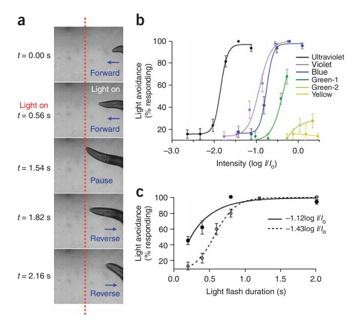
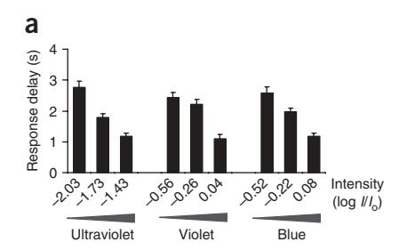
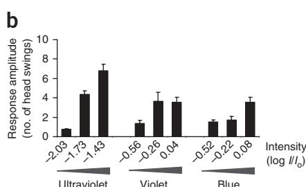
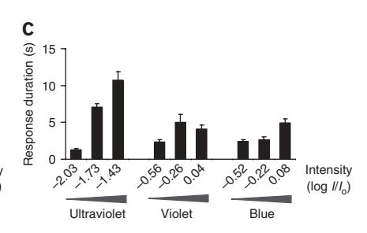
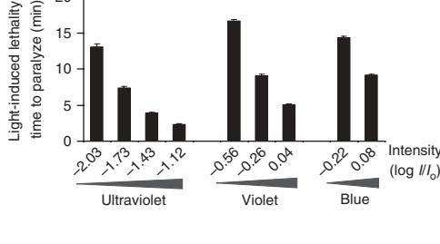
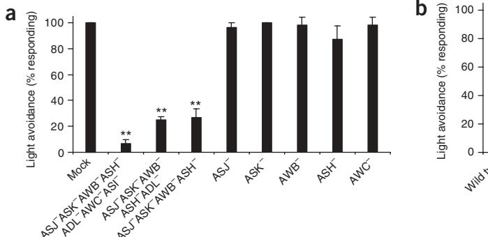
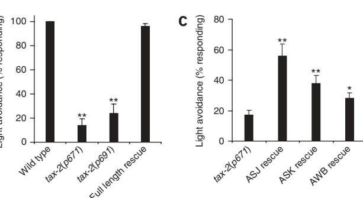
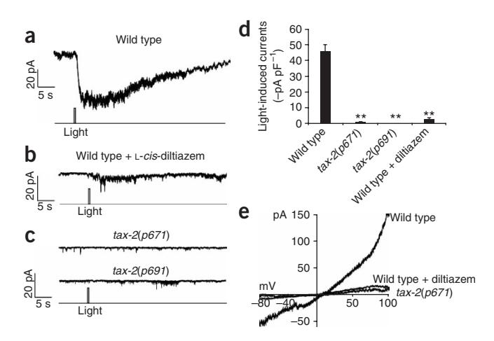
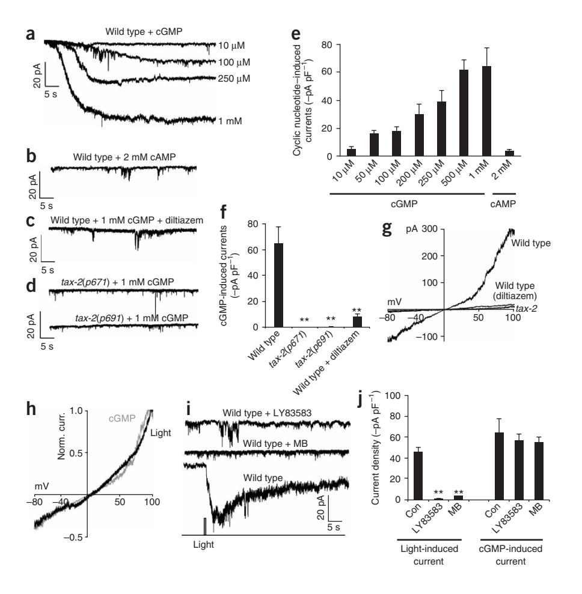

# Light-sensitive neurons and channels mediate phototaxis in C. elegans

Alex Ward1,2,5, Jie Liu1,5, Zhaoyang Feng1,4 & X Z Shawn Xu1–3

Phototaxis behavior is commonly observed in animals with light-sensing organs. C. elegans, however, is generally believed to lack phototaxis, as this animal lives in darkness (soil) and does not possess eyes. Here, we found that light stimuli elicited negative phototaxis in C. elegans and that this behavior is important for survival. We identified a group of ciliary sensory neurons as candidate photoreceptor cells for mediating phototaxis. Furthermore, we found that light excited photoreceptor cells by evoking a depolarizing conductance carried by cyclic guanosine monophosphate (cGMP)-sensitive cyclic nucleotide–gated (CNG) channels, revealing a conservation in phototransduction between worms and vertebrates. These results identify a new sensory modality in C. elegans and suggest that animals living in dark environments without light-sensing organs may not be presumed to be light insensitive. We propose that urbilaterians, the last common ancestor of bilaterians, might have already evolved a visual system that employs CNG channels and the second messenger cGMP for phototransduction.

The ability to sense and react to environmental stimuli is essential for animal survival[1.](#page-5-0) Among the most common stimuli are chemicals, mechanical forces and light. Animals have evolved specialized sensory systems (for example, olfactory, gustatory, auditory and visual systems) to detect these stimuli. Although the morphology of sensory organs is highly diverse among different organisms, the cellular and molecular mechanisms underlying sensory perception, transduction and processing have similarities across phylogen[y2](#page-5-0). As such, invertebrate organisms have been widely used as genetic models for the study of sensory physiology.

Light sensation is a universal phenomenon found in most organisms. In vertebrates and insects, light is detected by photoreceptor cells in the retina, which mediates image-forming visio[n3,4](#page-5-0). Photoreceptor cells also mediate non–image-forming functions, such as phototaxis and circadian rhyth[m5,6](#page-5-0). Notably, retinal photoreceptor cells in vertebrates (for example, cones and rods) and insects adopt distinct morphologies, with the former being ciliated and the latter bearing microvillar structures[3,4](#page-5-0). The phototransduction cascades in these two types of photoreceptor cells are also distinct, although both types of cells detect light with the rhodopsin family of G protein–coupled receptor[s3,4.](#page-5-0) Specifically, vertebrate rods and cones transduce light signals into electrical responses by opening/closing CNG channels using cGMP as a second messenge[r3.](#page-5-0) In contrast, Drosophila photoreceptor cells employ transient receptor potential (TRP) family channels and an unknown second messenger for phototransductio[n4](#page-5-0). It is not known how these two distinct modes of phototransduction have evolved in vertebrates and insects during evolution.

The nematode C. elegans has emerged as an increasingly popular genetic model organism for the study of sensory transduction, including olfactory transduction and mechanotransduction[7,8.](#page-5-0) Here, we developed C. elegans as a model for phototransduction. We found that, despite the lack of specialized light-sensing organs, worms engage in phototaxis behavior that is mediated by light-sensitive neurons and requires cGMP/CNG channel–dependent phototransduction. This behavior is important for survival and might provide a potential mechanism for retaining worms in soil.

## RESULTS

### Light stimuli evoke negative phototactic responses

Animals living in dark environments without light-sensing organs are generally believed to have not evolved or to have lost sensitivity to light during evolution. However, we reasoned that there must be a mechanism(s) that acts to keep such animals in the dark. One possibility is that when the animal approaches a light environment, light may trigger negative phototactic responses that would drive the animal back to a dark environment.

We tested this hypothesis in C. elegans, an organism that lives in soil and lacks morphologically distinct light-sensing organ[s9](#page-5-0). We found that light stimuli elicited robust avoidance responses in worms. Specifically, when a flash of light was focused on the head of a worm moving forward, the animal quickly responded by stopping forward movement and initiating reversals (Fig. 1a and Supplementary Video 1 online). Similarly, when a light pulse was directed to the tail or body of a worm moving backwards, the animal stopped its backward movement and began to move forward (Supplementary Video 2 online). As a result of these behavioral responses, the animals were able to avoid light. This negative phototaxis behavior might serve as a potential mechanism for keeping worms in soil.

Received 7 May; accepted 2 June; published online 6 July 2008; [doi:10.1038/nn.2155](http://www.nature.com/doifinder/10.1038/nn.2155)

1Life Sciences Institute, 2Neuroscience Graduate Program, 3Department of Molecular and Integrative Physiology, University of Michigan, 210 Washtenaw Avenue, Ann Arbor, Michigan 48109, USA. 4Present address: Department of Pharmacology, Case Western Reserve University, 10900 Euclid Ave, Cleveland, Ohio 44106, USA. 5These authors contributed equally to this work. Correspondence should be addressed to X.Z.S.X. ([shawnxu@umich.edu](mailto:shawnxu@umich.edu)).

#### Worms respond to light in a dose-dependent manner

To characterize phototaxis behavior, we focused on the head avoidance response, as it is relatively easy to quantify this response. We found that worms responded to light stimulation in a dose-dependent manner (Fig. 1b,c and Supplementary Fig. 1). The percentage of worms that responded increased as the intensity of the stimulus increased (Fig. 1b). A similar phenomenon was observed when we extended the duration of the stimulus (Fig. 1c and Supplementary Fig. 1). We also quantified the response delay and found that worms initiated reversals as soon as 1 s after the onset of light illumination, depending on the light intensity (Fig. 2a). To quantify the response amplitude and duration, we measured the distance (that is, the number of head swings) and the duration of backward movement (Fig. 2b,c). The distance and duration of backward movement increased with the intensity of the stimulus (Fig. 2b,c). These results demonstrate that behavioral responses to light in *C. elegans* are dose dependent.

Notably, we found that worms showed the highest sensitivity to UV-A light (long ultraviolet;  $350 \pm 25$  nm), followed by violet ( $435 \pm 10$  nm) and blue light ( $470 \pm 20$  nm) (**Fig. 1b**). UV-B (280–315 nm) and UV-C (<280 nm) light were not tested because of technical reasons. In contrast, worms were rather insensitive to green-1 light

**Figure 1** Light evokes avoidance responses in *C. elegans* in a dose-dependent manner. (a) Snapshot images showing that a flash of light triggered an avoidance response in a worm moving forward. A flash of light (2 s, UV-A) was delivered by an objective to the head of a worm moving forward under a microscope. The animal quickly responded by stopping forward movement and initiating reversals. The dotted red line indicates the position of the worm in the field. (b) Worms responded to light in an intensity-dependent manner and were most sensitive to UV-A light. Light pulses (2 s) of varying intensity were tested for the head avoidance response and the percentage of worms that responded was scored ( $I_0 = 20 \text{ mW mm}^{-2}$ , n = 10). Error bars represent s.e.m. (c) Worms responded to light in a duration-dependent manner. Light pulses of varying duration were tested for the head avoidance response. Two different intensities of UV-A light were tested ( $-1.12\log |II_0|$  and  $-1.43\log |II_0|$ , n = 10). We also examined violet and blue light (**Supplementary Fig. 1**). Error bars represent s.e.m.

 $(500 \pm 10 \text{ nm}; \text{Fig. 1b})$ . Very little, if any, response was induced by green-2  $(545 \pm 15 \text{ nm})$  or yellow light  $(575 \pm 25 \text{ nm})$ , the wavelengths shown to have subtle effects on worm movement10 (Fig. 1b). These results indicate that the observed avoidance responses resulted from light rather than heat, as green and yellow light produce more heat than ultraviolet, violet and blue light. Although it is always difficult to compare conditions in the laboratory with those in the natural environment, the ultraviolet components in sunlight might potentially induce a negative phototactic response in worms (Supplementary Fig. 2 online). Phototaxis to ultraviolet light has also been observed in other organisms, including the fruit fly *Drosophila*11.

#### Phototaxis is essential for survival

Phototaxis behavior may also serve as a protective mechanism for *C. elegans*, as prolonged light exposure paralyzed and killed the animal (**Fig. 3**). Thus, it seems that the ability to avoid light is essential for survival. The paralysis induced by prolonged light exposure and the phototactic responses triggered by acute light pulses are probably mediated by different mechanisms, as mutants lacking phototaxis can still be paralyzed by light (A.W. and X.Z.S.X., unpublished observations).

As observed with phototaxis, UV-A light was also more efficient at paralyzing worms than violet and blue light (**Fig. 3**). Green and yellow light did not induce paralysis in worms in 20 min under our conditions. As worms showed the highest sensitivity to UV-A light, we chose to focus on UV-A light for further characterization.

#### Identification of candidate photoreceptor cells

In the vertebrate retina, light is first detected by photoreceptor cells (for example, rods and cones)3. To identify candidate photoreceptor cells in

Figure 2 Behavioral quantification of phototactic responses. (a) Quantification of the response delay. Worms responded to a flash of light by initiating reversals in as short as  $\sim 1$  s, depending on the light intensity. The response delay was quantified as the time interval between the onset of light illumination and the time point at which the animal initiated backward movement. We tested three different intensities of UV-A, violet and blue light pulses (2 s, n=10). Error bars represent s.e.m. (b) Quantification of the response amplitude. The assay was performed as described in a, and the number of head swings during backward movement was quantified (n=10). Error bars represent s.e.m. (c) Quantification of the response duration. The assay was performed as described in a, and the duration of backward movement was quantified (n=10). Error bars represent s.e.m.

**Figure 3** Prolonged light exposure induces paralysis/lethality in worms. Worms were exposed to prolonged light illumination until death and the elapsed time was recorded. To keep the animal exposed to light continuously, we manually moved the stage to follow the animal to keep it in the field of illumination. Under this condition, worms were usually hyperactive at the beginning, but eventually ceased movement and pharyngeal pumping (n=10). Error bars represent s.e.m.

C. elegans, we used a laser ablation approach to determine which sensory neurons are required for mediating the light-induced head avoidance response. Laser ablation of a combination of seven neurons (ASJ, AWB, ASK, ASH, ASI, AWC and ADL) abrogated the head avoidance response (**Fig. 4a**). All of these neurons are ciliated neurons12.

We further narrowed down the list to four neurons (ASJ, AWB, ASK and ASH) that, when killed together, led to a severe defect in the head avoidance response (**Fig. 4a**). A similar group of neurons have been found to be important for electrotaxis13. Ablation of these neurons individually or in different combinations did not yield a severe defect (**Fig. 3a** and **Supplementary Fig. 3** online), revealing the presence of functional redundancy among these neurons for mediating phototaxis. Although we cannot rule out the possibility that other neurons may also be light sensitive, our results identify these neurons as candidate photoreceptor cells that are important for phototaxis in *C. elegans*.

#### CNG channels are important for phototaxis

In vertebrate rods and cones, light signals are transduced into electrical responses in a process called phototransduction, which requires CNG

channels3,14. We thus wondered whether CNG channels were also involved in mediating phototaxis in *C. elegans*. The worm genome encodes a total of six CNG channel homologs, four of which have known mutant alleles available for study (*cng-1*, *cng-2*, *tax-2* and *tax-4*)15. Some of these genes have also been shown to function as CNG channels in heterologous systems16. We found that mutations in the CNG-channel homolog *tax-2* led to a severe defect in phototaxis, whereas those in the other three did not (**Fig. 4b** and A.W. and X.Z.S.X., unpublished observations). Notably, a previous study showed that *tax-2* is expressed in a number of ciliary sensory neurons, including ASJ, AWB and ASK, that we identified as candidate photoreceptor cells by laser ablation17. This provides additional evidence that these neurons may act as photoreceptor cells.

To gather further evidence, we generated transgenic worms that expressed the wild-type tax-2 gene specifically in these neurons using cell-specific promoters. We found that expression of TAX-2 in ASJ, ASK or AWB alone was sufficient to yield a significant rescuing effect (P < 0.004 for ASJ and ASK, P < 0.04 for AWB; **Fig. 4c**). Notably, expression of TAX-2 in ASJ showed the strongest effect (**Fig. 4c**). This suggests that there may be multiple photoreceptor cells that possess overlapping functions in mediating phototaxis in C. elegans.

#### Light evokes an inward current carried by CNG channels

To obtain direct evidence that the identified candidate photoreceptor cells are light sensitive, we sought to record the activity of these neurons in response to light by patch clamp. Calcium imaging approaches were not chosen, as worms are sensitive to violet and blue light, which overlap with the spectrum of all of the genetically encoded calcium sensors that are currently available. We decided to focus on the ASJ neuron, as expression of *tax-2* in this neuron in *tax-2(p671)* mutant worms gave rise to the strongest rescuing effect (**Fig. 4c**). However, initial attempts to record this neuron using classic whole-cell recording protocols failed to detect light-induced currents in ASJ. This might result from some potential physical damage to the neuron that was caused by the recording protocol. Alternatively, some component(s) that are essential for phototransduction might have been dialyzed out by the recording pipette. To overcome this difficulty, we developed a protocol to record ASJ *in situ* in dissected live worms by perforated

Figure 4 Phototaxis in *C. elegans* requires ciliary sensory neurons and CNG channels. (a) Phototaxis in *C. elegans* required ciliary sensory neurons. Laser ablation of a group of ciliary sensory neurons led to a severe defect in light-induced avoidance responses. A 2-s light pulse (UV-A,  $-1.43\log |I|_0$ ) was used. \*\*P < 0.0002 compared with mock,  $n \ge 4$ . Error bars represent s.e.m. (b) Phototaxis in *C. elegans* requires CNG channels. Mutations in the CNG channel homolog TAX-2 led to a severe defect in light-induced avoidance responses. Two different tax-2 mutant alleles (p671 and p691) were examined. Full-length rescue experiments were performed on tax-2(p691) mutant worms expressing a full length tax-2 genomic DNA described previously tax-20.000001 compared with wild type, tax-21. Error bars represent s.e.m. (c) Cell-specific rescue of tax-21 mutant phenotype indicated that CNG channels may act in ciliary sensory neurons to mediate phototaxis. The wild-type tax-21 cDNA was expressed as a transgene in ASJ, AWB or ASK of tax-22 mutant worms using cell-specific promoters (ASJ rescue, tax-22 mutants, tax-23 mutants, tax-24 mutants, tax-26 mutants, tax-26 mutants, tax-27 mutants, tax-28 mutants, tax-28 mutants, tax-28 mutants, tax-28 mutants, tax-28 mutants, tax-28 mutants, tax-28 mutants, tax-28 mutants, tax-28 mutants, tax-28 mutants, tax-28 mutants, tax-28 mutants, tax-28 mutants, tax-28 mutants, tax-28 mutants, tax-28 mutants, tax-28 mutants, tax-28 mutants, tax-28 mutants, tax-28 mutants, tax-28 mutants, tax-28 mutants, tax-28 mutants, tax-28 mutants, tax-28 mutants, tax-28 mutants, tax-28 mutants, tax-28 mutants, tax-28 mutants, tax-28 mutants, tax-28 mutants, tax-28 mutants, tax-28 mutants, tax-28 mutants, tax-29 mutants, tax-29 mutants, tax-29 mutants, tax-29 mutants, tax-29 mutants, tax-29 mutants, tax-29 mutants, tax-29 mutants, tax-29 mutants, tax-29 mutants, tax-29 mutants, ta

current carried by CNG channels. (a) Light evoked an inward current in the ASJ neuron of wild-type worms. The ASJ neuron from acutely dissected live worms was recorded by perforated voltage clamp (-70 mV). A flash of UV-A light  $(0.5 \text{ s}, -1 \log I/I_0)$  was used to stimulate the neuron. The same intensity and duration of UV-A light was used during the rest recordings unless otherwise indicated. Shown is a representative trace. (b) The light-induced current was sensitive to the CNG-channel inhibitor L-cis-diltiazem. Recording was performed as described in a. L-cis-diltiazem (100 μM) is membranepermeable and was included in the bath solution. The inhibitory effect of this drug was reversible (Supplementary Fig. 5). Shown is a representative trace. (c) The light-induced current was absent in mutant worms lacking the CNGchannel homolog TAX-2. Recording was performed as in a. Two different tax-2 mutant alleles (p671 and p691) were examined. (**d**) Bar graph summarizing the data in  $\mathbf{a}-\mathbf{c}$ . \*\*P < 0.00001 compared with wild type,  $n \ge 9$ . Error bars represent s.e.m. (e) *I-V* relations of the light-induced conductance. Shown are voltage-ramp traces recorded from wild-type worms with and without L-cis-diltiazem and from tax-2(p671) mutant worms.

Figure 5 Light stimulates the photoreceptor neuron ASJ by evoking an inward

whole-cell recording. We found that a flash of light evoked an inward current in ASJ, which developed in milliseconds (356  $\pm$  37 ms, n=12) after the onset of light illumination (**Fig. 5a**). In vertebrate photoreceptors from the parietal eye, light can also evoke an inward current by opening CNG channels, although in those from lateral eyes light elicits an outward current18. Consistent with our behavioral data, UV-A light is more efficient in inducing a light conductance than are violet, blue and green light (**Supplementary Fig. 4** online). The light-induced current in ASJ was slightly outward rectifying, with a reversal potential near zero (**Fig. 5**), a feature similar to that observed in

vertebrate photoreceptors14. Notably, the light-induced current was sensitive to L-cis-diltiazem, a CNG channel–specific inhibitor that blocks light-induced currents in vertebrate rods and cones19 (**Fig. 5b,d** and **Supplementary Fig. 5** online). These data provide strong evidence that the ASJ neuron is a photoreceptor neuron and that the observed light conductance is mediated by CNG channels.

To provide further evidence for a critical role of CNG channels in mediating the light conductance in ASJ, we recorded this neuron from mutant animals lacking the CNG-channel homolog TAX-2 (**Fig. 5c**). No notable light-induced current was observed in ASJ of *tax-2* mutant

Figure 6 The light-sensitive CNG channels in the photoreceptor neuron ASJ are sensitive to cGMP. (a) cGMP induced an inward current in ASJ in a concentration-dependent manner. We dialyzed cGMP at varying concentrations into ASJ with the recording pipette. (b) cAMP failed to evoke an inward current in ASJ at concentrations of up to 2 mM. (c) The cGMP-induced current was sensitive to L-cis-diltiazem. The drug (100 μM) was included in the bath solution. (d) The cGMPinduced current was absent in tax-2 mutants. (e) Bar graph summarizing the cGMP- and cAMPinduced currents recorded from wild-type worms  $(n \ge 5)$ . (f) Bar graph summarizing the cGMPinduced currents recorded from tax-2 mutant worms. \*\*P < 0.0001 compared with wild type,  $n \geq 5$ . (g) *I-V* relations of the cGMP-induced conductance. Shown are voltage-ramp traces recorded from wild-type worms with and without L-cis-diltiazem and tax-2(p671) mutant worms. (h) The light-induced and the cGMP-induced conductance shared a nearly identical I-V relationship. The voltage-ramp traces from g and Figure 5e were normalized and superimposed. (i) The light-induced current was blocked by the guanylate cyclase inhibitors LY83583 and methylene blue (MB). LY83583 (100 µM) and MB (10  $\mu$ M) were included in the bath solution. A control trace (drug free) is also shown. (j) Bar graph summarizing the effects of the guanlynate cyclase inhibitors on the light- and cGMP-induced currents. LY83853 and MB blocked the lightinduced current but had no significant effect on the cGMP-induced current. \*\*P < 0.0003compared with control,  $n \ge 5$ . All error bars represent s.e.m.

worms (Fig. 5c–e). This observation, together with the electrophysiological and pharmacological evidence described above, strongly suggests that the light-induced conductance in ASJ is mediated by CNG channels.

#### cGMP is a second messenger for phototransduction in ASJ

In vertebrate rods and cones, the light-sensitive CNG channels are gated by the second messenger cGMP, but are rather insensitive to cAM[P14](#page-5-0). In contrast, the olfactory transduction CNG channels in vertebrate olfactory receptor neurons can be activated by both cAMP and cGMP, although their native ligand is cAM[P14](#page-5-0). We thus asked whether the light-sensitive CNG channels in worm photoreceptor neurons depend on cGMP and/or cAMP. Dialysis of cGMP into the ASJ neuron elicited an inward current, the amplitude of which showed a dose dependence on cGMP concentration (Fig. 6). Notably, cAMP evoked very little, if any, current in ASJ at concentrations of up to 2 mM (Fig. 6b,e), demonstrating that cGMP, rather than cAMP, is the preferred ligand for the CNG channels in ASJ, a property that is shared by those in vertebrate rods and cone[s14](#page-5-0).

As was the case with the light-induced current, the cGMP-induced current in ASJ was also sensitive to L-cis-diltiazem, a CNG channel– specific inhibitor[19](#page-5-0) (Fig. 6c,f and Supplementary Fig. 5). In addition, both types of currents shared a nearly identical I-Vrelationship, that is, slightly outward-rectifying with a reversal potential near zero (Fig. 6g). Normalized I-V traces from both channels extensively overlap (Fig. 6h). Furthermore, similar to the light-induced current, the cGMP-dependent current also required the CNG-channel homolog TAX-2, as no current was induced by cGMP in the ASJ neuron recorded from tax-2 mutant worms (Fig. 6d,f). Taken together, these observations strongly suggest that the light- and cGMP-induced currents were carried by the same type of CNG channels. These data also suggest that cGMP may be a second messenger for transducing light signals into electric responses in the photoreceptor neuron ASJ.

If cGMP is a second messenger mediating phototransduction in ASJ, as suggested above, then blocking the production of cGMP should block phototransduction. cGMP is produced by guanylate cyclases. The worm genome encodes over 30 guanylate cyclase gene[s20](#page-5-0). To overcome the potential functional redundancy, we tested LY83857, a known guanylate cyclase inhibito[r21](#page-5-0), and found that it suppressed the lightinduced current in ASJ (Fig. 6i,j). As a control, this drug did not have a significant effect on the cGMP-induced current in ASJ (P 4 0.50; Fig. 6j). To obtain additional evidence, we tested another known guanylate cyclase inhibitor, methylene blue[22,](#page-5-0) and found that methylene blue also suppressed the light-induced current in ASJ (Fig. 6i,j). These results demonstrate that cGMP has a critical role in phototransduction and strongly suggest that cGMP is a second messenger for mediating phototransduction in the photoreceptor cell ASJ.

#### DISCUSSION

C. elegans reacts to a wide variety of chemical (for example, odorants, tastants and oxygen, etc.) and mechanical (for example, body and nose touch) stimuli and is commonly used as a model for the study of sensory transductio[n23–28.](#page-5-0) In this study, we found that phototaxis behavior is present in C. elegans, a soil-dwelling organism that lacks specialized light-sensing organs. This behavior is essential for survival and might provide a potential mechanism for retaining worms in soil, their natural environment. It thus appears that organisms living in dark environments without light-sensing organs may not be presumed to be completely blind. Our studies identify a new sensory modality in C. elegans and indicate that C. elegans could be a suitable model organism for the study of phototransduction.

Classic anatomical analyses indicate that, in light of the wide diversity of eye structure, eyes in vertebrates and invertebrates must have evolved independentl[y29,](#page-6-0) although genetic studies of eye development have cast doubt on this vie[w30](#page-6-0). On the contrary, Charles Darwin postulated a monophyletic origin of eye evolution in his book, The Origin of Species, and suggested that all complex eyes may have evolved from a prototype eye that comprised only two cells: a photoreceptor cell (optic nerve) and a pigment cell(s), which were covered by translucent skin without any lens or other refractive body (depicted in Supplementary Fig. 6 online). The photoreceptor cell senses light and the pigment cell shades light such that light is only detected by the photoreceptor cell at certain directions (Supplementary Fig. 6). This type of primitive eye has been suggested to be present in a number of invertebrate organisms, including some planarians and annelid larv[a31,32](#page-6-0). It would be interesting to test whether the proposed photoreceptor cells are light sensitive.

In the case of C. elegans, clearly no pigment cells have been identified that may act to shade light from the photoreceptor cells. Nevertheless, it is important to consider that worms live in soil (depicted in Supplementary Fig. 6), an environment that is distinct from that above ground where light would be detected from all directions. It is conceivable that when a worm approaches or emerges from the surface of the ground, light would be projected from top but not underneath, which would trigger a negative phototactic response in the animal (Supplementary Fig. 6). Under this scenario, soil shades light, acting as a surrogate pigment cell (Supplementary Fig. 6). We thus propose that the photoreceptor cells in worms are capable of assuming the proposed function of Darwin's primitive eyes. It is possible that pigment cells have been lost in C. elegans during evolution since its ancestors began to live in soil. Indeed, some marine and freshwater nematodes do have pigments in the head and are phototactic, although no photoreceptor cell has been functionally identified in these specie[s33,34](#page-6-0). It is also possible that pigment cells have evolved independently of photoreceptor cells and have been recruited as needed during evolution.

There are two major types of photoreceptor cells in metazoans: the ciliary photoreceptors represented by vertebrate rods and cone[s3](#page-5-0) and the rhabdomeric photoreceptors, exemplified by those from Drosophila ommatidia[35](#page-6-0). Although these two types of photoreceptors both detect light with the rhodopsin family of G protein–coupled receptors, the downstream phototransduction cascades in the two cell types are distinc[t3,35](#page-5-0). Specifically, vertebrate rods and cones employ lightsensitive CNG channels and the second messenger cGMP for phototransductio[n3,](#page-5-0) whereas Drosophila phototransduction is mediated by light-sensitive TRP channels and an unknown second messenger(s) (possibly DAG or its metabolites[\)35](#page-6-0). Thus, the question arises as to whether these two distinct phototransduction cascades have evolved separately in vertebrates and insects after their ancestors split from urbilaterians, the last common ancestor of all bilaterian[s36](#page-6-0). Alternatively, one or both types of phototransduction may have already been present in urbilaterians. Our studies indicate that C. elegans photoreceptor cells also employ CNG channels and the second messenger cGMP for phototransduction. Thus, the cGMP/CNG channel–mediated phototransduction seems to be an ancient pathway. We propose that urbilaterians might have already evolved a visual system that employs the cGMP/CNG channel–mediated signaling for phototransduction. Considering that C. elegans and Drosophila both belong to the same superphylum, Ecdysozoa[36](#page-6-0), it is possible that Drosophila might have lost this mode of phototransduction during evolution; alternatively, this pathway may exist in some Drosophila photoreceptors that have not yet been functionally identified. Future work is needed to address the evolutionary origin of TRP channel–mediated phototransduction.

## gdu

#### **METHODS**

Behavioral and statistical analysis. Phototaxis was tested on day 1 adult worms unless otherwise indicated. Worms were transferred to nematode growth medium plates (one worm per plate) covered with a thin layer of freshly spread OP50 bacteria 2-5 min before the test. To quantify the percent responding, we tested each worm five times with an 8-10-min interval between each test and tabulated a percentage score for each worm. To quantify response delay, response amplitude and response duration, we tested each worm only once. The number of head swings was determined according to the definition created in a previous study37. Light pulses from an Arc lamp (EXFO Xcite) were delivered to the worm head via a 10× objective in combination with a 1-8× zoom lens on a Zeiss microscope (Zeiss Discovery) and the entire event was recorded with a digital camera (Cohu 7800) at 16 frames per s. To direct light to the worm head, we manually moved the stage (plate) such that only the head of the worm appeared in the field of view. A positive response was scored if the worm stopped forward movement within 3 s after the cessation of light illumination and also initiated backward movement that lasted at least half of a head swing. In most cases, a 2-s light pulse was used to trigger responses unless otherwise indicated. When light was directed to the worm tail or body, it usually stimulated forward movement. Light intensity was determined with a radiometric sensor head (268S for UV-A light and 268LP for visible light) coupled to an optometer (S471, UDT Instruments). The intensities of UV-A, violet, blue, green-1, green-2 and yellow light were sampled at 340, 430, 470, 500, 550 and 580 nm, respectively. The background light used to visualize worms was filtered into red with a red filter.  $I_0$  was set as 20 mW mm-2 for all wavelengths. A software package was developed in the laboratory by modifying one reported previously to control the shutter and the camera, as well as to process images and quantify behavioral parameters38,39. Laser ablation was performed on L2 worms using standard protocols40 and phototaxis was analyzed at day 1 or 2 adulthood. A GFP transgene under the control of the  $tax-2\Delta$  promoter was expressed in the worm to aid laser ablation17.

Statistical analysis was carried out using the Statistica (StatSoft). P values were generated by ANOVA using the Bonferroni test. P < 0.05 was considered to be significant.

Genetics and molecular biology. To generate transgenic worms expressing the wild-type *tax-2* genes in specific neurons, we directly injected plasmids encoding *tax-2* cDNA under the control of the *trx-1* (ASJ), *str-1* (AWB) and *srg-8* (ASK) promoters into *tax-2*(*p671*) worms41,42. Plasmids encoding DsRed driven by the same cell-specific promoters were used as a co-injection marker to facilitate selection of the worms carrying the transgene in the neuron of interest for behavioral tests. The *srg-8::tax-2* transgene appeared to get silenced after more than two passages, and the worms were thus assayed at the F2 generation.

Electrophysiology. Patch-clamp recordings were carried out under an Olympus microscope (BX51WI) with an EPC-10 amplifier and the Pulse software (HEKA) using a protocol modified from previous studies43,44. In brief, worms were glued to a sylgard-coated coverglass covered with bath solution and a small piece of cuticle in the worm head was cut open and pinned down to the coverglass to expose the cells. The ASJ neuron was identified by an mCherry fluorescence marker expressed as a transgene driven by the trx-1 promoter. mCherry was excited by orange light (590 ± 10 nm). Background light was filtered into red with a red filter. Light pulses (0.5 s) were delivered from an Arc lamp (EXFO Xcite) coupled to a mechanical shutter (Sutter) triggered by the amplifier. Recording pipettes were pulled from borosilicate glass and firepolished. The bath solution contains 145 mM NaCl, 5 mM KCl, 1 mM CaCl2, 5 mM MgCl2, 11 mM dextrose and 5 mM HEPES (330 mOsm, pH adjusted to 7.3). The pipette solution for perforated patch clamp contained 115 mM potassium gluconate, 15 mM KCl, 5 mM MgCl2, 10 mM HEPES, 0.25 mM CaCl2, 20 mM sucrose, 5 mM EGTA and 50 µg ml-1 nystatin (315 mOsm, pH adjusted to 7.2). We included 5 mM Na2ATP and 0.5 mM Na2GTP in the pipette solution during classic whole-cell recording. When acquiring voltageramp traces, potassium gluconate was replaced with CsCl in the pipette solution. Nystatin was included in the pipette solution only during perforated whole-cell recording. Several other ionophores were also tested for perforated patch clamp (for example, β-escin, amphotericin B and gramicidin), and nystatin was found to be the most efficient under our conditions. Voltages were clamped at -70 mV. Current data were sampled at 5 kHz. Series resistance and membrane capacitance were both compensated for during recording.

Note: Supplementary information is available on the Nature Neuroscience website.

#### ACKNOWLEDGMENTS

We thank P. Hu and A. Kumar for comments; C. Bargmann for providing *tax-2* rescuing strains; B. Decaluwe, M. Xia and S. Gu for technical assistance; L. Kang for movie editing; Q. Liu and Z.W. Wang for assistance in setting up recording; and members of the Xu lab for advice. Some strains were obtained from the *Caenorhabditis* Genetics Center. A.W. was supported by a US National Institutes of Health predoctoral training grant. This work was supported by the US National Institute of General Medical Sciences (NIGMS) and the Pew scholars program (X.Z.S.X.).

#### AUTHOR CONTRIBUTIONS

A.W. conducted the experiments and analyzed the data in **Figures 1–4**. J.L. conducted the experiments and analyzed the data in **Figures 5** and **6**. Z.F. developed tools to acquire and analyze behavioral data. X.Z.S.X. supervised the project and wrote the manuscript.

Published online at http://www.nature.com/natureneuroscience Reprints and permissions information is available online at http://npg.nature.com/reprintsandpermissions/

- Kandel, E.R. The neurobiology of behavior. in *Principles of Neural Science* (eds. Kandel, E.R., Schwartz, J.H. & Jessell, T.M.) 5–66 (McGraw-Hill Medical, 2000).
- Bargmann, C.I. Comparative chemosensation from receptors to ecology. Nature 444, 295–301 (2006).
- Fu, Y. & Yau, K.W. Phototransduction in mouse rods and cones. Pflugers Arch. 454, 805–819 (2007).
- Wang, T. & Montell, C. Phototransduction and retinal degeneration in *Drosophila*. Pflugers Arch. 454, 821–847 (2007).
- Berson, D.M. Phototransduction in ganglion-cell photoreceptors. *Pflugers Arch.* 454, 849–855 (2007).
- Kelber, A., Vorobyev, M. & Osorio, D. Animal color vision-behavioral tests and physiological concepts. *Biol. Rev. Camb. Philos. Soc.* 78, 81–118 (2003).
- Bargmann, C.I. Chemosensation. in C. elegans. WormBook, 1–29 <a href="http://www.wormbook.org/">http://www.wormbook.org/</a>> (2006).
- Bounoutas, A. & Chalfie, M. Touch sensitivity in Caenorhabditis elegans. Pflugers Arch. 454, 691–702 (2007).
- 9. Brenner, S. The genetics of Caenorhabditis elegans. Genetics 77, 71-94 (1974).
- Burr, A.H. The photomovement of *Caenorhabditis elegans*, a nematode which lacks ocelli. Proof that the response is to light not radiant heating. *Photochem. Photobiol.* 41, 577–582 (1985).
- Harris, W.A., Stark, W.S. & Walker, J.A. Genetic dissection of the photoreceptor system in the compound eye of *Drosophila melanogaster. J. Physiol. (Lond.)* 256, 415–439 (1976)
- White, J.G., Southgate, E., Thomson, J.N. & Brenner, S. The structure of the nervous system of the nematode *Caenorhabditis elegans*. *Phil. Trans. R. Soc. Lond. B* 314, 1–340 (1986).
- Gabel, C.V. et al. Neural circuits mediate electrosensory behavior in Caenorhabditis elegans. J. Neurosci. 27, 7586–7596 (2007).
- Kaupp, U.B. & Seifert, R. Cyclic nucleotide–gated ion channels. *Physiol. Rev.* 82, 769–824 (2002).
- Cho, S.W., Cho, J.H., Song, H.O. & Park, C.S. Identification and characterization of a putative cyclic nucleotide–gated channel, CNG-1, in *C. elegans. Mol. Cells* 19, 149–154 (2005)
- Komatsu, H. et al. Functional reconstitution of a heteromeric cyclic nucleotide-gated channel of Caenorhabditis elegans in cultured cells. Brain Res. 821, 160–168 (1999).
- Coburn, C.M. & Bargmann, C.I. A putative cyclic nucleotide–gated channel is required for sensory development and function in *C. elegans. Neuron* 17, 695–706 (1996).
- Finn, J.T., Solessio, E.C. & Yau, K.W. A cGMP-gated cation channel in depolarizing photoreceptors of the lizard parietal eye. *Nature* 385, 815–819 (1997).
- Stern, J.H., Kaupp, U.B. & MacLeish, P.R. Control of the light-regulated current in rod photoreceptors by cyclic GMP, calcium, and I-cis-diltiazem. Proc. Natl. Acad. Sci. USA 83, 1163–1167 (1986).
- Yu, S., Avery, L., Baude, E. & Garbers, D.L. Guanylyl cyclase expression in specific sensory neurons: a new family of chemosensory receptors. *Proc. Natl. Acad. Sci. USA* 94, 3384–3387 (1997).
- Mulsch, A., Luckhoff, A., Pohl, U., Busse, R. & Bassenge, E. LY 83583 (6-anilino-5, 8-quinolinedione) blocks nitrovasodilator-induced cyclic GMP increases and inhibition of platelet activation. *Naunyn Schmiedebergs Arch. Pharmacol.* 340, 119–125 (1989).
- Danziger, R.S. et al. Characterization of soluble guanylyl cyclase in transformed human nonpigmented epithelial cells. *Biochem. Biophys. Res. Commun.* 195, 958–962 (1993)
- Bargmann, C.I., Hartwieg, E. & Horvitz, H.R. Odorant-selective genes and neurons mediate olfaction in *C. elegans. Cell* 74, 515–527 (1993).

- 24. Ward, S. Chemotaxis by the nematode Caenorhabditis elegans: identification of attractants and analysis of the response by use of mutants. Proc. Natl. Acad. Sci. USA 70, 817–821 (1973).
- 25. Gray, J.M. et al. Oxygen sensation and social feeding mediated by a C. elegans guanylate cyclase homologue. Nature 430, 317–322 (2004).
- 26. Chalfie, M. et al. The neural circuit for touch sensitivity in Caenorhabditis elegans. J. Neurosci. 5, 956–964 (1985).
- 27. Kaplan, J.M. & Horvitz, H.R. A dual mechanosensory and chemosensory neuron in Caenorhabditis elegans. Proc. Natl. Acad. Sci. USA 90, 2227–2231 (1993).
- 28. Cheung, B.H., Cohen, M., Rogers, C., Albayram, O. & de Bono, M. Experiencedependent modulation of C. elegans behavior by ambient oxygen. Curr. Biol. 15, 905–917 (2005).
- 29. Salvini-Plawen, L. & Mayr, E. On the evolution of photoreceptors and eyes. in Evolutionary Biology (eds. Hecht, M.K., Steere, W.C. & Wallace, B.) 207–273 (Plenum Press, New York, 1961).
- 30. Gehring, W.J. & Ikeo, K. Pax 6: mastering eye morphogenesis and eye evolution. Trends Genet. 15, 371–377 (1999).
- 31. Gehring, W.J. New perspectives on eye development and the evolution of eyes and photoreceptors. J. Hered. 96, 171–184 (2005).
- 32. Arendt, D., Tessmar, K., de Campos-Baptista, M.I., Dorresteijn, A. & Wittbrodt, J. Development of pigment-cup eyes in the polychaete Platynereis dumerilii and evolutionary conservation of larval eyes in Bilateria. Development 129, 1143–1154 (2002).
- 33. Chitwood, B.G. & Murphy, D.G. Observations on two marine monhysterids: their classification, cultivation, and behavior. Trans. Am. Microsc. Soc. 83, 311–329 (1964).

- 34. Croll, N.A. The phototactic response and spectral sensitivity of Chromadorina viridis (Nematoda, Chromadorida) with a note on the nature of the paired pigment spots. Nematologica 12, 610–614 (1966).
- 35. Montell, C. Visual transduction in Drosophila. Annu. Rev. Cell Dev. Biol. 15, 231–268 (1999).
- 36. Adoutte, A., Balavoine, G., Lartillot, N. & de Rosa, R. Animal evolution. The end of the intermediate taxa? Trends Genet. 15, 104–108 (1999).
- 37. Gray, J.M., Hill, J.J. & Bargmann, C.I. A circuit for navigation in Caenorhabditis elegans. Proc. Natl. Acad. Sci. USA 102, 3184–3191 (2005).
- 38. Li, W., Feng, Z., Sternberg, P.W. & Xu, X.Z.S.A. C. elegans stretch receptor neuron revealed by a mechanosensitive TRP channel homologue. Nature 440, 684–687 (2006).
- 39. Feng, Z. et al. A C. elegans model of nicotine-dependent behavior: regulation by TRP family channels. Cell 127, 621–633 (2006).
- 40. Bargmann, C.I. & Avery, L. Laser killing of cells in Caenorhabditis elegans. Methods Cell Biol. 48, 225–250 (1995).
- 41. Troemel, E.R., Chou, J.H., Dwyer, N.D., Colbert, H.A. & Bargmann, C.I. Divergent seven transmembrane receptors are candidate chemosensory receptors in C. elegans. Cell 83, 207–218 (1995).
- 42. Miranda-Vizuete, A. et al. Lifespan decrease in a Caenorhabditis elegans mutant lacking TRX-1, a thioredoxin expressed in ASJ sensory neurons. FEBS Lett. 580, 484–490 (2006).
- 43. Richmond, J.E. & Jorgensen, E.M. One GABA and two acetylcholine receptors function at the C. elegans neuromuscular junction. Nat. Neurosci. 2, 791–797 (1999).
- 44. Brockie, P.J., Mellem, J.E., Hills, T., Madsen, D.M. & Maricq, A.V. The C. elegans glutamate receptor subunit NMR-1 is required for slow NMDA-activated currents that regulate reversal frequency during locomotion. Neuron 31, 617–630 (2001).

