# **The Fundamental Role of Pirouettes in** *Caenorhabditis elegans* **Chemotaxis**

**Jonathan T. Pierce-Shimomura, Thomas M. Morse, and Shawn R. Lockery**

*Institute of Neuroscience, University of Oregon, Eugene, Oregon 97403-1254*

To investigate the behavioral mechanism of chemotaxis in *Caenorhabditis elegans*, we recorded the instantaneous position, speed, and turning rate of single worms as a function of time during chemotaxis in gradients of the attractants ammonium chloride or biotin. Analysis of turning rate showed that each worm track could be divided into periods of smooth swimming (runs) and periods of frequent turning (pirouettes). The initiation of pirouettes was correlated with the rate of change of concentration (d*C*/d*t*) but not with absolute concentration. Pirouettes were most likely to occur when a worm was heading down the gradient (d*C*/d*t* , 0) and least likely to occur when a worm was heading up the gradient (d*C*/d*t* . 0). Further analysis revealed

that the average direction of movement after a pirouette was up the gradient. These observations suggest that chemotaxis is produced by a series of pirouettes that reorient the animal to the gradient. We tested this idea by imposing the correlation between pirouettes and d*C*/d*t* on a stochastic point model of worm motion. The model exhibited chemotaxis behavior in a radial gradient and also in a novel planar gradient. Thus, the pirouette model of *C. elegans* chemotaxis is sufficient and general.

*Key words: nematode; chemosensation; spatial orientation; neural computation; behavioral models; sensorimotor integration*

The nematode *Caenorhabditis elegans* is an excellent experimental system for studying the neuronal mechanisms of chemotaxis. *C. elegans* is a small, soil-dwelling nematode attracted by compounds thought to be associated with its food source, bacteria (Ward, 1973; Dusenbery, 1974; Bargmann et al., 1993). *C. elegans* chemotaxis is studied in the laboratory by following the movements of worms in gradients of attractants on agar plates (Ward, 1973). The *C. elegans* nervous system is easy to study for three main reasons. First, the adult hermaphrodite has only 302 neurons, each reidentifiable from animal to animal. Second, nearly all of the anatomically defined synaptic connections in the adult hermaphrodite have been reconstructed from electron micrographs (Albertson and Thomson, 1976; White et al., 1986). Third, it is possible to study neuronal function electrophysiologically in patch-clamp recordings (Goodman et al., 1998) from identified neurons. Little is known, however, about the behavioral and neuronal mechanisms of chemotaxis in *C. elegans*.

Spontaneous locomotion in *C. elegans* involves two elementary behaviors. On a moist agar surface, a worm makes a long series of sinusoidal-swimming movements, called a "run," interrupted approximately twice a minute by a sharp "turn." Turns are produced in two main ways: by an "omega turn" in which a worm's head curls back, touching or crossing the tail, as the animal

Received July 15, 1999; accepted Aug. 11, 1999.

This work was supported by the National Science Foundation; the National Institute of Mental Health; the National Heart, Lung, and Blood Institute; the Office of Naval Research; The Sloan Foundation; The Searle Scholars Program; and National Institutes of Health predoctoral fellowship Training Grant GM07257. We thank S. Owens for assistance; T. Ferre´e for help with the diffusion equation; B. Marcotte for tracking-system development; W. Kristan, E. Martins, W. Roberts, and J. Weeks for comments; and M. Gallegos and C. Bargmann for sharing unpublished results. Worms were provided by the *Caenorhabditis* Genetics Center, which is funded by the National Institutes of Health National Center for Research Resources.

Correspondence should be addressed to Dr. Shawn R. Lockery, Institute of Neuroscience, 1254 University of Oregon, Eugene, OR 97403-1254. E-mail: shawn@chinook.uoregon.edu.

Copyright © 1999 Society for Neuroscience 0270-6474/99/199557-13\$05.00/0

continues to move forward (Croll, 1975a,b) or by a "reversal" in which a worm moves backward for several seconds and then moves forward again in a new direction (Croll, 1975a,b).

Previous anatomical and behavioral observations suggest that chemotaxis in *C. elegans* may be regulated by attractant concentration sensed at a single point on the body (Ward, 1973; Dusenbery, 1980). Although *C. elegans* has pairs of chemosensory organs on its head (amphids) and tail (phasmids), the phasmids are not necessary for normal chemotaxis (Ward, 1973), making it unlikely that a worm orients primarily by sensing the difference in concentration between head and tail. Because there are two amphid organs, it is formally possible that a worm orients by taking the difference in concentration between them, but this is unlikely because the amphids are only 8 mm apart (Ward et al., 1975). These observations suggest that *C. elegans* assesses the gradient by making comparisons at a single point through time, a computation that approximates the time derivative of concentration d*C*/d*t*. Although *C. elegans* chemotaxis could be regulated by absolute attractant concentration alone, such a mechanism seems unlikely. This is because *C. elegans* chemotaxis has been observed in gradients that differ .1000-fold in absolute concentration (Ward, 1973), requiring an absolute-concentration detector with unusually high resolution. Behavioral responses consistent with a sensitivity to d*C*/d*t* in *C. elegans* have been reported (Dusenbery, 1980).

We used a tracking system to record the position, speed, and turning rate of individual worms in well-defined gradients of attractant. We found no evidence that *C. elegans* performs chemotaxis simply by adjusting its speed or turning rate as a function of concentration. Instead, we found that *C. elegans* modulates the probability of large, brief turns as a function of d*C*/d*t* experienced in the recent past. A computer model showed that this mechanism is sufficient to account for the main features of *C. elegans* chemotaxis in laboratory assays. These results define the behavioral

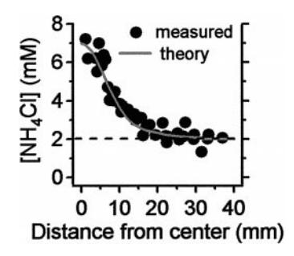

Figure 1. Comparison of estimated and actual concentration in a radial Gaussian gradient. The gradient was formed by placing two 5  $\mu$ l drops of 500 mm NH4Cl at the center of an agar-filled plate, the first drop 20 hr and the second drop 3.5 hr before actual concentrations were measured. Concentrations were measured with a chloride-selective microelectrode at the indicated distances from the center of the plate (measured). Concentration estimates (theory) were made as described in Materials and Methods (Eqs. 1, 2).

input-output function of the neural network for chemotaxis in *C. elegans*.

#### MATERIALS AND METHODS

Animals. Nematodes (*C. elegans*; Bristol strain N2) were cultured at  $19-24^{\circ}\text{C}$  on 1.7% agar-filled plates containing nematode growth medium seeded with the *Escherichia coli* strain OP50 (Brenner, 1974). Mixed-stage worms were rinsed off culture plates with assay medium containing (in mM): ammonium chloride (NH4Cl) 2, CaCl2 1, MgSO4 1, and KPO4 25, pH = 6.5. To remove bacteria and other potential chemical stimuli, we washed the animals by pelleting them loosely in a table-top microcentrifuge and transferred them to unseeded holding plates (diameter = 9 cm) filled with 15 ml of agar-containing assay medium. Animals remained on holding plates for 0.5-2 hr before being transferred individually to an assay plate for study. All animals were either adults or young adults. Assay plates contained assay medium under one of three possible conditions: (1) a spatially uniform concentration of the attractant NH4Cl, (2) a radial Gaussian-shaped chemical gradient (Ward, 1973), or (3) a planar gradient.

Chemical gradients. "Radial gradients" [NH4Cl, 2.0–6.0 mM, or biotin,  $4.3 \times 10^{-7}$  to 3.0 mM (Ward, 1973)] were established in assay plates, which contained the same agar as holding plates, by placing a 5  $\mu$ l drop of attractant at the center of the plate at two different times ( $t_1$  and  $t_2$ ) before the experiment (500 mM NH4Cl,  $16 \le t_1 \le 22$  hr;  $3 \le t_2 \le 4$  hr; 200 mM biotin,  $16 \le t_1 \le 22$  hr;  $4 \le t_2 \le 5$  hr). For each assay plate,  $t_1$  and  $t_2$  were recorded for estimation of the attractant concentration during the assay. At each time point t in the assay, the concentration of attractant C (millimolar) at the position of a worm was estimated according to the solution of the diffusion equation (Crank, 1956) for a point bolus in a cylindrical, aqueous volume having the same dimensions as the agar in the assay plate (diameter = 9 cm; depth = 0.264 cm). Accordingly:

$$C(t, r) = c(t, t_1, r) + c(t, t_2, r)$$
(1)

$$c(t, t_i, r) = 10^6 \frac{N_0}{4\pi dD(t+t_i)} e^{-(r^2/4D(t+t_i))}, \qquad (2)$$

where  $N_0$  is the moles of attractant in the 5  $\mu$ l drop, d is the depth of the agar (centimeters), r is the distance (centimeters) between the peak of the gradient and the location of the animal, t is the time (seconds) since the animal was placed in the assay plate, t is the drop number (1 or 2), and D is the diffusion coefficient: NH4Cl,  $D=1.861\times10^{-5}$  cm $^2$  sec $^{-1}$  (Robinson and Stokes, 1959); biotin,  $D=5.0\times10^{-6}$  cm $^2$  sec $^{-1}$ . The coefficient for biotin was approximated as the coefficient for fluorescein, a compound of similar molecular weight (Berg, 1993). The factor  $10^6$  was introduced to convert units to millimolar. The accuracy of the NH4Cl concentration estimate was tested by measuring the chloride concentration in three typical assay plates with a chloride-sensitive microelectrode (Microelectrodes, Bedford, NH). As shown in Figure 1, there was a good match between theory and experiment. "Planar gradients" (NH4Cl, 0-100 mm) were constructed by pouring the output of a gradient maker

(Jule, New Haven, CT) into a  $10 \times 10 \times 0.5$  cm mold. To produce spatially smooth planar gradients, it was necessary to establish an opposing gradient of sucrose (0–10 mm), which is not attractive to *C. elegans* (Ward, 1973).

Chemotaxis index. Chemotaxis performance was quantified by computing the chemotaxis index Iche, defined as the time average of chemical concentration along the path of a worm in the assay plate [adapted from Ferrée and Lockery (1999)]. Accordingly:

$$I^{\text{che}} = \frac{1}{T} \int_{0}^{T} \frac{C(t, r)}{C(t, 0)} dt, \tag{3}$$

where T is the duration of the assay and C(t, 0) is the estimated concentration at the peak of the gradient.  $I^{\text{che}}$  ranges from 0 [if C(t, r) = 0 for all t] to 1 (if a worm moves instantly to the gradient peak and stays there for the duration of the assay).

Tracking system. The tracking system comprised a 200 MHz pentium computer running image analysis software (Image Pro Plus; Media Cybernetics, Silver Spring, MD) and a compound microscope (Zeiss Axiovert 135; Carl Zeiss, Thornwood, NY) fitted with a video camera (Sony AVC-D7 CCD; Sony, Tokyo, Japan) and a computer-controlled, motorized stage (Prior Scientific, Rockland, MA). The tracking system located a worm's centroid (defined as the geometrical center of the smallest rectangle that could be drawn around a worm) and recorded its x and y coordinates (in videopixel units, 1 mm = 163 pixels) with a sampling rate of  $\sim 1~{\rm sec}^{-1}$ . When a worm neared the edge of the field of view  $(3.73 \times 2.94 \text{ mm})$ , the tracking system automatically recentered the worm by moving the stage and recorded the distance that the stage was moved. Variation in sampling rate was a consequence of the small differences in the time it took to recenter the worm and the need to take data only when the stage was stationary. For the typical experiment shown in Figure 2B, the average sampling rate was  $1.117 \pm 0.445 \text{ sec}^{-}$  $(\pm SD; n = 41,954 \text{ samples}; \text{ range}, 0.831-5.79 \text{ sec}^{-1})$ . The spatiotemporal track of each worm was reconstructed from the record of centroid locations and stage displacements. The instantaneous speed and turning rate were computed using the displacement of the centroid in successive samples. Because it has been shown previously that healthy adult hermaphrodites move ≥98% of the time on foodless plates (Chiba and Rankin, 1990), data from animals that stopped for >2% of the 20 min assay (24 sec) were not analyzed. The output of the camera was videotaped for later visual analysis of behavior. The recentering movements of the motorized stage did not affect behavior. This was shown by tracking 10 animals for 10 min each and delivering probe trials (duration, 3 sec) at 10 sec intervals in an A, B design. A trials began with a typical recentering movement; B trials began with no movement. Counts were made of any behavioral responses, i.e., reversals, omega turns, or forward accelerations (Rankin et al., 1990), that occurred during each type of trial. There was no statistical difference in the number of responses between A and B trials  $[t_{(1),9} = 0.861; p > 0.05].$ 

Critical run duration. The distribution of swim durations (see Fig. 5B) was well fit by the sum of two exponentials, suggesting that swims are of two types: short and long. Because the two exponential functions overlap, some short swims will be misclassified as long swims, and some long swims will be misclassified as short swims. To minimize the number of misclassifications, a critical swim duration  $t_{\rm crit}$  was calculated according to the equation:

$$t_{\text{crit}} = \frac{1}{\frac{1}{\tau_{\text{s}}} - \frac{1}{\tau_{\text{l}}}} \ln \frac{A_{\text{s}}}{A_{\text{l}}},\tag{4}$$

where  $A_1$  and  $A_s$  are the respective amplitudes of the long- and short-swim exponentials and  $\tau_1$  and  $\tau_s$  are their respective time constants (Jackson et al., 1983). Values for the constants in Equation 4 were estimated from fits to the data (see Fig. 5B;  $A_1 = 71.3$ ;  $A_s = 719.2$ ;  $\tau_1 = 26.1$  sec;  $\tau_s = 2.38$  sec) yielding  $t_{\rm crit} = 6.05$  sec. A swim whose duration was less than  $t_{\rm crit}$  was classified as a short swim; a swim whose duration was greater than or equal to  $t_{\rm crit}$  was classified as a long swim. Long swims were referred to as runs to preserve the analogy to bacterial chemotaxis (Berg and Brown, 1972). Short swims, and their associated sharp turns, were considered to be components of pirouettes.

Bearing. This quantity was defined as the angle between the velocity vector of a worm and the spatial vector from a worm's location to the peak of the gradient. The velocity vector was formed by connecting the

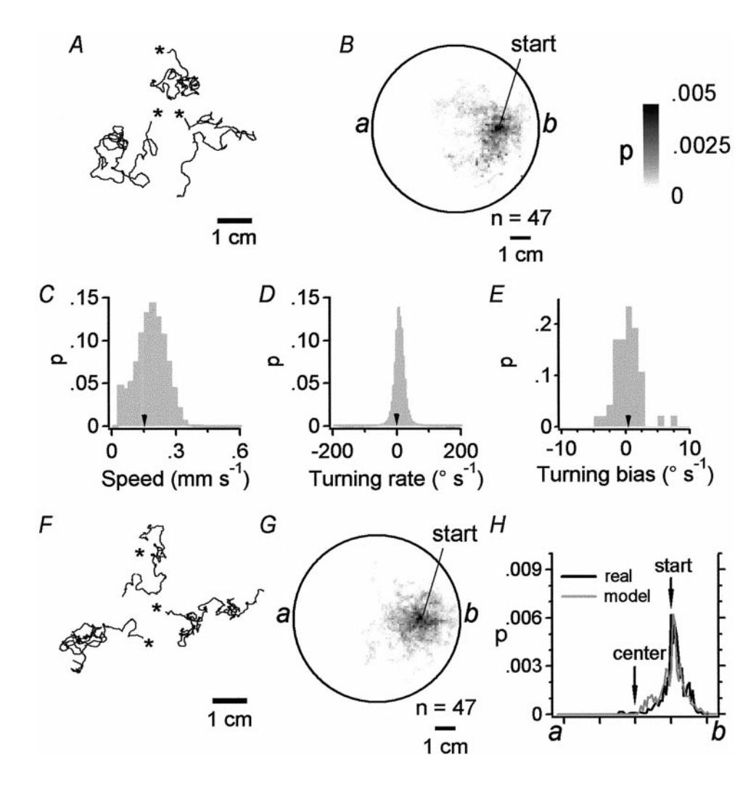

Figure 2. Dispersion of real and simulated worms in the absence of a chemical gradient. A, Tracks of three real worms moving in a spatially uniform concentration of attractant (2 mm NH4Cl). Individuals were allowed to wander for 20 min from their starting point (asterisk). Each animal was run separately. B, Probability-density plot for real worms (same conditions described in A). The gray scale (right) indicates the probability per unit area of finding a worm at a given location in the plate during a 20 min assay, computed from the tracking data of 47 individuals started from the indicated location in the plate. C-E, Distributions of instantaneous speed, turning rate, and turning biases for the animals tested in B. Arrowheads indicate the average speed [0.152  $\pm$  0.0702 mm sec $^{-1}$  ( $\pm$  SD)] and turning rate [0.861  $\pm$  38.9° sec $^{-1}$  ( $\pm$  SD)] for 41,954 samples and the turning bias  $[0.441 \pm 2.12^{\circ} \text{ sec}^{-1} \ (\pm \text{ SD})]$  for the 47 animals. F, Tracks of three simulated worms moving in a uniform concentration of attractant as described in A. G, Probability-density plot for 47 simulated worms (same conditions described in A) started from the indicated location in the plate. H, Probability-density cross sections from points a to b in B and G. The dispersion behavior of model and real animals was similar, as indicated by the degree of overlap of the cross sections. The inequality of areas under the curves in H is a result of taking the cross sections of the probabilitydensity plots.

points marking a worm's position at two successive sample points during data acquisition. The spatial vector was formed by connecting the first sample point and the center of the gradient. For a worm moving directly up the gradient,  $B=0^\circ$ ; for a worm moving directly down the gradient,  $B=\pm 180^\circ$ . The vector average of a bearing distribution was computed as the vector sum of the N angles in the distribution divided by N (Zar, 1984). The all-points histograms of bearing (see Fig. 12B) were constructed by treating the bearing value obtained for each individual worm at each sample point as an independent variate and computing the frequency at which each bearing was observed in  $20^\circ$  bins.

Instantaneous pirouette rate. For each animal, we constructed a matrix  $M = \{(e_i, r_i, dC/dt_{i-4}); i = 5, \dots, N\}, \text{ where } N \text{ is the number of sample } i = 1, \dots, N\}$ points in the animal's track and  $(e_i, r_i, dC/dt_{i-4})$  is a triplet describing the animal's behavioral state, instantaneous pirouette initiation rate, and stimulus condition, respectively. The component  $e_i$  was assigned one of three values according to the animal's behavioral state at sample interval i:  $e_i = 1$  if a pirouette was initiated during interval i;  $e_i = 0$  if a pirouette could have been initiated but was not; and  $e_i = -1$  if a pirouette could not have been initiated. There were two conditions in which pirouettes could not be initiated: (1) when the animal was already in the pirouette state and (2) when the animal was in a run state that had not yet surpassed  $t_{crit}$ (see Analysis of tracks in Results and Critical run duration in Materials and Methods). The component  $r_i$  was assigned the value  $e_i/\Delta t_i$  for  $e_i \neq -1$ ; for  $e_i = -1$ , the *i*th triplet was eliminated from the matrix. The component  $dC/dt_{i-4}$  was the value of dC/dt observed four sample points previously. The shift of four sample points approximated the time lag between the initiation of the pirouette motor program and the visible expression of the pirouette (see Fig. 7C,D). Matrices were pooled across animals, and the triplets were sorted by the value of  $dC/dt_{i-4}$  to extract an ordered series of pairs  $(r_i, dC/dt_{i-4})$ . Values of  $r_i$  were smoothed with a box filter and plotted against  $dC/dt_{i-4}$  (see Fig. 8).

Computer simulations. In simulations of "dispersion," a worm was

represented as a point whose position was updated at 1 sec intervals. Point displacement during each interval was computed from a randomly selected pair of speed and turning-rate values  $(v_i, d\theta/dt_i)$  sampled conjointly from the speed and turning-rate distributions of 47 real worms moving in the absence of a gradient (Fig. 2*C*,*D*; n = 41,954; see Eqs. 5, 6 below). Like real worms in behavioral assays, each point was allowed to move until it hit the edge of the simulated Petri plate or for the equivalent of 20 min, whichever was least. For comparison with the assays of Bargmann et al. (1993), a point was allowed to move for 1 hr. If a point hit the edge of the plate in these simulations, it was made to follow the edge until its computed displacement caused it to adopt a position inside the edge.

In simulations of "chemotaxis," separate sampling procedures were used for runs and pirouettes. During runs, the simulation sampled from the distributions of Figure 2, C and D, with the provision that sampling was confined to the range -50 to  $+50^{\circ}$  sec  $^{-1}$  (to eliminate the pirouettes from these distributions). During pirouettes, the simulation sampled from the change in bearing ( $\Delta B$ ) distribution of worms tested in a gradient (see Fig. 10B) and used the average speed during pirouettes [0.0747  $\pm$  0.0657 mm sec  $^{-1}$  ( $\pm$  SD); n=4308]. To preserve the correlation between the bearing before pirouettes ( $B_{\rm before}$ ) and  $\Delta B$  (see Fig. 10A, B), pairs of  $B_{\rm before}$  and  $\Delta B$  values were sorted into 20° bins according to their  $B_{\rm before}$  value, and sampling of  $\Delta B$  was restricted to the bin corresponding to the point's bearing at the time step immediately before the model pirouette.

Statistics. Unless indicated otherwise, averages are stated as mean  $\pm$  SEM.

# **RESULTS**

#### Dispersal behavior

As a prelude to studying chemotaxis, we examined the dispersion of worms in a spatially uniform concentration of attractant (2 mm

NH4Cl). Single, adult animals were started 22 mm from the center of a circular, agar-filled Petri plate and tracked for 20 min or until the worm reached the edge of the plate. The tracking system recorded the worm's position, speed, and turning rate at ;1 sec intervals. Individual worms (*n* 5 47) moved away from their starting location, leaving complex tracks (Fig. 2*A*) similar to those reported previously (Ward, 1973; Croll, 1975a). Population behavior was visualized in a probability-density plot made by digitally superimposing individual tracks and computing, for each location in a 1 mm 3 1 mm grid, the probability of an animal being observed there during a tracking assay. Probability was computed by dividing the amount of time that an animal was observed at a location by the total elapsed time during all 47 assays. For animals dispersing in a uniform concentration of attractant, probability density was highest at the starting position and decreased with distance from this point (Fig. 2*B*). Similar dispersal behavior has been observed in other species, including other nematodes (Berg and Brown, 1972; Croll and Blair, 1973; Croll, 1975b; Dethier, 1976).

The tracks of individual worms and their population behavior suggest that dispersion in *C. elegans* may involve a random walk. To test this idea, we constructed a stochastic model of worm movement. A worm was simulated as a point (*xt* , *yt* ) whose position in a simulated Petri plate was updated in 1 sec time steps, consistent with the sampling rate of the tracking system. At each time point *t* in the simulation, step length *lt* and direction u*t* were calculated as:

$$l_t = \Delta t \ v_t \tag{5}$$

$$\theta_t = \theta_{t-1} + \Delta t (d \theta_t / dt + \delta), \tag{6}$$

where *vt* is the instantaneous speed, du*t* /d*t* is the instantaneous turning rate (using the convention that du*t* /d*t* . 0 is a right turn and du*t* /d*t* , 0 is a left turn), d is the turning bias, and D*t* is the duration of the time step. A turning bias was chosen for each model worm by sampling randomly from the distribution of observed turning biases (Fig. 2*E*). Speed and turning rate were sampled randomly from their respective distributions (Fig. 2*C*,*D*) obtained from tracking data (Fig. 2*B*). In real worms, speed and the absolute value of turning rate showed a slight negative correlation (*r* 5 20.290; SE 5 0.0148; *p* , 0.001; data not shown), meaning that sharp turns slowed the animal down. To preserve this correlation in the model, we made use of the fact that, during tracking, values of speed and turning rate were recorded as pairs. The correlation was preserved by retaining the original pairing. As in the tracking experiments with real worms, the simulated worm was started 22 mm away from the center of the simulated Petri plate and allowed to move for the equivalent of 20 min or until it hit the edge of the plate.

The stochastic model reproduced worm behavior at the individual and population levels. Individual points made complex tracks leading away from the starting location (Fig. 2*F*) that looked like the tracks of real animals (Fig. 2*A*). Probability density for simulated worms (*n* 5 47) was highest at the starting position (Fig. 2*G*) as in the case of real worms (Fig. 2*B*). Dispersion of model and real worms was compared by plotting probability density along the cross section defined by the line between *points a* and *b* in Figure 2, *B* and *G*. This comparison showed that model dispersion was similar to real dispersion, because the cross-sectional probability densities were nearly identical. Statistical tests on the population behavior of model (*n* 5 500) and real (*n* 5 47) worms showed that they were indistinguishable, because

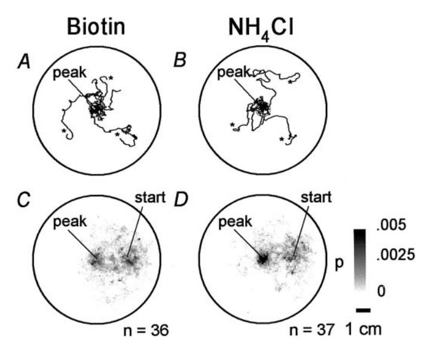

*Figure 3.* Chemotaxis behavior. *A, B*, *Tracks* of three worms moving in a radial Gaussian gradient of the attractants biotin (*A*) or NH4Cl (*B*) originating at the center of the plate ( *peak*). The *gray circle* indicates the region of the gradient peak used for statistical analysis. Starting points are indicated by an *asterisk*. Elapsed time is 20 min. Each animal was run separately. *C, D*, Probability-density plots for worms assayed in gradients of biotin (*C*) or NH4Cl (*D*). The probability (*C, D*) scale is indicated in *D*. Scale bar: *A–D*, 1 cm.

the percentage of animals reaching the center of the plate (real worms, 12.7%; model worms, 11.8%; *Z* 5 0.049; *p* . 0.05) and the percentage of animals reaching the edge of the plate (real worms, 19.5%; model worms, 21.2%; *Z* 5 0.27; *p* . 0.05) were not statistically different. As a further test of the population behavior of the model, we compared model and real worms in a standard population assay of dispersal behavior (Bargmann et al., 1993). Accordingly, model worms were started at the center of a simulated plate that contained two circular goals (radius 5 5 mm), located at opposite sides of the plate, and allowed to wander for the equivalent of 1 hr. The percentage of model worms (*n* 5 500) that reached either of the two goals (at least once) was counted and compared with the percentage for real animals (*n* 5 270) in the same assay using previously published data from an independent laboratory (Bargmann et al., 1993). Percentages for the model and real animals were almost the same (real worms, 11.1%; model worms, 10.8%; *Z* 5 0.127; *p* . 0.05). This result shows that the stochastic model accurately reproduced worm dispersal and that worm movement in a spatially uniform attractant is well described as a random walk. Below we use the stochastic model as a means of testing several theoretical mechanisms of *C. elegans* chemotaxis.

# **Chemotaxis**

We performed chemotaxis assays by tracking individual worms in radial Gaussian-shaped gradients of two attractants, biotin (*n* 5 36) and NH4Cl (*n* 5 37). As in previous studies (Ward, 1973; Bargmann and Horvitz, 1991), most animals reached the peak of the gradient (biotin, 55.6%; NH4Cl, 59.5%), defined as a circular region with a radius of 5 mm located at the center of the plate (Fig. 3). Animals tested in a gradient were significantly more likely to reach the center than were control animals tested in a uniform concentration of attractant [2 mM NH4Cl; 8.3%; *n* 5 47; x2 (2) 5 34.1; *p* , 0.0001]. This result shows that animals in the chemotaxis assays were performing well above chance level de-

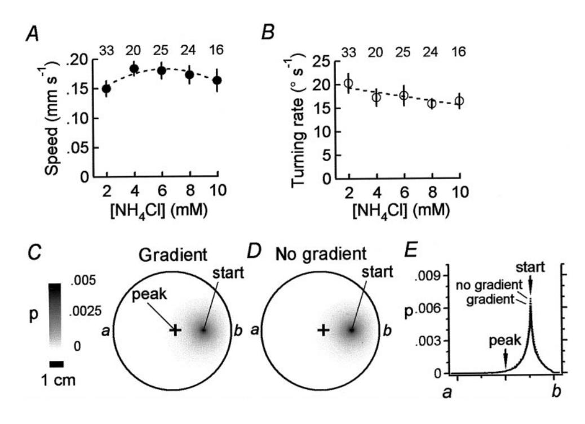

Figure 4. Kinesis behavior and model. A, B, Dependence of the average speed (A)and turning rate (B) of real worms on the absolute concentration of the attractant NH4Cl. Numbers above the circles indicate the sample size for each concentration group. Error bars represent 95% confidence intervals. The dashed line in A is the best-fitting quadratic function, and the dashed line in B is the best-fitting linear function. C, D, Probability-density plots for simulated worms in a radial gradient of  $NH_4Cl$  (C; 2–8 mM) and a uniform concentration of the same attractant (D; 2 mm). In model worms, speed and turning rate were determined by the concentration dependencies shown in A and B (n = 5000for each plot). The probability scale is shown in C; a plus sign indicates the peak of the gradient in C. Scale bar: C, D, 1 cm. E, Probability-density cross sections from points a to b in C and D. The concentration dependencies of speed and turning rate were not sufficient to produce accumulation at the peak of the gradient. The inequality of areas under the curves in E is a result of taking the cross sections of the probability-density plots.

spite the fact that some animals did not reach the peak of the gradient.

#### Kinesis behavior

Two main forms of chemotaxis have been identified in animals that are limited to sensing chemical concentration at a single point in space (Dunn, 1990). The first is a kinesis mechanism in which the animal modulates its speed (orthokinesis) or turning rate (klinokinesis) as a function of attractant concentration. The second is a taxis mechanism in which the direction of locomotion is correlated with the direction of the gradient  $(\partial C/\partial x, \partial C/\partial y)$  at the animal's location (Dunn, 1990).

To test whether C. elegans exhibits a kinesis mechanism in NH4Cl gradients, we measured the concentration dependence of instantaneous speed and turning rate by tracking animals (n =118) in agar-filled plates containing a uniform concentration of the attractant NH4Cl at 2, 4, 6, 8, or 10 mm. These values cover the range of concentrations encountered by animals in our chemotaxis assays (data shown in Fig. 3D). Average instantaneous speed, plotted against concentration, showed a significant quadratic trend (Fig. 4A; F = 8.89; df = 1; p < 0.01; n = 118). Average turning rate showed a significant linear trend (Fig. 4B; F = 7.40; df = 1; p < 0.01; n = 118). Thus, average instantaneous speed and turning rate were weakly dependent on concentration. Are the observed concentration dependencies sufficient for chemotaxis? This question was addressed by imposing these dependencies on the stochastic model to see whether it now exhibited chemotaxis. The concentration dependence of speed was incorporated in the model by making the mean of the instantaneous speed distribution a function of the attractant concentration C. Thus, the concentration-dependent speed  $v_t$  at location (x, y) was given by the expression:

$$v_t'(x, y) = v_t - v_0 + \bar{v}(C[x, y]), \tag{7}$$

where  $v_t$  is an element randomly selected at time t from the observed instantaneous speed distribution in 2 mm attractant (Fig. 2C),  $v_0$  is the mean of the instantaneous speed distribution

at 2 mm, and  $\bar{v}(C[x, y])$  is the quadratic fit to the data shown in Figure 4A. Similarly, the concentration dependence of turning rate was incorporated by making the mean of the instantaneous turning-rate distribution a function of attractant concentration. Thus, the concentration-dependent turning rate  $r_t$  at location (x, y) was given by the expression:

$$r'_t(x, y) = r_t - r_0 + \bar{r}(C[x, y]) + \Delta t \delta, \tag{8}$$

where  $r_t$  is the value of the turning rate paired with  $v_t$  from the observed instantaneous turning-rate distribution in 2 mm attractant (Fig. 2D),  $r_0$  is the mean of the instantaneous turning-rate distribution at 2 mm,  $\bar{r}(C[x,y])$  is the linear fit to the data shown in Figure 4B,  $\Delta t$  is the time step, and  $\delta$  is the turning bias selected as in the dispersion model. In Equations 7 and 8, C[x,y] was determined by the diffusion equation (see Materials and Methods).

Probability density for simulated worms (n = 5000) was plotted for two different conditions: in the presence of a gradient to test for chemotaxis (Fig. 4C) and in the absence of a gradient (spatially uniform attractant concentration, 2 mm NH4Cl) to measure simple dispersion (Fig. 4D). The effect of the imposed concentration dependence was assessed by comparing cross-sectional probability density as described above. Cross-sectional probability for the two conditions was nearly identical, indicating that the observed concentration dependence of speed and turning rate was not sufficient to cause accumulation at the peak of the gradient. Thus, it is unlikely that C. elegans accumulates at the peak of the NH4Cl gradient in our assays by a kinesis mechanism.

## Taxis behavior

Finding no evidence of chemotaxis by a kinesis mechanism, we searched for correlations between chemosensory input and changes in orientation that might be consistent with a taxis mechanism. As a first step, we examined the tracks of individual worms during the chemotaxis assays of Figure 3, C and D. Like spontaneous locomotion, locomotion during chemotaxis comprised a series of runs punctuated by turns, as described previ-

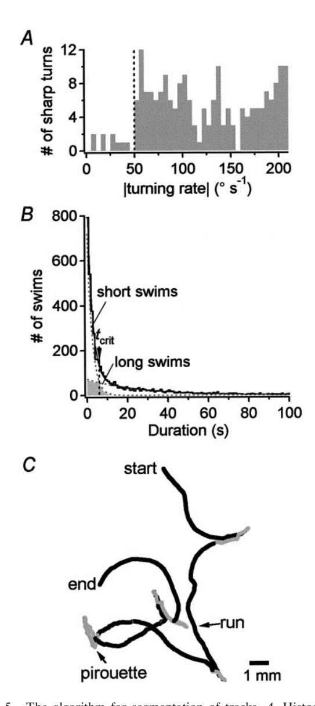

*Figure 5.* The algorithm for segmentation of tracks. *A*, Histogram of turning rates associated with visually identified sharp turns (reversals and/or omega turns; *n* 5 366). The histogram shows that 97.5% of all sharp turns were associated with a turning rate \$50° sec 21 (*vertical dashed line*). This value was used to identify sharp turns objectively. *B*, Histogram of swim durations. Swims were defined as track segments between sharp turns defined by the 50° sec 21 cutoff identified in *A*. The swim-duration histogram is well fit by the sum of two exponentials (*solid line*) indicating the existence of distinct long- and short-swim states. The predicted longand short-swim distributions are shown as *dashed lines*. The *vertical dashed line* beneath the *arrow* indicates the critical swim duration (*t*crit 5 6.05 sec) that minimizes the probability of misclassifying a swim as long or short. Intervals whose duration was greater than or equal to *t*crit were assumed to be long swims (later identified as runs); intervals whose duration was less than *t*crit were assumed to be short swims. Episodes of one or more consecutive short swims (and the associated turns) are called pirouettes because they were brief and usually resulted in large changes in direction. The *shaded region under* the *dashed lines* indicates the predicted number of misclassified swims. *C*, A track segmented according to *t*crit. Long swims (runs) are *black*; short swims and turns (pirouettes) are *gray*.

ously (Ward, 1973). In our assays, turns generally resulted in a substantial change in a worm's orientation with respect to the gradient. Thus, if turns were triggered appropriately, they could function to orient a worm in a taxis mechanism. To test this idea,

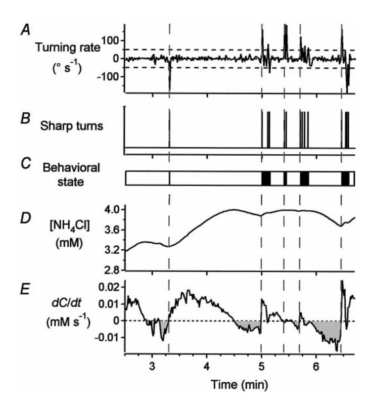

*Figure 6.* The correlation between concentration changes and the initiation of pirouettes. These data (*A*–*E*) were recorded from a single animal during a typical chemotaxis assay. *A*, Instantaneous turning rate. *Dashed horizontal lines* indicate the 50° sec 21 threshold for identifying sharp turns. *B*, Sharp turns identified as threshold crossings in *A*. Note that sharp turns often occur in bursts. *C*, Runs (*white*) and pirouettes (*black*) distinguished by the algorithm described in Figure 5. *D*, Estimated attractant concentration at the worm's location in the plate (see Materials and Methods). *E*, Rate of change of attractant concentration (d*C*/d*t*). The *shaded regions* indicate d*C*/d*t* , 0. Note that pirouettes were usually preceded by episodes in which d*C*/d*t* , 0 (*dashed vertical lines).*

however, we needed an objective procedure to segment worm tracks into runs and turns. Development of the segmentation procedure involved three steps.

#### *Analysis of turns*

Inspection of the videotapes from which the data of Figure 3, *C* and *D,* were derived revealed that the turning events separating consecutive runs were composed of omega turns and reversals, the two main forms of turning behavior in *C. elegans* (Croll, 1975a). For a randomly selected subpopulation of 30 animals from Figure 3, *C* and *D*, single omega turns accounted for 43% of turning events, and single reversals accounted for 17% of turning events. Because individual omega turns and reversals produced larger changes in direction than did the deviations that occur during runs, we refer collectively to single omega turns and reversals as "sharp turns." Bouts of frequent turning, comprising two or more sharp turns in close succession, accounted for 40% of turning events. We shall refer to turning bouts as "pirouettes," and for simplicity, we shall also use this term to refer to turning events composed of a single sharp turn. Thus, a pirouette is a series of one or more sharp turns separating consecutive runs.

### *Analysis of turning rate*

We developed an algorithm to identify sharp turns on the basis of the turning rate du/d*t.* First, we visually identified all sharp turns (*n* 5 366) in a group of 15 animals randomly selected from the

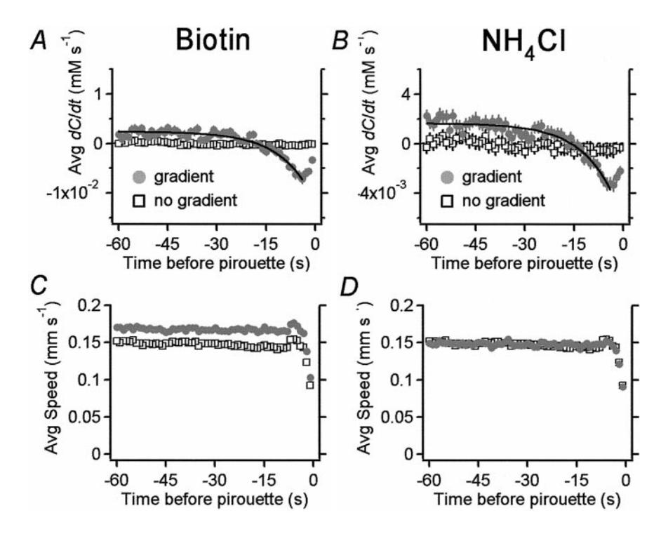

Figure 7. Prepirouette averages. A, B, The prepirouette average of dC/dt for animals in biotin (A) and NH4Cl (B) gradients (solid circles). The averages are well fit by single exponentials (solid lines) having time constants  $\tau = 9.45$  sec for biotin and  $\tau = 10.0$  sec for NH4Cl. For comparison, the prepirouette average was also computed for animals tested in a uniform concentration of attractant (2 mm NH4Cl; data from Fig. 2B) as if the same gradient were present (open squares). C, D, The prepirouette average of speed for the same animals in biotin (C) and NH4Cl (D) gradients (solid circles). The prepirouette average of speed for the animals in a uniform concentration of attractant (open squares) is shown for comparison in C and D. In A, C, and D, error bars representing SEM are smaller than some or all of the markers.

populations in Figure 3, C and D. A histogram of the absolute value of the turning rate  $|d\theta/dt|$  associated with each visually identified sharp turn (Fig. 5A) showed a discontinuity at 50° sec-1, with 98% of all sharp turns falling in the range 50–210° sec-1. Thus, we classified periods in a worm's track in which  $|d\theta/dt| > 50^\circ$  sec-1 as sharp turns; we classified periods in which  $|d\theta/dt| \le 50^\circ$  sec-1 as swims. Using 50° sec-1 as a threshold for detecting sharp turns, we analyzed the time series of  $|d\theta/dt|$  for the tracking data of a different randomly selected set of 30 animals from the same population and found a 100% correspondence between threshold crossings and the occurrence of a visually identified sharp turn. This test showed that we could identify sharp turns with confidence simply by noting when  $|d\theta/dt|$  exceeded the turning-rate threshold.

## Analysis of tracks

Segmenting a track into runs and pirouettes was complicated by the fact that pirouettes often occurred as clusters or bursts of turns, each separated by a short interval of swimming. Thus, many of the short swimming intervals appeared to be components of pirouettes rather than of runs. To distinguish between runs and pirouettes, therefore, we computed the histogram of all swimming intervals (Fig. 5B) from the data of Figure 3, C and D. The histogram was well fit by the sum of two exponentials, suggesting a kinetic model in which there are two distinct swimming states: one in which the sharp-turn probability is low, yielding mostly long swims, and one in which the sharp-turn probability is high, yielding mostly short swims. In such a model both states are theoretically capable of generating long or short swims, so we used a probabilistic method to distinguish between long and short swims in the data. This method involved computing  $t_{crit}$ , the swim-duration threshold that minimized the number of mistakes made in classifying a swim as long or short (see Materials and Methods). Swims with durations greater than or equal to  $t_{crit}$  were assumed to be long swims; swims with durations less than  $t_{crit}$ were assumed to be short swims. Tracks were segmented into runs and pirouettes by defining runs as long swims and defining pirouettes as track regions composed of sharp turns and short swims (Fig. 5C).

The segmentation procedure revealed a striking correlation between chemosensory input and pirouettes. Figure 6 shows the analysis of 4 min of representative tracking data from an animal performing chemotaxis. Sharp turns (Fig. 6B) were identified by noting the times at which  $d\theta/dt$  (Fig. 6A) exceeded the turningrate threshold. Runs and pirouettes, as defined by the segmentation procedure operating on the sharp-turn record, are shown in Figure 6C. Pirouettes tended to occur after episodes in which the animal moved down the gradient, visible as regions of negative slope in the plot of estimated attractant concentration versus time (Fig. 6D). The correlation between pirouettes and movement down the gradient can be seen more easily in the *trace* showing the time derivative of estimated attractant concentration (Fig. 6E). In four out of five cases in the data shown, the pirouette occurred after an episode in which dC/dt < 0. We found no correlation between pirouettes and other measures such as C or  $d^2C/dt^2$ . Thus, it appears that an episode in which dC/dt < 0constitutes the sensory event that triggers a pirouette. An analogous reaction has been observed previously in the response of tethered worms to imposed decreases in attractant concentration (Dusenbery, 1980).

To examine the reliability of the correlation between pirouettes and episodes in which  $\mathrm{d}C/\mathrm{d}t < 0$ , we computed the ensemble average of  $\mathrm{d}C/\mathrm{d}t$  values before each pirouette, which we call the "prepirouette average." The prepirouette average of  $\mathrm{d}C/\mathrm{d}t$  shows the typical time course of  $\mathrm{d}C/\mathrm{d}t$  leading up to a pirouette. For animals in the biotin and NH4Cl assays (Fig. 7*A*,*B*), the averages were negative for ~15 sec before each pirouette, consistent with a reliable correlation between pirouettes and episodes in which  $\mathrm{d}C/\mathrm{d}t < 0$ . At times >15 sec before each pirouette, the averages were positive, indicating movement up the gradient. The time course of the prepirouette averages of  $\mathrm{d}C/\mathrm{d}t$  suggests that worms moving up the gradient eventually drift off course, leading to an episode of  $\mathrm{d}C/\mathrm{d}t < 0$  that triggers a pirouette. As a control, we

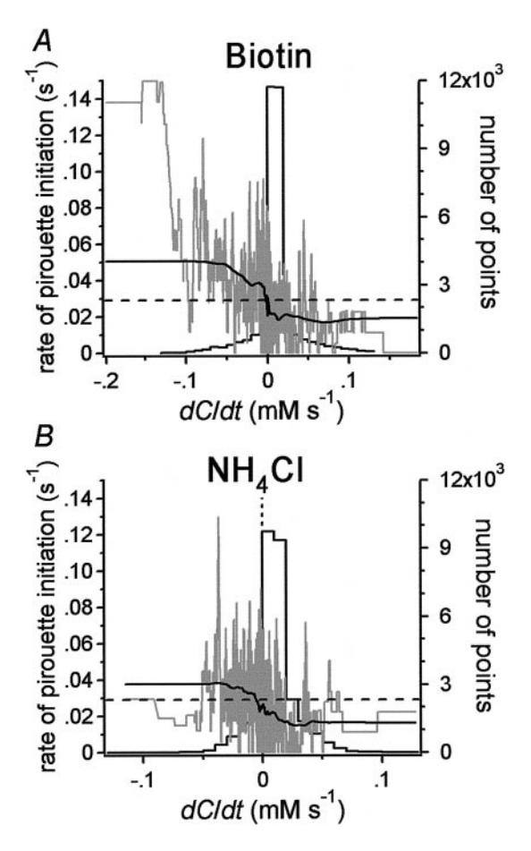

Figure 8. Pirouette initiation rate as a function of dC/dt. A, B, Black lines represent the instantaneous pirouette initiation rate as a function of the value of dC/dt occurring 4 sec previously for animals in biotin (A) and NH4Cl (B) gradients. Each mean spontaneous pirouette initiation rate is represented by a horizontal dashed line. The data have been smoothed with a box filter with a width of 4001 points. Gray lines represent the same data with minimal smoothing (box width = 101 points). There were 32,458 points in the biotin data set and 29,171 points in the NH4Cl data set. Histograms (formed by black lines) show the number of data points as a function of dC/dt.

tracked animals in a uniform concentration of attractant (2 mm  $NH_4Cl$ ; data from Fig. 2B) but computed the prepirouette average of dC/dt as if a typical biotin or  $NH_4Cl$  gradient were present. As expected, pirouettes in control animals were not correlated with dC/dt, because the prepirouette averages of dC/dt for control animals were flat (Fig. 7A,B). Such pirouettes are most likely spontaneous in origin, consistent with previous observations (Croll, 1975a, 1976; Chiba and Rankin, 1990).

The prepirouette averages of dC/dt for worms in biotin and NH4Cl gradients reached a minimum ~4 sec before the pirouette and then rose slightly until the pirouette occurred (Fig. 7*A*,*B*). The rise in dC/dt could reflect a progressive improvement in orientation or simply a decrease in speed. Examination of the direction of locomotion with respect to the gradient peak for all worms in each of the 4 sec before a pirouette showed that orientation continued to worsen during this period (data not shown). This result suggests that the rise in dC/dt is not attributable to improved orientation. In contrast, examination of the prepirouette average of speed revealed a sharp deceleration in the 4 sec leading up to a pirouette (Fig. 7*C*,*D*). We conclude that the rise in dC/dt is attributable to a drop in speed before pirou-

ettes. This result suggests that the animal may detect that it has drifted off course several seconds before the pirouette starts. Similar decelerations were observed in animals tested in the absence of a gradient (Fig. 7*C*,*D*). This observation suggests that changes in direction are the result of a two-step motor program in which the animal slows down and then does a pirouette.

We noted that the average speed of animals in the presence of biotin was higher than that in the absence of biotin (Fig. 7C). This result suggests the possibility that speed in biotin is concentration dependent. However, we found no correlation between instantaneous speed and biotin concentration (r = 0.006; n = 33,164; p > 0.05) in the tracking data for worms tested in a biotin gradient. This result argues against a kinesis effect in the biotin assay.

Because the initiation of pirouettes was correlated with episodes in which dC/dt < 0, one might expect that the rate of pirouette initiation r would be higher for animals in a gradient than for animals in a uniform concentration of attractant, where dC/dt = 0. This was not the case, however, because an ANOVA revealed no significant differences in the mean r (F = 2.60; df = 2; p > 0.05) for animals in a biotin gradient (n = 36;  $r = 0.0234 \pm 0.0234$  $0.00205 \text{ sec}^{-1}$ ), an NH4Cl gradient (n = 37;  $r = 0.0264 \pm 0.00136$  $\sec^{-1}$ ), and a uniform concentration of attractant (n = 47; r =  $0.0296 \pm 0.00213 \text{ sec}^{-1}$ ). Plotting r against dC/dt (Fig. 8) revealed a sigmoidal relationship in which r rises above the spontaneous rate (measured in a uniform concentration of attractant) in the region where dC/dt < 0 and r is suppressed below the spontaneous rate in the region where dC/dt > 0. The sigmoidal relationship shows that the worms detected increases as well as decreases in attractant concentration, as demonstrated previously (Dusenbery, 1980). The fact that r is suppressed when the worm is going up the gradient may explain the absence of the expected relationship between r and the presence or absence of a gradient.

#### The function of pirouettes in chemotaxis

To determine how pirouettes contribute to chemotaxis, we studied the distribution of orientations before pirouettes in the tracking experiments of Figure 3, C and D. Orientation was defined in terms of the bearing B with respect to the peak of the gradient, where  $B = 0^{\circ}$  means movement directly up the gradient and B =±180° means movement directly down the gradient. The bearing was calculated from worm tracks as described in Materials and Methods. The distributions of bearings before pirouettes,  $B_{\text{before}}$ , had a peak near ±180° and a trough near 0° in the NH4Cl and biotin groups (Fig. 9A1,B1). To control for nonspecific bias in the bearing distributions, we also examined the distribution of bearings before pirouettes with respect to the center of the plate for worms in a uniform concentration of attractant using the data of Figure 2B. The distribution of  $B_{\text{before}}$  was flat (Fig. 9C1), indicating that the shape of the  $B_{\text{before}}$  distributions for animals tracked in a gradient does not reflect a response to nonspecific cues in the testing environment. Taken together, these results show that pirouettes were most likely to occur when an animal was headed down the gradient and least likely to occur when an animal was headed up the gradient. Thus, one function of pirouettes may be to terminate runs that have veered down the gradient. In agreement with this idea, we found a positive correlation between the chemotaxis performance of individuals (chemotaxis index  $I^{\mathrm{che}}$ ; see Materials and Methods) and their average value of  $|B_{\text{before}}|$  (biotin, r = 0.402; p < 0.05; NH4Cl, r = 0.651; p < 0.001).

Pirouettes could contribute to chemotaxis by randomizing the animal's orientation or, in a more complex mechanism, by correcting the animal's course (Daykin et al., 1965; Green, 1966;

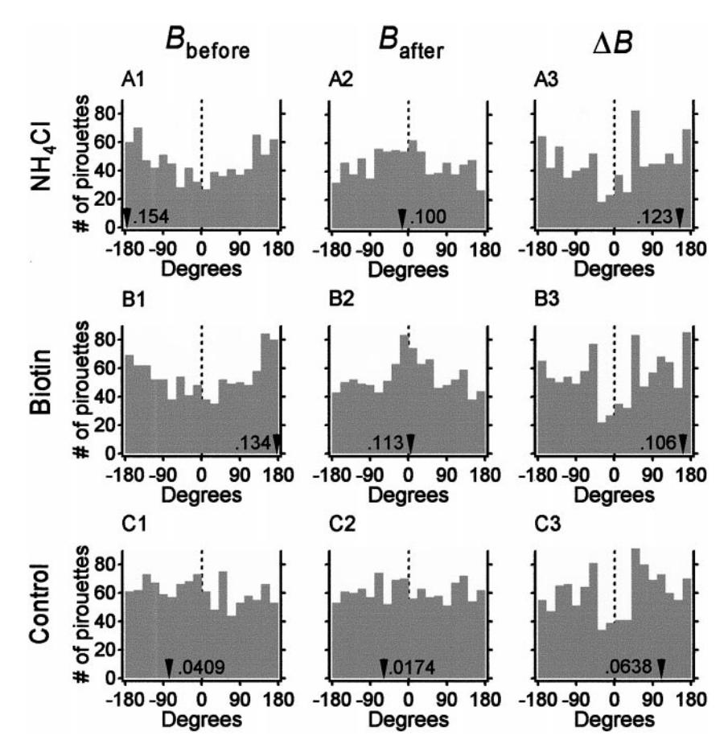

Figure 9. Analysis of bearing distributions. Histograms of bearings immediately before pirouettes ( $B_{\rm before}$ ), bearings immediately after pirouettes ( $B_{\rm after}$ ), and changes in bearing ( $\Delta B$ ) are shown in their respective columns. A1–3, NH4Cl group. B1–3, Biotin group. C1–3, Animals tested in a uniform concentration of attractant (2 mM NH4Cl; data from Fig. 2B) but analyzed as if a gradient were present. Arrowheads indicate the angle of the vector average for each distribution. The accompanying numbers indicate the corresponding vector magnitude. The number of pirouettes are 972 for the biotin group, 816 for the NH4Cl group, and 1099 for the control group.

Berg and Brown, 1972). These two mechanisms can be distinguished by the shape of the distribution of bearings after pirouettes,  $B_{after}$ . A distribution with a peak near  $0^{\circ}$  would reflect a reorientation mechanism, whereas a flat distribution would reflect a random mechanism. The  $B_{\text{after}}$  distributions (Fig. 9A2,B2) had a significant peak near 0° [modified Rayleigh test (Zar, 1984);  $NH_4Cl$ , n = 816; u = 3.83; p < 0.001; biotin, n = 972; u = 4.87; p < 0.001), showing that chemotaxis in C. elegans involves course correction. The  $B_{\text{after}}$  distribution for the control animals tested in a uniform concentration of attractant was flat (n = 1099; u =0.351; p > 0.05; Fig. 9C2), arguing against a response to nonspecific cues in the testing environment. Thus, a second function of pirouettes is to reorient the animal. In agreement with this idea, we found a negative correlation between the chemotaxis performance of individuals and their average value of  $|B_{after}|$  (biotin, r =-0.384; p < 0.05; NH4Cl, r = -0.575; p < 0.001).

How do pirouettes correct the animal's course? One simple possibility is that pirouettes cause the animal to reverse course. Course reversal, coupled with the observed tendency to initiate pirouettes when heading down the gradient (Fig. 9A1,B1), would result in a  $B_{\rm after}$  distribution with a peak at 0°. To examine this possibility, we analyzed the change in bearing,  $\Delta B = B_{\rm after} - B_{\rm before}$ , associated with each pirouette for animals in the gradient and control groups. In the gradient groups (Fig. 9A3,B3), the  $\Delta B$  distributions had a broad, flat peak centered near  $\pm 180^\circ$ . The shape of the  $\Delta B$  distributions indicates that large changes in bearing were more frequent than very small ones, a pattern that reflects a tendency to approximately reverse course. Note that the  $\Delta B$  distributions for the control group (Fig. 9C3) were similar to the  $\Delta B$  distributions for the gradient groups, implying that the  $\Delta B$ 

distribution is to some extent a property of the pirouette motor program itself and not a directed response to the chemical environment.

To determine whether an approximate course-reversal mechanism was sufficient to account for the degree of reorientation evident in the  $B_{after}$  distribution, we estimated numerically the  $B_{\rm after}$  distribution that would result if the change in bearing associated with each pirouette were random. This was done by adding to each entry in the pooled  $B_{\mathrm{before}}$  distribution for both gradient groups (Fig. 10A) a randomly selected entry from the pooled  $\Delta B$  distribution for the same groups (Fig. 10B) and repeating this process 10,000 times to obtain a distribution of  $B_{\rm after}$  values. In contrast to the pooled  $B_{\rm after}$  distribution, the estimated  $B_{\text{after}}$  distribution was essentially flat (Fig. 10C, black line). This result indicates that the pattern of course reversal exhibited by real worms is not sufficient to correct the animal's course. It further suggests that the degree of course correction exhibited by real worms requires that the original association between each  $B_{\mathrm{before}}$  and its corresponding  $\Delta B$  be maintained.

To understand why this association was essential for course correction, we plotted  $\Delta B$  against  $B_{\rm before}$  for the gradient and control groups. The plot for the gradient group (Fig. 10D) had a broad cluster of points centered near  $B_{\rm before}=\pm180^{\circ}$  and  $\Delta B=\pm180^{\circ}$ , whereas the data for the control group were uniformly distributed (Fig. 10E). During chemotaxis, therefore, large changes in bearing were specifically associated with large values of  $B_{\rm before}$ . Because  $B_{\rm before}$  measures the degree to which the animal was off course before the pirouette, this result shows that pirouettes correct the animal's course by compensating for large errors in orientation. No such error compensation was apparent

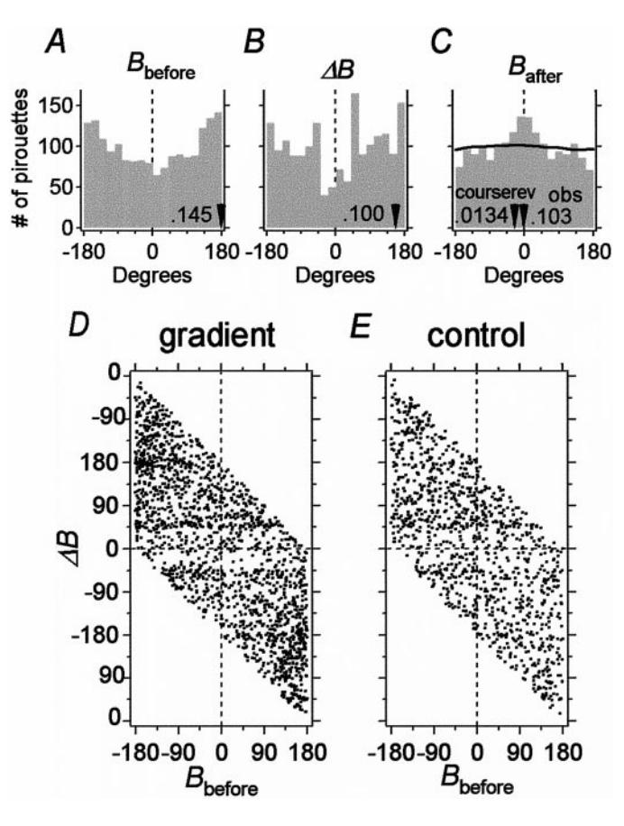

Figure 10. Analysis of pirouettes in terms of two possible coursecorrection mechanisms. A-C, Absence of a course-reversal mechanism. A, Histogram of  $B_{\rm before}$  values for the pirouettes of animals in the gradient groups (biotin and NH4Cl combined). B, Histogram of  $\Delta B$  values for the animals in A. C, Comparison of course-reversal (black line; courserev) and observed (gray bars; obs) histograms of  $B_{\text{after}}$  values for the animals in A. The course-reversal  $B_{\text{after}}$  histogram was generated by sampling randomly from the  $\Delta B$  histogram in B. Arrowheads indicate the angle of the vector average for each distribution; the accompanying numbers indicate the magnitude of the vector average. D, E, Presence of an error-compensation mechanism. Plots of  $\Delta B$  against  $B_{\rm before}$  for pooled data of animals tested in a gradient (D; n = 1788) and data for control animals (E; n = 1099) tested in a uniform concentration of attractant (2 mm NH4Cl) are shown. Control data are from Figure 2B, analyzed as if a gradient were present. The  $\Delta B$  axis is extended beyond  $\pm 180^{\circ}$  so that it is easier to see the cluster of points centered near  $B_{\rm before} = \pm 180^{\circ}$  and  $\Delta B = \pm 180^{\circ}$ . Although the  $\Delta B$  axis is periodic, each data point is represented only once, resulting in the blank triangular regions above and below the data.

in the range  $-90^{\circ} < B_{\rm before} < 90^{\circ}$  in which orientation errors are small.

# Computer simulations of chemotaxis

The foregoing analysis suggests a strategy in which chemotaxis is achieved by a series of pirouettes that reorient the animal to the gradient by a course-correction mechanism. To test whether this mechanism is quantitatively sufficient to produce chemotaxis in our assays, we constructed a computer model. If the course-correction mechanism were sufficient, it would bias the random dispersion of model worms toward the peak of the gradient. The chemotaxis model was made by superimposing the course-correction mechanism on the stochastic model of dispersion (Fig. 2F,G). In the model, pirouettes were triggered with a rate r that depended on the instantaneous value of dC/dt according to the sigmoidal relationships between r and dC/dt shown in Figure 8.

Pirouettes were modeled as instantaneous changes in direction determined by sampling from the  $\Delta B$  distribution to preserve the observed correlation between  $\Delta B$  and  $B_{\rm before}$  (see Materials and Methods). Chemotaxis in biotin and NH4Cl gradients was modeled separately using the r versus dC/dt relationship obtained from real animals in the appropriate attractant.

The chemotaxis model qualitatively reproduced the behavior of individual animals in that it produced oriented movement up the gradient and dwelling at the peak (Fig. 11A,D). The model also qualitatively reproduced the behavior of populations, because the probability distribution of the model was biased toward the peak of the gradient (Fig. 11B,E), like the probability distribution for real animals (Fig. 3C,D) and unlike the probability distribution for dispersion in a uniform concentration of attractant (Fig. 2B,G). Statistical comparisons of cross-sectional probability for the chemotaxis model and the dispersion model (Fig. 11C,F) showed that the behavior of the chemotaxis model differed significantly from the behavior of the dispersion model (biotin, n = 18000; F = 268.0; df = 1; p < 0.001; NH4Cl, n = 0.00118000; F = 340.1; df = 1; p < 0.001). In addition, the average distance to the peak of the gradient for the duration of the assay for individuals in the chemotaxis model was significantly less than the average distance to the peak in the dispersion model [biotin,  $t_{(2),198} = 17.2; p < 0.001; NH4Cl, t_{(2),198} = 11.4; p < 0.001].$  These results show that the course-correction mechanism is sufficient to bias the random dispersion of worms toward the direction of the

Comparison of the probability distributions (Fig. 11B,E) and the cross-sectional probability (Fig. 11C,F) for the model and real worms showed that model worms underperformed real worms in quantitative terms. The discrepancy could have at least three sources. First, tests of the analysis procedure used to estimate the relationship between r versus dC/dt showed that the procedure systematically underestimates r in the region where dC/dt < 0 if the data are sparse. Thus, the actual values of r in this region could be somewhat higher. In agreement with this idea, we found that when the model was modified such that for dC/dt < 0, r =0.08, the model reproduced the behavior of the real animals in the NH4Cl gradient (data not shown). Second, the model did not incorporate the low-pass filter (Fig. 7A,B) that could enhance performance by preventing responses to sudden changes in dC/dt. Third, it is possible that one or more unidentified mechanisms act in parallel with the course-correction mechanism to enhance performance in real worms.

As a further test of the model, we asked whether it could predict the behavior of worms in a novel gradient. This was done by computing the tracks of animals chemotaxing in a planar gradient instead of the usual radial one. Model worms traveled up the simulated gradient, often at an angle to the line of steepest ascent (Fig. 12A). Thus an all-points histogram (see Materials and Methods) of bearing data, pooled across all model worms (n = 50), revealed a broad peak at  $0^{\circ}$  (Fig. 12B, solid line) rather than a sharp one. After testing real animals (n = 28) in identical planar gradients, we found similar behavior at the level of the individual worms (Fig. 12C) and the all-points histogram (Fig. 12B, dotted line). Thus the model qualitatively and quantitatively predicts chemotaxis behavior in a novel planar gradient.

# **DISCUSSION**

By tracking individual worms in well-defined concentration gradients, we have identified a behavioral strategy that is sufficient to account for the main features of chemotaxis in *C. elegans*. In this

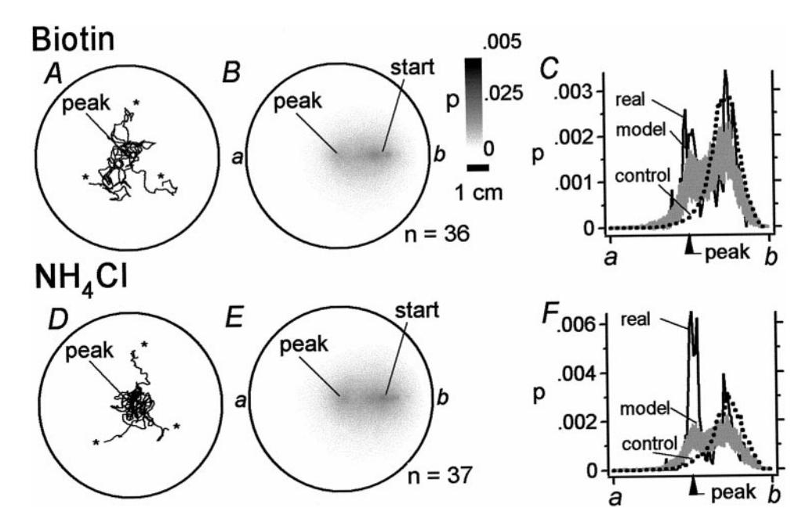

*Figure 11.* Quantitative reconstruction of chemotaxis behavior in *C. elegans* for radial gradients of attractant. *A–C,* Biotin group. *D–F,* NH4Cl group. *A, D*, *Tracks* of three simulated worms moving in radial gradients. Chemotaxis was modeled by imposing the course-correction mechanism on the dispersion model of Figure 2, *F* and *G*. Simulated worms were allowed to move for the equivalent of 20 min. *B*, *E*, The average probability-density plots for 100 batches of simulated worms (number of worms per batch indicated by *n*) in radial gradients. Probability is displayed according to the *gray scale* on the *right* in *B. C, F*, Cross sections of probability density (from *points a* to *b* in *B, E*) for real animals (*black lines*) in Figure 3, *C* and *D*, and model animals ( *gray lines*) in *B* and *E* in radial gradients; *vertical lines* represent SD in probability density (model only). The cross-sectional probability for the model tested with no gradient is shown for comparison (*dotted lines*). The inequality of *areas under* the *curves* in *C* and *F* is a result of taking the cross sections of the probability-density plots. Starting points are indicated by *asterisks* in *A* and *D*. Scale bar: *A, B, D, E*, 1 cm.

strategy, the probability of an abrupt change in direction, called a pirouette, rises when the time derivative of attractant concentration d*C*/d*t* , 0 and falls when d*C*/d*t* . 0. Pirouettes contribute to chemotaxis by reorienting a worm. Reorientation is achieved by a course-correction mechanism in which the size of a turn is weakly correlated with the degree to which the animal was off course just

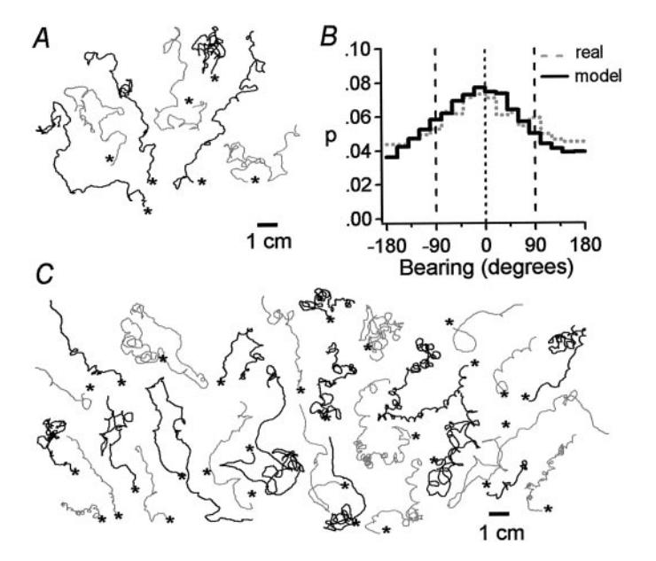

*Figure 12.* Predicted and actual chemotaxis behavior in a novel planar gradient of attractant. *A*, *Tracks* of 7 simulated worms moving in a planar gradient (concentration ranged from 0 to 100 mM NH4Cl over a distance of 10 cm). Individuals were allowed to wander for the equivalent of 20 min from their starting position (*asterisk*). *B*, An all-points histogram of bearing values for model (*solid line*) and real (*dotted line*) worms. Bearing values between 690° (*vertical dashed lines*) indicate movement up the gradient. *C*, *Tracks* of 28 real worms moving in a planar gradient of NH4Cl identical to the simulated planar gradient in *A*. Each animal was run separately. *Line color* ( *gray* or *black*) is used merely to distinguish neighboring tracks. Scale bar: *A, C*, 1 cm.

before the pirouette. A computer simulation of the coursecorrection strategy, based on the movement statistics of real worms and containing no free parameters, showed that the course-correction strategy is sufficient to bias the random dispersion of model worms toward the peak of a Gaussian gradient. Moreover, it accurately predicted the behavior of real worms tested in a novel planar gradient. Qualitative observations of chemotaxis behavior in other species of nematodes suggest that pirouettes may contribute to chemotaxis in these species as well (Green, 1966).

Previous observations support the view that pirouettes in *C. elegans* are triggered by episodes in which d*C*/d*t* , 0 and are suppressed by episodes in which d*C*/d*t* . 0. Individual worms tethered by the tail in a pool of buffer exhibit behavioral correlates of runs and pirouettes (Dusenbery, 1980). Under these conditions, a sudden drop in the concentration of the attractant NaCl in the buffer (50–0 mM at 210 mM sec 21 ) causes a transient increase in the probability of pirouette-like behavior. A sudden increase in the concentration of NaCl (0–50 mM at 10 mM sec 21 ) causes a slight suppression of pirouette-like behavior in tethered worms. Our work extends these observations in three ways. First, we have shown that pirouette probability is modulated during chemotaxis in freely moving animals. Second, we found that pirouette probability is sensitive to changes in attractant concentration in the physiological range (1–10 mM sec 21 ; Fig. 7*A*,*B*). Third, we have shown that pirouettes reorient the animal (Fig. 9*A*2,*B*2), a finding that could not have been determined in a tethered-animal study.

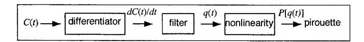

*Figure 13.* Conceptual model for *C. elegans* chemotaxis. Attractant concentration *C*(*t*) modulates pirouette probability *P*[*q*(*t*)] by a three-stage process involving differentiation, low-pass filtering, and a nonlinearity that maps filter output *q*(*t*) to pirouette probability *P*[*q*(*t*)]. Note that the order of the first two stages of processing could be reversed if the biological system is approximately linear.

## **Evidence of an alternative chemotaxis strategy**

The pirouette model differs substantially from the *C. elegans* chemotaxis strategy proposed previously by Ward (1973) on the basis of behavioral analysis of mutants. Ward found that *unc*-*23* mutants, forced to swim in arcs or tight curls because their heads rest at an angle to the body, nevertheless travel fairly directly to the peak of the gradient. This result was interpreted to mean that wild-type animals perform chemotaxis by pointing the tip of the head up the gradient, like a weather vane pointing into the wind. We find no direct evidence of the weather vane strategy, which in its strongest form would result in long runs pointed straight up the gradient, because we failed to observe this in both radial and planar gradients. We cannot rule out the possibility, however, that a weak weather vane strategy operates in parallel with the coursecorrection model, making runs better oriented than they might otherwise have been. Indeed, perhaps the reason that the real worms performed better than model worms in the radial gradient is that real worms use both a course-correction strategy and a weather vane strategy. We also cannot rule out the possibility that the weather vane strategy exists as a default mechanism when the course-correction strategy is inactivated or when animals are in steeper gradients.

#### **Comparison with bacterial chemotaxis**

The pirouette strategy for chemotaxis in *C. elegans* resembles the strategy used by the bacterium *E. coli* (Berg and Brown, 1972), but the *C. elegans* strategy is more efficient. In both strategies, locomotion during chemotaxis consists of episodes of fairly straight swimming (called runs) punctuated by sudden, large turns (pirouettes in *C. elegans* and tumbles in *E. coli*). The two strategies are similar in that the probability of a turn depends on values of d*C*/d*t* in the recent past, but they differ in two important ways. First, for chemotaxis to attractive compounds, *C. elegans* exhibits both suppression and facilitation of turning, whereas *E. coli* exhibits only suppression. Second, tumbles produce a random change in the direction of bacterial locomotion (Berg and Brown, 1972), whereas pirouettes correct the animal's course by error compensation. Perhaps *C. elegans* chemotaxis represents a transitional stage between biased random locomotion and continuous alignment with the direction of the gradient (Hara, 1971).

#### **Adaptations for effective chemotaxis**

The prepirouette average of d*C*/d*t* in *C. elegans*, analogous to a spike-triggered average of input in neurons, reveals important features of sensory processing in the *C. elegans* chemotaxis system. In a linear system stimulated by white noise input, the spike-triggered average is proportional to the weighting function (or kernel) that, when convolved with the time course of the system's input, yields the time course of the firing probability of the system (Rieke et al., 1997). To the extent that the *C. elegans* chemotaxis mechanism functions linearly, the prepirouette average reflects a weighting function well suited for efficient chemotaxis, because the magnitude of the prepirouette average is maximal at times just before the pirouette and decays exponentially to a steady-state value at times well before the pirouette. Thus, pirouette probability depends strongly on values of d*C*/d*t* in the recent past and weakly on values in the distant past. This makes functional sense because d*C*/d*t* in the recent past is well correlated with the animal's current bearing, whereas d*C*/d*t* in the distant past is not. A weighting function that decays as a single exponential is characteristic of a low-pass filter, suggesting that in *C. elegans*, the probability of a pirouette depends on a low-pass filtered version of the sensory input. Such a filter may act to reduce the likelihood of responses to sudden, potentially spurious, changes in attractant concentration.

### **Implicit computations in chemotaxis**

In the course of identifying the behavioral strategy for chemotaxis, we found evidence of two computations: differentiation and low-pass filtering. This result leads to the conceptual model depicted in Figure 13. Chemosensory input in the model, represented by the concentration of chemical attractant *C*(*t*), modulates pirouette probability *P*[*q*(*t*)] by a three-stage process in which the input is differentiated, low-pass filtered, and passed through a saturating nonlinearity. The saturating nonlinearity represents the likely constraint that pirouette rate has an upper limit. An alternative model is one in which the saturating nonlinearity precedes the low-pass filter.

Such models provide a well-defined theoretical framework for a neuronal analysis of chemotaxis in *C. elegans*, currently in progress (J. Pierce-Shimomura and S. Lockery, unpublished observations; M. Gallegos and C. Bargmann, personal communication). A preliminary neural network for chemotaxis is being delineated via laser ablation of identified chemosensory neurons (Bargmann and Horvitz, 1991; Bargmann et al., 1993) and closely associated interneurons and motor neurons (Gallegos and Bargmann, personal communication). It should be possible, therefore, to determine whether the neuronal mechanisms of chemotaxis in *C. elegans* are consistent with the three-stage model proposed in Figure 13 and, if so, to assign computational roles to identified neurons. These assignments could be made by recording from identified chemosensory neurons, interneurons, and motor neurons (Avery et al., 1995; Lockery and Goodman, 1998) in response to controlled changes in attractant concentration or by tracking the movements of individual worms in which a particular neuron has been removed from the network by laser ablation (Bargmann and Avery, 1995).

# **REFERENCES**

Albertson DG, Thompson JN (1976) The pharynx of *C. elegans.* Philos Trans R Soc Lond [Biol] 275:299–325.

Avery L, Raizen D, Lockery SR (1995) Electrophysiological methods. In: *C. elegans*: modern biological analysis of an organism (Epstein HF, Shakes DC, eds), pp 251–269. Orlando, FL: Academic.

Bargmann C, Avery L (1995) Laser killing of cells in *Caenorhabditis elegans*. In: Methods in cell biology, Vol 48 (Epstein HF, Shakes DC, eds), pp 225–250. San Diego: Academic.

Bargmann C, Horvitz R (1991) Chemosensory neurons with overlapping function direct chemotaxis to multiple chemicals in *C. elegans*. Neuron 7:729–742.

Bargmann C, Hartwieg E, Horvitz R (1993) Odorant-selective genes and neurons mediate olfaction in *C. elegans*. Cell 74:515–527.

Berg HC (1993) Random walks in biology. Princeton, NJ: Princeton UP. Berg HC, Brown DA (1972) Chemotaxis in *Escherichia coli* analysed by three-dimensional tracking. Nature 239:500–504.

Brenner S (1974) The genetics of *Caenorhabditis elegans*. Genetics 77:71–94.

Chiba CM, Rankin CH (1990) A developmental analysis of spontaneous and reflexive reversals in the nematode *Caenorhabditis elegans*. J Neurobiol 21:543–554.

Crank J (1956) The mathematics of diffusion. Oxford: Clarenden.

Croll NA (1975a) Components and patterns in the behavior of the nematode *Caenorhabditis elegans*. J Zool 176:159–176.

Croll NA (1975b) Behavioral analysis of nematode movement. Adv Parasitol 13:71–122.

Croll NA (1976) When *Caenorhabditis elegans* (Nematoda: *Rhabditidae*) bumps into a bead. Can J Zool 54:566–570.

Croll NA, Blair A (1973) Inherent movement patterns of larval nematodes, with a stochastic model to simulate movement of infective hooknematode larvae. Parasitology 67:53–66.

- Daykin PN, Kellogg FE, Wright RH (1965) Host-finding and repulsion of *Aedes aegypti*. Can Entomol 97:239–263.
- Dethier VG (1976) The hungry fly. Cambridge, MA: Harvard UP.
- Dunn G (1990) Conceptual problems with kinesis and taxis. In: Biology of the chemotactic response (Armitage JP, Lackie JM, eds), pp 1–13. Cambridge, U.K.: Cambridge UP.
- Dusenbery DB (1974) Analysis of chemotaxis in the nematode *Caenorhabditis elegans* by countercurrent separation. J Exp Zool 188:41–47.
- Dusenbery DB (1980) Responses of the nematode *Caenorhabditis elegans* to controlled chemical stimulation. J Comp Physiol [A] 136:327–331.
- Ferre´e TC, Lockery SR (1999) Computational rules for chemotaxis in the nematode *C. elegans.* J Comput Neurosci 6:263–277.
- Goodman MB, Hall DH, Avery L, Lockery SR (1998) Active currents regulate sensitivity and dynamic range in *C. elegans* neurons. Neuron 20:763–772.
- Green CD (1966) Orientation of the male *Heterodera rostochiensis* Woll. and *H. schachtii* Schm. to their females. Ann Appl Biol 58:327–339.
- Hara TJ (1971) Chemoreception in fish. In: Fish physiology, Vol V, Sensory systems and electric organs (Hoar WS, Randall DJ, eds), pp 79–120. New York: Academic.
- Jackson MB, Wong BS, Morris CE, Lecar H, Christian C (1983) Suc-

- cessive openings of the same acetylcholine receptor channel are correlated in open time. Biophys J 42:109–114.
- Lockery SR, Goodman MB (1998) Tight-seal whole-cell patch clamping of *C. elegans* neurons. Methods Enzymol 295:201–217.
- Rankin CH, Beck CDO, Chiba CM (1990) *Caenorhabditis elegans*: a new model system for the study of learning and memory. Behav Brain Res 37:89–92.
- Rieke F, Warland D, van Steveninck R, Bialek W (1997) Spikes. Cambridge, MA: MIT.
- Robinson RA, Stokes RH (1959) Electrolyte solutions: the measurement and interpretation of conductance, chemical potential and diffusion in solutions of simple electrolytes. London: Butterworths.
- Ward S (1973) Chemotaxis in the nematode *Caenorhabditis elegans*: identification of attractants and analysis of the response by use of mutants. Proc Natl Acad Sci USA 70:817–821.
- Ward S, Thomson N, White JG, Brenner S (1975) Electron microscopical reconstruction of the anterior sensory anatomy of the nematode *Caenorhabditis elegans*. J Comp Neurol 160:313–338.
- White JG, Southgate E, Thompson JN, Brenner S (1986) The structure of the nervous system of the nematode *Caenorhabditis elegans*. Philos Trans R Soc Lond [Biol] 314:1–340.
- Zar JH (1984) Biostatistical analysis. Englewood Cliffs, NJ: Prentice-Hall.