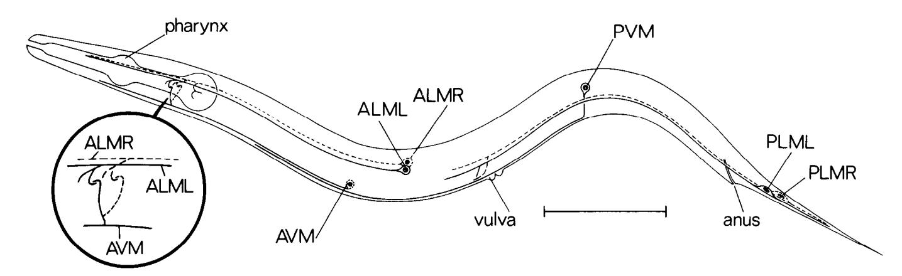
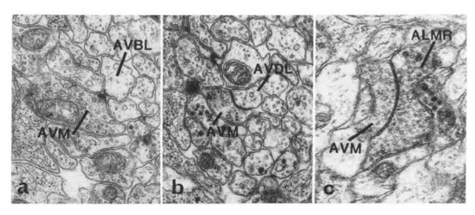
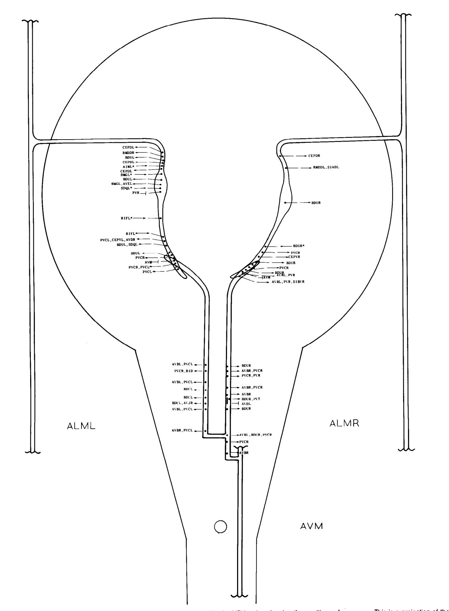
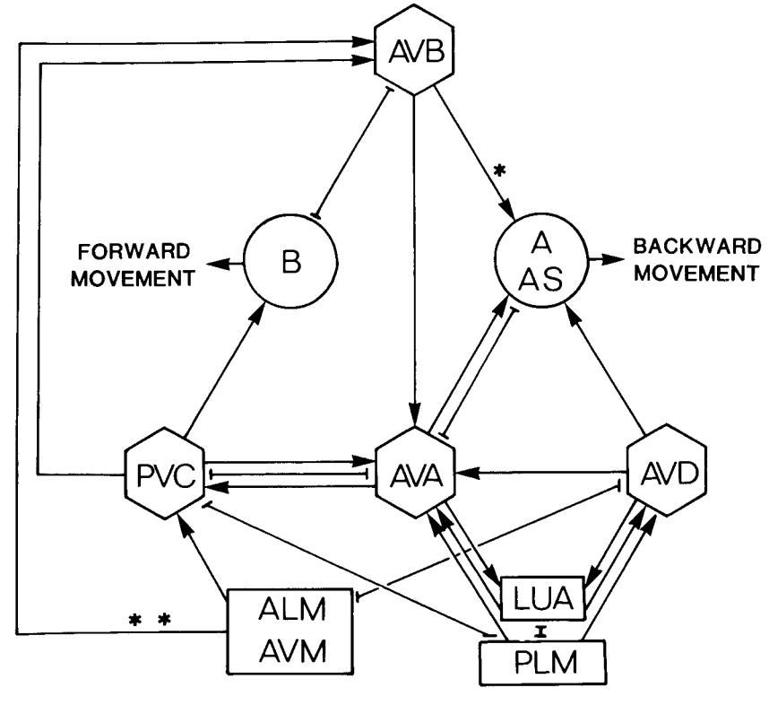
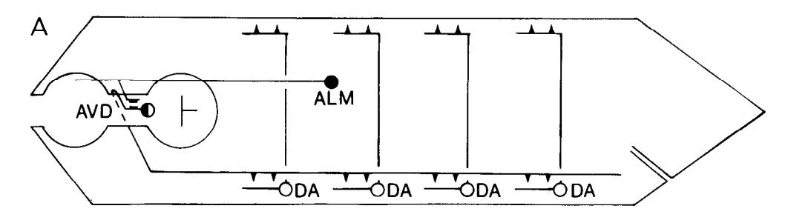
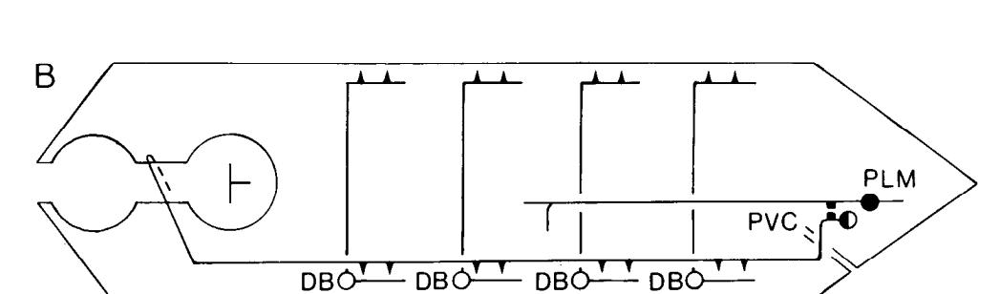
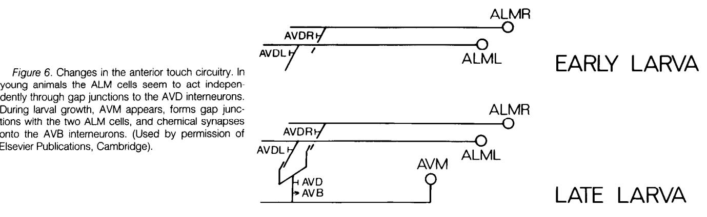
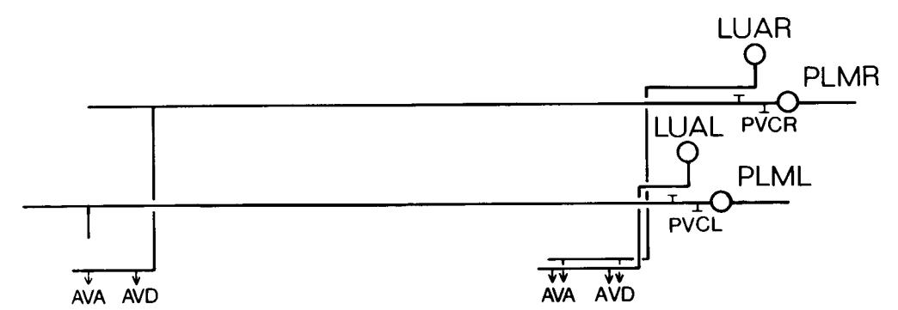

# The Neural Circuit for Touch Sensitivity in Caenorhabditis elegans'

## MARTIN CHALFIE,\*\$\*, JOHN E. SULSTON,\* JOHN G. WHITE,\* EILEEN SOUTHGATE,\* J. NICHOL THOMSON,+ AND SYDNEY BRENNERS

\* Deoartment of Biolooical Sciences, Columbia University, New York, New York 10027 and \$ Medical Research Council Laboratory of Molecular Biology, Hiis Road, Cambridge CB2 2QH, En&and

## Abstract

The neural pathways for touch-induced movement in Caenorhabditis ekgans contain six touch receptors, five pairs of interneurons, and 69 motor neurons. The synaptic relationships among these cells have been deduced from reconstructions from serial section electron micrographs, and the roles of the cells were assessed by examining the behavior of animals after selective killing of precursors of the cells by laser microsurgery. This analysis revealed that there are two pathways for touch-mediated movement for anterior touch (through the AVD and AVB interneurons) and a single pathway for posterior touch (via the PVC interneurons). The anterior touch circuitry changes in two ways as the animal matures. First, there is the formation of a neural network of touch cells as the three anterior touch cells become coupled by gap junctions. Second, there is the addition of the AVB pathway to the pre-existing AVD pathway. The touch cells also synapse onto many cells that are probably not involved in the generation of movement. Such synapses suggest that stimulation of these receptors may modify a number of behaviors.

The adult hermaphrodite of the nematode Caenorhabditis elegans has precisely 302 neurons (White et al., 1983; J. G. White, E. Southgate, J. N. Thomson, and S. Brenner, unpublished data). Over the past decade the structure of each of these cells has been deduced from reconstructions of serial section electron micrographs (Ward et al., 1975; Ware et al., 1975; Albertson and Thomson, 1976; White et al., 1976, 1985; Sulston et al., 1980; Hall, 1977). The resolution of this method allows the identification of the complete set of putative chemical synapses, gap junctions, and possible neurosecretory endings within the C. elegans nervous system. Electrophysiological studies of the functions of these connections are precluded by the small size of the animal and its neurons, although such studies have been carried out on the large, related nematode Ascaris lumbricoides (e.g., Stretton et al., 1978; Johnson and Stretton, 1980).

Accepted August 27, 1984

In this paper, we use an alternative approach to analyze the function of specific cells and synapses in that part of the C. elegans nervous system that mediates touch-induced movement. The reconstructions are used to identify cells that are likely to be involved in the touch reflex. The role of these cells is then tested by killing them with a laser microbeam (Sulston and White, 1980) and observing the effects of cell loss on the touch response. This method has enabled us to confirm the functional importance of certain synapses seen in the electron microscope and to generate a plausible model of the touch reflex circuit. These studies also demonstrate that the anterior touch circuitry is modified during C. elegans development by the addition of a postembryonic touch cell that provides supplemental as well as novel synaptic connections.

#### Materials and Methods

Strain maintenance. The wild-type strain (N2) of C. elegans var. Bristol was grown at 20°C as described by Brenner (1974).

identification of synapses. The synapses made by the touch cells have been reconstructed from serial section electron micrographs of three hermaphrodites (N2U, JSH, and JSE) and one male (N2Y) in the Cambridge laboratory (Sulston et al., 1980; White et al., 1985). Additional reconstructions of the hermaphrodite tail have been done by Hall (1977).

In these reconstructions, presynaptic cells in putative chemical synapses are identified by the presence of presynaptic darkenings and vesicles (see Fig. 2 and White et al., 1976). Since postsynaptic specializations usually are not seen, postsynaptic cells are identified by their proximity to the presynaptic darkenings. Because of the ambiguity of assigning postsynaptic cells, a chemical synapse is considered significant if there is only one postsynaptic cell or if a cell is repeatedly found as a member of a multiple synapse. Moreover, to qualify as significant, chemical synapses must also be found onto both cells of a given type, e.g., to AVBR and to AVBL (which are right and left homologues), or in more than one series.

Gap junctions are identified as darkened and parallel membranes joining two cells (see Fig. 2 and White et al., 1976). Although a cell may form a number of chemical synapses to another cell, there are usually only one or a few gap junctions. Significant gap junctions, therefore, are those that are seen with both cells of a given type (e.g., PVCR and PVCL) or that are seen in more than one series.

Laser ablation. Cells were killed with a laser microbeam as described by Sulston and White (1980). Motor neurons in the ventral cord were killed in newly hatched larvae. To ensure that animals lacked interneurons or touch cells, we generally killed the precursors to the cells rather than the cells themselves. Except for the AVM precursor (Q2 in Sulston and Horvitz, 1977), which was killed in newly hatched larvae, all of the precursors were killed in embryos (see Sulston et al., 1983, for'details of these lineages). Although other cells were removed by this procedure, none of them (except for LUA, the sister to PVC) formed synapses that were part of the touch circuitry. In control experiments, the extra cells produced by the precursors to the AVD interneurons were killed without any effect upon touch sensitivity, and direct killing of the AVD cells resulted in the same behavioral defects as killing the precursor cells. Thus, it is unlikely that the behavioral abnormalities resulting

&#x27; We are indebted to Donna Albertson for reconstructing the N2Y series and to Lou Byerly and Dick Russell for suggesting that the A and B motor neurons mediate backward and forward movement, respectively. This work was done during the tenure of a British American Research Fellowship of the American Heart Association and the British Heart Foundation, a Research Fellowship from the Muscular Dystrophy Association of America, and United States Public Health Service Grants GM30997 and All9399 to M. C.

2To whom correspondence should be addressed, at Department of Biological Sciences, Columbia University, New York, NY 10027.

from the ablations were due to the loss of the cells other than those of interest.

The absence of the progeny of ablated cells was checked using Nomarski optics (Sulston and Horvitz, 1977) several hours after the ablation. Animals were then characterized by their movement and touch sensitivity (Chalfie and Sulston, 1981) at various ages in double-blind tests.

Nomenclature. Most C. elegans neurons are designated by a three-letter code with additional letters added to denote positional differences between otherwise identical cells, e.g., R for right and L for left. Whenever a set of identical cells is referred to, the symmetry designations are dropped. For example, "the AVB cells" refers to AVBR and AVBL. Before this nomenclature was standardized, the ventral cord interneurons AVA, AVB, PVC, and AVD were called alpha, beta, gamma, and delta, respectively (White et al., 1976).

## Results and Discussion

The touch receptors. C. elegans moves sinuously forward and backward when undisturbed. If the animal is touched gently with a fine hair near the head, it moves backward; if it is touched near the tail, it moves forward. There are six touch receptor cells, called microtubule cells (Fig. 1; Chalfie and Thomson, 1979; Chalfie and Sulston, 1981). Four cells are located laterally, the right and left anterior lateral microtubule cells (ALMR and ALML) and the right and left posterior lateral microtubule cells (PLMR and PLML), and two ventrally, the anterior ventral microtubule cell (AVM) and the posterior ventral microtubule cell (PVM). The lateral cells are present at hatching; the ventral cells arise postembryonically. Like most neurons in C. elegans, the touch cells have a simple structure (Fig. 1); each has a single long receptor process that extends anteriorly from the cell body and lies next to the cuticle. This process contains unusually large microtubules that are found only in the touch receptors and that give the cells their name (Chalfie and Thomson, 1979, 1982). Near the end of the process of all of the cells except PVM is a branch, the synaptic branch, on which most of the synapses to other neurons are made. In addition, AVM, PVM, and the PLM cells make synapses to other neurons on their receptor processes (see below).

The role of the microtubule cells in the touch response has been demonstrated by laser ablation of the microtubule cells or their precursors (Chalfie and Sulston, 1981). The results indicated that (7) PLML or PLMR is required for any response to touch on the tail; (2) ALML or ALMR is required for a full response to touch on the head; (3) AVM alone mediates a very weak touch response to head touch, i.e., the animals move after some but not all touches, in later larval stages or adults; and (4) PVM alone does not mediate a detectable touch response. It is, therefore, possible to divide the

touch cells into an anterior set (ALML, ALMR, and AVM) and a posterior set (PLML and PLMR) by the response they produce. PVM does not seem important for either response in the wild type.

Motor output. Movement in C. elegans results from the alternate contraction and relaxation of the dorsal and ventral body wall muscles. In the adult three sets of ventral cord motor neurons seem to be responsible for the muscle cell activity: (a) the A motor neurons (12 VA cells and 9 DA cells), (b) the B motor neurons (11 VBs and 7 DBs), and (c) the D motor neurons (13 VDs and 6 DDs) (White et al., 1976). Cells within a given set have similar synaptic inputs and outputs and are coupled by gap junctions. An additional set of cells, the 11 AS motor neurons, share many of the properties of the DA cells (White et al., 1976). The D cells differ from the A and B cells in that they receive no interneuron synapses (see below), but receive synapses from the other classes of motor neurons on the opposite side of the animal (either ventral or dorsal) to that on which they form neuromuscular junctions.

It is virtually impossible to test the function of all of these motor neurons by laser ablation in the adult because of the massive cell killing that is required. However, at hatching only three types of motor neurons are present in the ventral cord, DA, DB, and DD (Sulston, 1976; White et al., 1978), and it is possible to kill most of the cells of a given type and observe the effect on larval movement (only cells in the ventral cord were killed; a few cells of each type are found anterior and posterior to the ventral cord). When we killed six of the nine DA cells (six animals), the resulting larvae could not move backward but moved forward normally. When five of the seven DB cells were eliminated (five animals), the larvae had difficulty moving forward but moved backward normally. Ablation of four of the six DD cells (three animals) produced animals that were severely uncoordinated when moving in either direction. These data are consistent with the hypothesis that the A motor neurons are required for backward motion, the B cells for forward motion, and the D cells for both.

Corresponding sets of motor neurons analogous to those in C. elegans are found in the larger nematode Ascaris lumbricoides (Stretton et al., 1978; Johnson and Stretton, 1980). In Ascaris depolarization of cells equivalent to the A and B motor neurons leads to the excitation of muscle cells; stimulation of D-like cells leads to inhibition. Because of the great similarity in the nerve cord of these two animals, it is likely that the A, B, and D cells of C. elegans act similarly. A model consistent with the laser and anatomical data from C. elegans and the electrophysiological evidence from Ascaris is that the A and B cells mediate muscle contraction for backward and

(the receptor process) and a radial branch (the synaptic branch). The anterior microtubule cells (ALMR, ALML, and AVM) are joined by gap junctions at the ends of their synaptic branches (area shown in the inset). These cells are the touch receptors for touch-induced movement in the head. The posterior microtubule cells (PLMR and PLML) are required for the touch response in the tail; they are not joined by gap junctions. Bar, 100 pm. (Used by permission of Elsevier Publications, Cambridge).

#### TABLE I

#### Synapses made by the microtubule cells

These data represent synapses seen in the reconstructions in the Cambridge collection. Reconstructions cover the areas of the synaptic branch (sb; see Fig. l), the ventral cord (vc; the area of the receptor processes of AVM and PVM), or the lumbar ganglia (lg; the areas near the PLM cell bodies). Only significant chemical synapses (C) and gap junctions (J), as defined under "Materials and Methods, are listed. Postsynaptic cells are characterized as: interneurons to the ventral cord motor neurons (i), touch receptors (t), touch cell connectors (c), sensory neurons (s), neurons required for egg-laying (e), interneuron that may affect the pharyngeal nervous system (p; cells other than PVR may also affect pumping), and other (0). All of the postsynaptic cells are in bilaterally symmetric pairs except for AVM, PVR, and AVL, which are unpaired, and CEP, of which there are four. PVM synapses onto AVKL but not AVKR. Six chemical synapses are seen from PVM to PDE in the N2U series (five of these are onto both PDE cells); a single gap junction was also found. The branch of PLML, unlike that of PLMR, does not enter the ventral cord. The only known synapses that both PLM cells make at their anterior ends are the chemical synapses to the HSN cells (this has been confirmed in a second series, N2 vulva; data not shown). Although the gap junctions between AVD and the ALM cells are easily seen in the JSH animal (a late larval, L4, animal), they colild not be unambiguously identified in sections from two gravid adults, N2U (asterisk) or N2T (data not shown). The gap junction marked with the double asterisk is likely to be between PLMR and PVCR, although the cells were not positively identified in this animal (D. Albertson, personal communication). The gap junctions joining PLM to LUA and PVC were also found by Hall (1977).

|             |        | Postsynaptic Cell |   |  |   |    |    |   |        |      |    |        |    |   |   |     |   |
|-------------|--------|----------------------|---|--|---|----|----|---|--------|------|----|--------|----|---|---|-----|---|
| Cell Type   |        |                      | t |  |   |    | C  | S |        |      |    | P e |    |   |   |     |   |
| Cell Name   |        | 5                    | D |  |   | D  | D  | r | L D | 7 -0 |    | I      | -0 |   |   |     |   |
|             |        | <                    | < |  | < | r  | -= | c | 0      | 0    | m  | cn     | <  | 0 | < | <   | < |
|             |        | D                    | m |  | 0 | sz | z  | D | m      | m    | -0 | Z      | n  | c | D | ;r; | r |
| Cell        | Series |                      |   |  |   |    |    |   |        |      |    |        |    |   |   |     |   |
| ALM (SW  | N2U    |                      |   |  | J |    | J  |   |        |      | C  |        | J  | C |   |     |   |
|             | JSH    |                      |   |  | J |    | J  |   | C      |      | C  |        | J  | C |   |     |   |
| AVM (SW  | N2U    |                      | C |  | J | J  |    |   |        |      |    |        |    | C |   |     |   |
|             | JSH    |                      | C |  | J | J  |    |   |        |      |    |        |    | C |   |     |   |
| AVM t4   | N2U    |                      |   |  | J |    |    |   | C      |      |    |        |    |   |   |     |   |
| PVM (W   | N2U    |                      |   |  |   |    |    |   |        | C/J  |    |        |    |   | C | C   | J |
| PLMR        | N2U    | C                    |   |  | C |    |    |   |        | C    |    | C      | J  |   | C |     |   |
| PLML W   | N2U    |                      |   |  |   |    |    |   |        |      |    | C      |    |   |   |     |   |
| PLM (Ig) | JSE    |                      |   |  |   |    |    | J |        |      |    |        | J  |   |   |     |   |
|             | N2Y    |                      |   |  | l |    |    | J |        |      |    |        | J  |   |   |     |   |

forward movement, respecGvely, and the D cells mediate contralatera1 inhibition.

Anatomical connections for touch-induced movement. The touch receptors synapse onto a large number of cells (Table I; examples of these synapses and of the reconstructions are given in Figs. 2 and 3, respectively). Of immediate importance for the analysis of touch-induced movement are the putative chemical synapses and gap junctions made by the touch receptors to the ventral cord interneurons and the gap junctions joining AVM to the ALM cells.

Only four pairs of interneurons (AVA, AVB, PVC, and AVD) synapse onto the motor neurons of the ventral cord and also span the full length of the cord (White et al., 1976). All four pairs of interneurons receive synapses from the touch cells (Table II and Fig. 4). The most striking feature of these synapses is the complementary pattern they present. A given interneuron receives chemical synapses from either the anterior or posterior touch cells and has either a gap junction or no synapse with the other set.

These interneurons synapse onto each other and onto the A and

Figure 2. Types of synapses formed by the touch cells. a, A chemical synapse from AVM to AVBL. b, A gap junction between AVM and AVDL. c, A gap junction joining two touch cells (AVM and ALMR). a and b are taken from the JSH series; c is from the N2U series. Magnification x 30,000.

inset area of Figure 1 showing the positions of the synaptic branches relative to the nerve ring (the area of the large circle). Chemical synapses (+, the arrowhead points to the postsynaptic cell) and gap junctions (--I) are indicated. Asterisks signify that there is more than one possible postsynaptic cell. None of the chemical synapses onto the touch cells are significant by the criteria listed under "Materials and Methods." The small circle denotes the position of the excretory duct in this projection.

TABLE II Summary of touch receptor synapses onto the ventral cord interneurons

| Interneurons | Synapses Made by     |                              |  |  |  |  |  |
|--------------|----------------------------|------------------------------|--|--|--|--|--|
|              | Antenor touch receptors | Posterior touch receptors |  |  |  |  |  |
| AVA          | -                          | chemical                     |  |  |  |  |  |
| AVB          | chemicala                  |                              |  |  |  |  |  |
| PVC          | chemical                   | gap junction                 |  |  |  |  |  |
| AVD          | gap junction               | chemical                     |  |  |  |  |  |

a These synapses are only made by AVM.

6 motor neurons of the ventral cord (Fig. 4). The pattern of synapses suggests that a three-neuron reflex circuit involving the touch receptors, interneurons, and motor neurons could mediate the touch response. In the young larva, i.e., before AVM appears, the touch circuitry is simplest: the anterior touch ceils, the AVD interneurons, and the A motor neurons are used for anterior touch sensitivity, and the posterior touch ceils, the PVC interneurons, and the B motor neurons are used for anterior touch sensitivity (Fig. 5).

Testing the touch circuitry by laser ablation. The role of the interneurons in the touch response was assessed by laser microsurgery (Table Ill). When the PVC cells were killed, the resulting larvae and adults were touch insensitive at the tail but were touch sensitive at the head and moved normally forward and backward. Killing AVD produced young larvae that were touch insensitive only in the head but moved normally (see below for different results observed in adults). The animals were touch sensitive after either the AVA cells or the AVB cells were killed, but their movement was irregular and contorted.

These data suggest that PVC is required for the response to touch on the tail and AVD is required for the response to touch on the head in young larvae. A priori the posterior touch cells could activate the B motor neurons by three alternative sets of synapses to PVC (see Fig. 4): gap junctions directly to PVC, chemical synapses to AVA, and chemical synapses to AVD. However, since ablation of AVA and AVD had no effect on posterior touch sensitivity, it seems

that the most important of these connections are the gap junctions between the touch cells and PVC.

Similarly, the response to touch in the head in young larvae, i.e., the activation of the A motor neurons, could be mediated through the gap junctions joining the anterior touch cells and AVD or via chemical synapses from the anterior cells to PVC (because AVM has not developed in young larvae, these young animals lack the connections with the AVB cells). However, since ablation of PVC had no effect on the anterior touch response, it seems that the ALM-AVD gap junctions are the most important functional connections for the anterior touch response.

Since the gap junctions between the posterior touch cells and PVC and between the anterior touch cells and AVD seem to be the most important for touch-induced movement, we may speculate on the function of the chemical synapses made by the touch cells onto these interneurons. These chemical synapses could inactivate the inappropriate neural pathway. Thus, for example, anterior touch would lead to the activation of the A motor neurons and inactivation of the B motor neurons.

Synapses contributed by AVM. The postembryonic touch receptor AVM has chemical synapses onto the AVB interneurons and gap junctions with the AVD interneurons and the other anterior touch cells. The importance of these connections was demonstrated in experiments in which AVD was killed (Table Ill). When only the AVD cells were killed, as late larvae and adults, the experimental animals regained considerable anterior touch sensitivity; the experimental animals differed from controls only in having the touch response habituate after a very few touches instead of tens of touches. However, when AVM was also killed, animals remained touch insensitive. (Ablation of AVM alone reduces touch sensitivity very slightly; Chalfie and Sulston, 1981.) Thus, the AVB connections are important for anterior touch sensitivity in the adult, and the chemical synapses seen in the electron micrographs between AVM and AVB must be functional. When AVA, in addition to AVD, was killed, adults did not move backward in response to anterior touch (Table Ill). Thus, it

The touch cells and the touch cell connector, LUA, are designated by rectangles. the interneurons are designated by hexagons, and the motor neurons are designated by circles. Both chemical synapses (+ and gap junctions ('-I ) are indicated. The diagram represents a composite of data and does not indicate the changes that occur in the circuitry during development; e.g., the connections from AVM to AVB are formed late in larval development. Missing from the diagram are the gap junctions between identical motor neurons and interneurons and the gap junctions joining AVM and ALM. AH3 forms chemical synapses only with the AS cells, not the A cells (\*); only AVM of the anterior touch cells chemically synapses onto AVB (\*\*). The connections made by the interneurons are taken from White et al., (1976; J. G. White, E. Southgate, J. N. Thomson, and S. Brenner, unpublished data).

Figure 5. Schematic representations of the principal anterior (A) and posterior (B) touch circuits in the newly hatched larva. Only one of the two touch cells (0) and interneurons (a) and four of the seven or nine mntor neurons (0) are drawn. =, gap junction; A, chemical synapse.

TABLE Ill Effect of laser ablation of selected neurons on touch sensitivity and movement

|               | Nb |          |       | Touch Sensitivity | Movement |         |          |  |
|---------------|----|----------|-------|-------------------|----------|---------|----------|--|
| Cells Killed' |    | Anterior |       | Posterior         |          | Forward | Backward |  |
|               |    | Larva    | Adult | Larva             | Adult    |         |          |  |
| PVC"          | 5  | +d       | +     | -d                | -        | +       | +        |  |
| AVD           | 10 | -        | +e    | +                 | +        | +       | +        |  |
| AVDand AVM | 4  | -        | -     | +                 | +        | +       | +        |  |
| AVA           | 2+ |          | +     | +                 | +        | +       | uric'    |  |
| AVA and AVD   | 3- |          | +g+   |                   | +        | +       | -        |  |
| AVB           | 2+ |          | +     | +                 | +        | uric'   | +        |  |
| AVBandPVC"    | 2  | +        | +     | -                 | -        | -h      | +        |  |

a Precursors to the indicated cells were killed in embryos or newly hatched

seems that the principal pathway from AVB to the class A motor neurons for the touch reflex is via AVA. The experiments involving the ablation of AVD also indicate that

the gap junctions connecting the three anterior touch cells are functional. The anterior touch response in adults without AVD cells is strong (Table Ill), yet the response in adults without ALM cells (but with AVM) is weak (Chalfie and Sulston, 1981). Thus, it seems that the activity of the ALM cells in the former animals must be routed through the gap junctions to AVM and, thus, to AVB. lnterneuron function. The AVD and PVC cells seem to serve

similar functions in the control of opposing behaviors (Fig. 5). The AVD cells have cell bodies in the head and send processes posteriorly in the ventral cord; the PVC cell bodies are in the tail and their

processes project anteriorly in the ventral cord (White et al., 1985). Both pairs of cells are joined by gap junctions to the touch cells that have cell bodies near their own cell bodies and receive chemical synapses from the opposite set of touch cells. Finally, both pairs of interneurons synapse chemically onto putative excitatory motor neurons, the A cells in the case of AVD and the B cells in the case of PVC. As a result of these connections, the AVD cells are used for backward movement and the PVC cells are used for forward movement.

AVA and AVB also seem to have opposing effects with regard to movement. Ablation of the AVA interneurons results in animals whose backward movement is uncoordinated (Table Ill). Although these animals move forward normally, a bout of forward motion ends with the animal assuming an uncoordinated (kinked) posture. Thus, the AVA interneurons seem to be required for normal backward movement and for the cessation of forward movement. A complementary series of events occurs when the AVB interneurons are killed (Table Ill). Given the results of these laser ablations, it is likely that the AVB cells, which synapse to both the AS and B sets of motor neurons, inactivate the AS cells. After ablation of any single class of interneurons, animals were

still able to move forward and backward. When both AVA and AVD were killed, animals were incapable of moving backward, and when PVC and AVB were killed, animals were incapable of generating forward motion with their bodies (the muscles in the head are innervated by a separate set of motor neurons in the nerve ring and can generate slow forward movement on their own but are not needed for backward movement). Thus, AVA and AVD are both used in backward movement and AVB and PVC are both used in forward movement. Of these interneurons AVA and AVB seem to be the most important for normal movement, an importance that correlates with their larger diameter compared with AVD and PVC (White et al., 1976). Our results suggest that AVD and PVC modify, but are not required for, normal movement. The laser ablation studies permit an evaluation of the major

interneuron pathways for touch sensitivity: the AVD and AVB pathways for anterior touch sensitivity and the PVC pathway for posterior touch sensitivity. However, these studies are necessarily crude; we cannot analyze many of the intricate synaptic complexes within the circuit. For example, it is difficult to explain the wealth of reciprocal synapses between AVA and PVC (see Fig. 4). Presumably, these connections may affect the timing of the touch reflex and other movements. Reorganization of the anterior touch circuitry. The anterior touch

b N, number of animals.

c It has not been possible to kill PVC without killing its sister cell LUA. Animals lacking only the LUA cells, however, are touch sensitive. d +, normal response; -, lack of a response.

e These animals often adapted after a few touches.

&#x27; These animals were uncoordinated when moving in the indicated direc-

tion and when stopping after moving in the opposite direction. gAlthough an anterior touch could not make these animals move back-

ward, it could stop them if they were moving forward. The touch also stopped pharyngeal pumping. h These animals were incapable of propagating a wave of muscle contrac-

tion for forward motion in the body but did move forward from waves generated in the head.

circuitry changes during the maturation of the animal (Fig. 6). Initially, ALML and ALMR work independently via the AVD interneurons. Later, AVM grows in and connects to the ALM cells and provides additional output to the AVD cells and unique output to the AVB interneurons.

Although the addition of AVM (and its synapses to AVB) represents a major alteration in the anterior touch circuitry, we do not know why this change occurs. The change in the circuitry is not apparently needed to accommodate the large size of the mature animal since a similar change is not seen in the posterior touch circuitry. Many other changes take place during the re-formation of the anterior touch circuit: five classes of motor neurons, including one (the AS cells) that receives the major chemical output of the AVB cells, are added to the ventral cord (Sulston, 1976); the embryonic DD motor neurons change their pattern of synapses (White et al., 1978); and a number of neurons involved in reproductive functions arise or mature. It is possible that one or more of these changes necessitates the alteration of the anterior touch output. Alternatively, these changes may represent previously important modifications in the neural circuitry that have been made obsolete as the animal has evolved.

The functional joining of the touch cells. The joining of sets of identical neurons either by ultrastructurally identified gap junctions or by Observed electrical or dye coupling has been seen throughout the animal kingdom. Examples are seen in the leech (Baylor and Nicholls, 1969; Stuart, 1970; Muller and Carbonetto, 1979) embryonic locusts (Bate and Grunewald, 1981) Aplysia (Kaczmarek et al., 1979) turtles (Stewart, 1978) and many other organisms (e.g., see review by Bennett, 1977). A large number of sets of identical cells in C. elegans are also joined by gap junctions (White et al., 1976, 1985).

The functional joining of the anterior touch cells also produces a more complex network of neurons. This method of generating complexity may be particularly important in C. elegans because of the simple structure of the neurons. Not only does the network have a more complex structure than any individual cell, but it also has a greater variety of synaptic connections. In addition to the AVB synapses made only by AVM, there are chemical synapses onto a set of sensory cells (the CEP cells) and gap junctions with the cell PVR that are only made by the ALM cells (Table I).

How the synaptic differences expressed by the anterior touch cells develop is not known. Although the position of a cell within the organism can affect the types of synapses it forms (Chalfie et al., 1983; White et al., 1983) this is probably not the only factor. For example, the synaptic branches of the ALM cells as well as those of AVM lie next to the AVB cells, yet AVB receives synapses only from AVM. Alternatively, synaptic differences may represent different intrinsic synaptic specificities between ALM and AVM. Although we cannot rule out this possibility, it has been hard to document an intrinsic difference among the touch cells. Touch-insensitive animals can be produced by mutation, but none of the genes affecting touch sensitivity seem to be differentially expressed in a subset of the

touch cells (Chalfie and Sulston, 1981; M. Chalfie, unpublished data). A third possible explanation for the synaptic differences seen among the touch cells is that synapse formation depends on when the cells are made. For example, perhaps only AVM cells can synapse to AVB because they develop postembryonically. Such dependence of synapse formation on growth of the synapsing cells has recently been demonstrated for snail neurons (Hadley and Kater, 1983; Hadley et al., 1983).

The LUA cells-possible extensions of the posterior touch cells. The formation of neuronal complexes by gap junctions may also occur in the posterior touch system. Only PLMR makes direct synapses to the interneurons AVA and AVD. The synaptic branch of PLML does not project into the ventral cord and thus cannot make equivalent synapses. However, both posterior touch cells have indirect connections with AVA and AVD via their gap junctions with another pair of cells, LUAR and LUAL, in the tail (Fig. 7). The LUA cells send short processes into the posterior portion of the ventral cord and there form chemical synapses with the AVA and AVD interneurons and gap junctions with the tail interneuron PVR; i.e., they synapse onto the same neurons as PLMR (see PLMR (sb) in Table I). An analogous connector cell has been seen in the leech, coupling the touch cells to the S interneurons (Muller and Scott, 1981).

It has not been possible to test the role of the LUA cells in the touch reflex. When the LUA cells (two animals) were killed with the laser, no abnormalities of movement or touch sensitivity were seen. However, since we hypothesize that the chemical synapses provided by these cells inactivate the inappropriate motor response (see above) and since the PLMR chemical synapses may provide some redundancy, removal of the LUA cells would not be expected to result in a detectable defect in touch sensitivity.

If the LUA cells act as connector cells for the posterior touch cells, they also increase the symmetry of the touch circuitry: as the anterior touch cells form chemical synapses with interneurons anterior to the ventral cord, the LUA cells form their interneuron synapses posterior to the ventral cord. The touch cells branch at the distal end of the process (Fig. 1). Past experiments (Chalfie et al., 1983) have suggested that the production of the synaptic branch is dependent upon the correct placement of the touch cells within the animal; if appropriately positioned, even PVM will branch at its distal end. It is possible that the touch cells can only branch distally and that the LUA cells provide connections that compensate for this restriction. Other touch cell synapses and the role of PVM. The touch cells

synapse onto more cells than are needed to account for touchinduced movement (Table I); it is possible that these additional synapses are involved in other touch-mediated behaviors. Both anterior and posterior touch cells synapse onto a number of presumed sensory neurons: the cephalic neurons (CEP), the deirids (ADE), and the postdeirids (PDE). These cells are the only dopaminecontaining neurons in the hermaphrodite (Sulston et al., 1975). Other synapses are made to cells (CEP and PVR) that synapse onto the RIP cells, the cells that connect the 20 neurons of the pharynx with

young animals the ALM cells seem to act independently through gap junctions to the AVD interneurons. tions with the two ALM cells, and chemical synapses onto the AVB interneurons. (Used by permission of AVDRrf Elsevier Publications, Cambridge). 0

Figure 7. Schematic diagram of the posterior touch cells and the LUA connector cells. Each posterior touch cell (PLM) forms a gap junction with one of the LUA cells. The LUA and PLM cells have similar output.

those of the rest of the nervous system. The posterior touch cells synapse onto the HSN cells, a pair of cells that are required for egglaying (Trent et al., 1983). Direct confirmation by laser ablation of the functional importance of these connections is difficult at present, although there is some evidence that the touch system affects pharyngeal pumping (Table Ill). However, since the laser ablation experiments described above have confirmed the functional importance of many of the touch cell chemical synapses and gap junctions, we feel that these synapses, too, are likely to be significant.

The role of PVM as a touch receptor in the wild type is unclear. The cell does synapse onto the PVC interneurons in the anterior of the ventral cord. In this respect it is like the anterior cells and may help to inactivate the PVC cells. However, PVM does not form gap junctions with any ventral cord interneurons. (In mutants in which PVM is produced more anteriorly, the cell mediates a detectable anterior touch response (Chalfie et al., 1983).) If stimulation of the touch cells modifies behaviors other than movement, it is possible that PVM may serve as a touch receptor in the wild type. The numerous PVM-PDE synapses suggest such a role.

Conclusion. We have described an attempt to understand the mode of action of the touch circuitry in C. elegans based on the knowledge of the connectivity of the component neurons. Behavioral analysis of animals in which certain neurons have been ablated, or of mutants with defined alterations in structure, has enabled the functions of certain neurons to be deduced. The addition of extra postembryonically generated receptor neurons has been shown to be accompanied by functional changes in the pre-existing circuitry. Using the approach that we have described, it may be possible to gain a considerable understanding of the operation of the nervous system in C. elegans without the use of electrophysiological techniques.

## References

elegans. Philos. Trans. R. Sot. Lond. (Biol.) 275: 299-325.

Bate, C. M., and E. B. Grunewald (1981) Embryogenesis of an insect nervous system II. A second class of neuron precursor cells and the origin of the intersegmental connectives. J. Embryol. Exp. Morphol. 67: 317-330.

Baylor, D. A., and J. G. Nicholls (1969) Chemical and electrical synaptic connections between cutaneous mechanoreceptor neurones in the central nervous system of the leech. J. Physiol. (Lond.) 203: 591-609. Bennett, M. V. L. (1977) Electrical transmission: A functional analysis and

comparison to chemical transmission. In Handbook of Physiology. Sect. 1: The Nervous System. Vol. I: Cellular Biology of Neurons, E. R. Kandel, ed.. pp. 357-416, American Physiological Society, Bethesda, MD. Brenner, S. (1974) The genetics of Caenor/&ditis elegans. Genetics 77:

71-94. Chalfie, M., and J. Sulston (1981) Developmental genetics of the mechano-

sensory neurons of Caenorhabditis elegans. Dev. Biol. 82: 358-370. Chalfie, M., and J. N. Thomson (1979) Organization of neuronal microtubules

in the nematode Caenohabditis elegans. J. Cell. Biol. 82: 278-289. Chalfie, M., and J. N. Thomson (1982) Structural and functional diversity in

the neuronal microtubules of Caenorhabditis elegans. J. Cell Biol. 93: 15- 23.

Chalfie, M., J. N. Thomson, and J. E. Sulston (1983) Induction of neuronal branching in Caenorhabditis elegans. Science 227: 61-63.

Hadley, R. D., and S. B. Kater (1983) Competence to form electrical connections is restricted to growing neurites in the snail, Helisoma. J. Neurosci. 3: 924-932.

Hadley, R. D., S. B. Kater, and C. S. Cohan (1983) Electrical synapse formation depends on interaction of mutually growing neurites. Science 221: 466-468.

Hall, D. H. (1977) The posterior nervous system of the nematode Caenorhabditis elegans. Ph.D. Thesis. California Institute of Technology.

Johnson, C. D., and A. 0. W. Stretton (1980) Neural control of locomotion in Ascaris: Anatomy, electrophysiology, and biochemistry. In Nematodes as Biological Models, B. Zuckerman, ed., Vol. 1, pp. 159-195, Academic Press, Inc., New York.

Kaczmarek, L. K., M. Finbow, J. P. Revel, and F. Strumwasser (1979) The morphology and coupling of Aplysia bag cells within the abdominal ganglion and in cell culture. J. Neurobiol. 70: 535-550.

Muller, K. J., and S. Carbonetto (1979) The morphological and physiological properties of a regenerating synapse in the C.N.S. of the leech. J. Comp. Neurol. 785: 485-516.

Muller, K. J., and S. A. Scott (1981) Transmission at a 'direct' electrical connexion mediated by an interneurone in the leech. J. Physiol. (Lond.) 311: 565-583.

Stewart, W. W. (1978) Intracellular marking of neurons with a highly fluorescent naphthalimide dye. Cell 74: 741-759.

Stretton, A. 0. W., R. M. Fishpool, E. Southgate, J. E. Donmoyer, J. P. Walrond, J. E. R. Moses, and I. S. Kass (1978) Structure and physiological activity of the motoneurons of the nematode Ascaris. Proc. Natl. Acad. Sci. U. S. A. 75: 3493-3497.

Stuart, A. E. (1970) Physiological and morphological properties of motorneurones in the central nervous system of the leech. J. Physiol. (Lond.) 209: 627-646.

Sulston, J. E. (1976) Post-embryonic development in the ventral cord of Caenorhabditis elegans. Philos. Trans. R. Sot. Lond. (Biol.) 275: 287- 297. Sulston, J. E., and H. R. Horvitz (1977) Post-embryonic cell lineages in the

nematode, Caenorhabdifis elegans. Dev. Biol. 56: 110-l 56. Sulston, J. E., and J. G. White (1980) Regulation and cell autonomy during

postembryonic development of Caenohabditis elegans. Dev. Biol. 78: 577-597. Sulston, J. E., M. Dew, and S. Brenner (1975) Dopaminergic neurons in the

nematode Caenorhabdifis elegans. J. Comp. Neurol. 763: 215-226.

Sulston, J. E., D. G. Albertson, and J. N. Thomson (1980) The Caenorhabditis elegans male: Postembryonic development and nongonadal structures. Dev. Biol. 78: 542-576. Sulston, J. E., E. Schierenberg, J. G. White, and J. N. Thomson (1983) The

embryonic cell lineage of the namatode Caenorhabditis elegans. Dev. Biol. 700: 64-l 19. Trent, C., N. Tsung. and H. R. Horvitz (1983) Egg-laying defective mutants

of the nematode Caenorhabditis elegans. Genetics 704: 619-647. Ward, S., N. Thomson, J. G. White, and S. Brenner (1975) Electron micro-

scopical reconstruction of the anterior sensory anatomy of the nematode Caenorhabditis elegans. J. Comp. Neurol. 760: 313-338. Ware, R. W., D. Clark, K. Crossland, and R. L. Russell (1975) The nerve ring

- of the nematode *Caenorhabditis elegans*: Sensory input and motor output. J. Comp. Neurol. *162*: 71–110.
- White, J. G., E. Southgate, J. N. Thomson, and S. Brenner (1976) The structure of the ventral cord of *Caenorhabditis elegans*. Philos. Trans. R. Soc. Lond. (Biol.) 275: 327–348.
- White, J. G., D. G. Albertson, and M. Anness (1978) Connectivity changes in a class of motoneurone during the development of a nematode. Nature (Lond.) 271: 764–766.
- White, J. G., E. Southgate, J. N. Thomson, and S. Brenner (1983) Factors which determine connectivity in the nervous system of *C. elegans*. Cold Spring Harbor Symp. Quant. Biol. 48: 633–640.
- White, J. G., E. Southgate, J. N. Thomson, and S. Brenner (1985) The structure of the nervous system of the nematode *Caenorhabditis elegans*. Philos. Trans. R. Soc. Lond. (Biol.), in press.